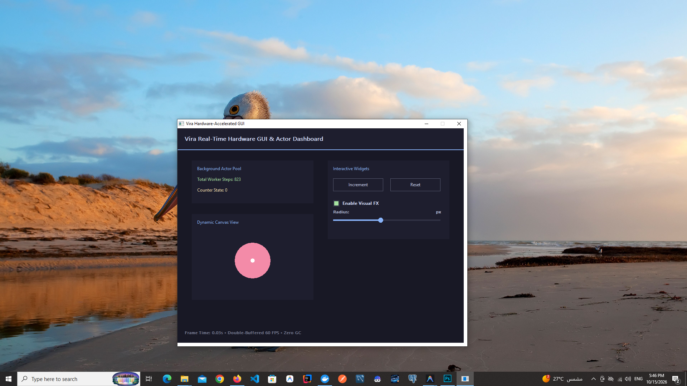

# The Vira Programming Language

<p align="center">
  
</p>

<p align="center">
  <strong>A modern, high-performance systems and AI programming language.</strong><br>
  Combines the execution speed, zero-cost abstractions, and hardware control of C & Rust with the simplicity, clean ergonomics, and instant compilation of Go.
</p>

<p align="center">
  <a href="https://github.com/viralang/vira/releases"></a>
  <a href="https://golang.org"></a>
  <a href="#license"></a>
  <a href="#7-memory-management-deterministic-autofree--arenas"></a>
  <a href="#9-actor-concurrency--fault-supervision"></a>
  <a href="#8-first-class-ai-tensors--simd-acceleration"></a>
</p>

---

## Table of Contents

1. [Architectural Highlights & Core Philosophy](#1-architectural-highlights--core-philosophy)
2. [Quick Installation Guide](#2-quick-installation-guide)
3. [Toolchain & CLI Reference](#3-toolchain--cli-reference)
4. [Master Catalog: Tutorials & Runnable Examples Table](#4-master-catalog-tutorials--runnable-examples-table)
5. [Complete Language Guide & Syntax Breakdown](#5-complete-language-guide--syntax-breakdown)
   - [Modules & Visibility](#modules--visibility)
   - [Variables & Immutability](#variables--immutability)
   - [Blank Identifier (`_`)](#blank-identifier-_)
   - [Primitive Types](#primitive-types)
   - [String Interpolation](#string-interpolation)
   - [4-Quadrant Struct Encapsulation & OOP](#4-quadrant-struct-encapsulation--oop)
   - [Struct Embedding & Composition](#struct-embedding--composition)
   - [Methods (Value vs Mutable Pointer Receivers)](#methods-value-vs-mutable-pointer-receivers)
   - [Static Factory Methods](#static-factory-methods)
   - [Structural Interfaces & Dynamic Dispatch](#structural-interfaces--dynamic-dispatch)
   - [Zero-Cost Error Handling: `!T` Result & `or { ... }`](#zero-cost-error-handling-t-result--or----)
   - [Deterministic Memory Management: Autofree & Arenas](#deterministic-memory-management-autofree--arenas)
   - [First-Class AI Tensors & SIMD Acceleration](#first-class-ai-tensors--simd-acceleration)
   - [Pure Vira Autograd Engine & Native SafeTensors](#pure-vira-autograd-engine--native-safetensors)
   - [Pure Vira Local LLM Engine & GGUF Parser](#pure-vira-local-llm-engine--gguf-parser)
   - [Actor Concurrency & Erlang-Style Fault Supervision](#actor-concurrency--erlang-style-fault-supervision)
   - [Native File I/O Operations](#native-file-io-operations)
   - [High-Performance HTTP 1.1 Web Server & Fast JSON](#high-performance-http-11-web-server--fast-json)
   - [Native Desktop GUI Engine](#native-desktop-gui-engine)
   - [Native Package Management & Air-Gapped Vendoring](#native-package-management--air-gapped-vendoring)
   - [Rust/V-Style Diagnostic Engine](#rustv-style-diagnostic-engine)
6. [Complete End-to-End Production Program](#6-complete-end-to-end-production-program)
7. [VS Code Extension & LSP Integration](#7-vs-code-extension--lsp-integration)
8. [Cross-Platform Release Packager](#8-cross-platform-release-packager)
9. [Roadmap & Contributing](#9-roadmap--contributing)
10. [License](#10-license)

---

## 1. Architectural Highlights & Core Philosophy

Vira is engineered from the ground up for modern systems development, numerical computing, and machine learning infrastructure:

- **Zero-Garbage Collector Overhead:** Memory management is static, deterministic, and invisible. The compiler's escape analysis tracks lifecycles and automatically injects LIFO destructors (`autofree`) at scope exits. No stop-the-world pauses, no GC tracing overhead.
- **Zero-Allocation Lexer & Frontend:** Tokenizes millions of lines of code per second at **0 B/op and 0 allocs/op**, generating AST nodes with minimal memory overhead.
- **Strict 4-Quadrant Mutability:** Variables are immutable by default. Struct fields can be granularly isolated into private/public and read-only/mutable quadrants (`default`, `mut:`, `pub:`, `pub mut:`).
- **Mandatory Result Handling:** Functions returning `!T` cannot be silently ignored. Failure to unwrap via `or { ... }` or propagate with `!` is a compile-time semantic error. No unhandled runtime exceptions.
- **First-Class AI Tensors & Hardware SIMD:** 2D tensors (`tensor[f32]`) are language primitives with native `@` dot-product matrix multiplication vectorized via AVX2+FMA on x86_64 and ARM NEON on Apple Silicon/AArch64.
- **Native SafeTensors & GGUF LLM Inference:** Pure Vira loaders for Hugging Face `.safetensors` model weights and binary GGUF v2/v3 LLM weights with Q4_0/Q8_0 SIMD dequantization, RoPE, RMSNorm, SwiGLU, and token sampling — without requiring Python or external runtime dependencies.
- **Supervised Actor Concurrency:** Concurrency is achieved through isolated actors communicating via non-blocking message sends (`<-`), scheduled across a lock-free Chase-Lev work-stealing thread pool with Erlang-style `setjmp`/`longjmp` fault boundaries and `OneForOne` supervisor restarts.
- **Native Desktop GUI & Web Networking:** Built-in lightweight Canvas/Win32/X11 GUI framework and HTTP 1.1 asynchronous request processing engine with zero-copy JSON parsing.
- **Clean C99 Backend:** Lowers directly into portable, readable C99, compiled via GCC, Clang, MinGW-w64, or TCC with `-O3 -flto -march=native` optimizations.

---

## 2. Quick Installation Guide

### Windows (PowerShell)

Install the latest release binary, runtime headers, examples, and documentation automatically:

```powershell
irm https://raw.githubusercontent.com/viralang/vira/main/scripts/install.ps1 | iex
```

Or run the local installer:
```powershell
powershell -ExecutionPolicy Bypass -File .\scripts\install.ps1
```

### Linux & macOS (Bash)

```bash
curl -fsSL https://raw.githubusercontent.com/viralang/vira/main/scripts/install.sh | bash
```

### Building From Source

Prerequisites: Go 1.22+ and a C99 compiler (`gcc`, `clang`, or `x86_64-w64-mingw32-gcc`).

```bash
# Clone the repository
git clone https://github.com/viralang/vira.git
cd vira

# Build the standalone Vira compiler
go build -o vira.exe ./cmd/vira   # Windows
go build -o vira ./cmd/vira       # Linux / macOS

# Verify toolchain installation
./vira version
```

---

## 3. Toolchain & CLI Reference

The Vira compiler CLI is invoked via `vira`:

```bash
vira <command> [flags] [arguments]
```

### Command Matrix

| Command | Description | Example |
| :--- | :--- | :--- |
| `run` | Compile and immediately execute a Vira program | `vira run main.vir` |
| `build` | Compile into a native standalone executable (`.exe` / ELF / Mach-O) | `vira build -prod -o app main.vir` |
| `cgen` | Lower the Vira AST into human-readable C99 code | `vira cgen main.vir` |
| `check` | Run syntax validation, 4-quadrant type-checking & print autofree escape analysis | `vira check main.vir` |
| `test` | Run all unit tests (`*_test.vir`) in a directory or project | `vira test ./tests` |
| `fmt` | Format Vira source files in-place to canonical style | `vira fmt ./src` |
| `init` | Scaffold a modern enterprise multi-package Vira project with `vira.mod`, `src/`, `tests/` | `vira init my_app` |
| `add` | Add and download a package dependency (local or Git repository) | `vira add github.com/user/pkg@v1.0.0` |
| `install` | Install and verify all dependencies declared in `vira.mod` and `vira.lock` | `vira install` |
| `remove` | Remove a package dependency from manifest, lockfile, and cache | `vira remove github.com/user/pkg` |
| `vendor` | Vendor all dependencies into `./vendor` for air-gapped offline builds | `vira vendor` |
| `lsp` | Start the Language Server Protocol daemon (stdio) for VS Code / IDEs | `vira lsp` |
| `demo` | Compile and execute the built-in parallel AI actor demo | `vira demo` |
| `version` | Display Vira toolchain version, build commit, and target platform | `vira version` |

### Compiler Flags

- `-prod`: Enables aggressive native optimizations (`-O3 -march=native -flto`).
- `-sanitize`: Compiles with AddressSanitizer (`ASan`) and UndefinedBehaviorSanitizer (`UBSan`).
- `-keep-c`: Preserves intermediate generated `.c` files in `build/` for auditing.
- `-o <filename>`: Specifies the destination path for the compiled binary.
- `-cc <compiler>`: Overrides the backend C compiler (`gcc`, `clang`, `cc`, `tcc`).

---

## 4. Master Catalog: Tutorials & Runnable Examples Table
The repository includes 30 comprehensive step-by-step tutorials paired directly with 31 standalone, self-contained runnable `.vir` example programs and benchmark suites.

| # | Topic & Domain | Level | Runnable Code Example | Complete Tutorial Guide | Key Features & Concepts |
| :-: | :--- | :--- | :--- | :--- | :--- |
| **01** | **Syntax & Basics** | Beginner | [`01_basics.vir`](docs/examples/01_basics.vir) | [`01_getting_started_and_basics.md`](docs/tutorials/01_getting_started_and_basics.md) | Immutability by default, `mut`, primitives (`int`, `i64`, `f32`, `bool`, `string`), string interpolation `${...}`, `if`/`else`, blank identifier `_`. |
| **02** | **OOP & Encapsulation** | Intermediate | [`02_oop_composition.vir`](docs/examples/02_oop_composition.vir) | [`02_oop_and_4_quadrant_structs.md`](docs/tutorials/02_oop_and_4_quadrant_structs.md) | 4-quadrant struct access levels (`default`, `mut:`, `pub:`, `pub mut:`), struct embedding, promoted methods/fields, value vs pointer receivers. |
| **03** | **Structural Interfaces** | Intermediate | [`03_interfaces.vir`](docs/examples/03_interfaces.vir) | [`03_interfaces_and_polymorphism.md`](docs/tutorials/03_interfaces_and_polymorphism.md) | Implicit interface satisfaction (no `implements` keyword), 16-byte fat-pointer boxing, dynamic polymorphic vtable dispatch, automatic destructor chaining. |
| **04** | **Result Error Handling** | Intermediate | [`04_result_handling.vir`](docs/examples/04_result_handling.vir) | [`04_error_handling_and_results.md`](docs/tutorials/04_error_handling_and_results.md) | Result types (`!T`), `return error('...')`, mandatory unwrap blocks `or { ... }`, default fallbacks, compile-time unhandled error prevention. |
| **05** | **Autofree & Arenas** | Advanced | [`05_arenas_and_autofree.vir`](docs/examples/05_arenas_and_autofree.vir) | [`05_autofree_and_bump_arenas.md`](docs/tutorials/05_autofree_and_bump_arenas.md) | Static LIFO scope-exit autofree without a GC, escape analysis states, 64-byte aligned bump arenas (`arena { ... }`) with O(1) bulk slab teardown. |
| **06** | **SIMD AI Tensors** | Intermediate | [`06_simd_tensors.vir`](docs/examples/06_simd_tensors.vir) | [`06_simd_tensors_and_ai_math.md`](docs/tutorials/06_simd_tensors_and_ai_math.md) | 2D numerical tensors (`tensor[f32]`), matrix multiplication with the `@` operator, hardware AVX2/NEON vectorization, multi-layer forward passes. |
| **07** | **Actors & Supervisors** | Advanced | [`07_actors_and_supervisors.vir`](docs/examples/07_actors_and_supervisors.vir) | [`07_actor_concurrency_and_supervisors.md`](docs/tutorials/07_actor_concurrency_and_supervisors.md) | Multi-threaded actors (`actor`), non-blocking asynchronous dispatch (`<-`), `Future[T]` `.await()`, Chase-Lev work-stealing, `panic` containment, `OneForOne` restarts. |
| **08** | **Production Pipeline** | Advanced | [`08_production_pipeline.vir`](docs/examples/08_production_pipeline.vir) | [`08_building_production_systems.md`](docs/tutorials/08_building_production_systems.md) | Integrated real-world pipeline combining OOP telemetry, dynamic interfaces, parallel actor inference, error propagation, and 0 memory leaks. |
| **09** | **Native File I/O** | Advanced | [`09_file_io.vir`](docs/examples/09_file_io.vir) | [`09_file_io_and_streams.md`](docs/tutorials/09_file_io_and_streams.md) | File existence checking, atomic writes, appending records, reading into autofreed buffers, and file deletion with Result error handling. |
| **10** | **Multicore Concurrency** | Advanced | [`10_threads_actors_fault_tolerance.vir`](docs/examples/10_threads_actors_fault_tolerance.vir) | [`10_threads_actors_fault_tolerance.md`](docs/tutorials/10_threads_actors_fault_tolerance.md) | Multicore Chase-Lev thread pool, actor isolation, non-blocking dispatch (`<-`), `Future[T]` `.await()`, panic containment with `setjmp`/`longjmp`, O(1) arena wipes. |
| **11** | **Control Flow & Loops** | Beginner | [`11_control_flow_loops_operators.vir`](docs/examples/11_control_flow_loops_operators.vir) | [`11_control_flow_loops_operators.md`](docs/tutorials/11_control_flow_loops_operators.md) | Multi-way branching (`if`/`else if`/`else`), unified `for` loops (3-part C-style, while-style, infinite), `break`/`continue`, bitwise shifts, compound assignments. |
| **12** | **Deep Dive AI Tensors** | Advanced | [`12_deep_dive_tensors.vir`](docs/examples/12_deep_dive_tensors.vir) | [`12_deep_dive_ai_tensors_and_simd.md`](docs/tutorials/12_deep_dive_ai_tensors_and_simd.md) | Architectural comparison with Python, Mojo, Rust, Julia; 64-byte aligned tensors, AVX2+FMA vectorization, zero-allocation bump arena inference. |
| **13** | **Hardware Acceleration** | Advanced | [`13_hardware_acceleration_gpu.vir`](docs/examples/13_hardware_acceleration_gpu.vir) | [`13_hardware_acceleration_gpu_npu.md`](docs/tutorials/13_hardware_acceleration_gpu_npu.md) | Discrete GPUs (CUDA/ROCm), Apple Metal Unified DMA, 64-byte PCIe cache alignment, zero-copy C-ABI handoff, supervisor containment for GPU OOM faults. |
| **14** | **Neural Networks: CPU vs GPU** | Advanced | [`14_neural_network_cpu_gpu.vir`](docs/examples/14_neural_network_cpu_gpu.vir) | [`14_neural_network_cpu_gpu_inference.md`](docs/tutorials/14_neural_network_cpu_gpu_inference.md) | 3-layer MLP forward pass (Dense + Bias + ReLU + Softmax Scaling), AVX2/NEON SIMD execution, GPU device stream actors, CPU fallback on GPU OOM. |
| **15** | **Pretrained Weights Loader** | Advanced | [`15_pretrained_weights_loader.vir`](docs/examples/15_pretrained_weights_loader.vir) | [`15_loading_pretrained_models_weights.md`](docs/tutorials/15_loading_pretrained_models_weights.md) | Zero-copy binary tensor ingestion (`tensor_load_bin`), bit-exact forward pass matching PyTorch reference output, asynchronous actor serving. |
| **16** | **Compilation & Deployment** | Beginner/Adv | [`16_compilation_and_build_modes.vir`](docs/examples/16_compilation_and_build_modes.vir) | [`16_compilation_and_deployment.md`](docs/tutorials/16_compilation_and_deployment.md) | Ahead-Of-Time (AOT) pipeline, build flags (`-prod`, `-sanitize`, `-keep-c`, `-cc`), static linking, standalone binary deployment, and Docker containers. |
| **17** | **HTTP 1.1 & Fast JSON** | Advanced | [`17_http_web_server_and_json.vir`](docs/examples/17_http_web_server_and_json.vir) | [`17_http_web_service_and_json.md`](docs/tutorials/17_http_web_service_and_json.md) | Fast JSON field parsing (`json_get_str`, `json_get_int`, `json_get_f32`), HTTP 1.1 response generation, actor-based request processing, 0 leaks. |
| **18** | **Autograd & SafeTensors** | Advanced | [`18_autograd_and_safetensors.vir`](docs/examples/18_autograd_and_safetensors.vir) | [`18_autograd_and_safetensors.md`](docs/tutorials/18_autograd_and_safetensors.md) | Native zero-copy loading of Hugging Face `.safetensors`, SIMD Autograd backpropagation (`tensor_matmul_grad_b`, `tensor_relu_backward`), in-place SGD optimization. |
| **19** | **Local LLM Engine (GGUF)** | Expert | [`19_local_llm_inference.vir`](docs/examples/19_local_llm_inference.vir) | [`20_gguf_llm_inference_engine.md`](docs/tutorials/20_gguf_llm_inference_engine.md) | Native GGUF v2/v3 binary parser, Q4_0/Q8_0 SIMD dequantization, RMSNorm, RoPE embeddings, SwiGLU activations, Causal Self-Attention, token sampling. |
| **20** | **Tooling, LSP & Packaging** | Beginner/Adv | `vira init`, `vex.mod`, `vira fmt` | [`19_tooling_lsp_and_package_management.md`](docs/tutorials/19_tooling_lsp_and_package_management.md) | Project scaffolding (`vira init`), manifest packages (`vex.mod`), code formatter (`vira fmt`), test runner (`vira test`), and Language Server (`vira lsp`). |
| **21** | **Native Desktop GUI & Dashboards** | Intermediate/Adv | [`20_native_gui.vir`](docs/examples/20_native_gui.vir) / [`gui_demo.vir`](examples/gui_demo.vir) | [`21_native_gui_desktop_applications.md`](docs/tutorials/21_native_gui_desktop_applications.md) | Immediate-Mode GUI (IMGUI), double-buffered 60 FPS Win32/X11 rendering, interactive widgets (buttons, sliders, checkboxes), and non-blocking background actor dashboards. |
| **22** | **Declarative GUI Auto-Layout** | Intermediate/Adv | [`21_declarative_gui.vir`](docs/examples/21_declarative_gui.vir) / [`declarative_gui.vir`](examples/declarative_gui.vir) | [`22_declarative_gui_auto_layout.md`](docs/tutorials/22_declarative_gui_auto_layout.md) | Declarative layout cursor stack, vertical columns (`gui_vstack_begin`), horizontal rows (`gui_hstack_begin`), auto-sized cards, text inputs (`gui_input`), progress bars (`gui_progress`), radio buttons (`gui_radio`), separators, badges, and zero-math widgets (`gui_btn`, `gui_slide`, `gui_check`, `gui_lbl`). |
| **23** | **GUI Navigation & Lifecycle** | Intermediate/Adv | [`22_gui_navigation_lifecycle.vir`](docs/examples/22_gui_navigation_lifecycle.vir) / [`gui_navigation_lifecycle.vir`](examples/gui_navigation_lifecycle.vir) | [`23_gui_window_navigation_and_lifecycle.md`](docs/tutorials/23_gui_window_navigation_and_lifecycle.md) | Multi-view routing, tab strips (`gui_tab_item`), modal dialogs (`gui_modal_begin`/`gui_modal_end`), and close request interception (`gui_cancel_close`). |
| **24** | **Multi-Package Architecture & Scopes** | Intermediate/Adv | [`23_multi_package_architecture.vir`](docs/examples/23_multi_package_architecture.vir) / [`enterprise_multi_package`](examples/enterprise_multi_package/) | [`24_multi_package_architecture_and_scopes.md`](docs/tutorials/24_multi_package_architecture_and_scopes.md) | Scalable project structures (`src/config/`, `src/models/`, `src/services/`), recursive package compilation, 5-tier lexical scoping, 4-quadrant cross-package encapsulation, and zero-leak cross-package actors. |
| **25** | **Native Package Management & Vendoring** | Intermediate/Adv | [`24_package_management_consumer.vir`](docs/examples/24_package_management_consumer.vir) | [`25_package_management_publishing_and_vendoring.md`](docs/tutorials/25_package_management_publishing_and_vendoring.md) | Decentralized package management, `vira add`, `vira install`, `vira remove`, `vira vendor`, cryptographic `vira.lock` SHA-256 tree hashing, GitHub publishing, and 6-tier import resolution. |
| **26** | **Actor System Trade-offs & High-Concurrency Benchmarks** | Advanced/Expert | [`25_actors_banking_fault_tolerance.vir`](docs/examples/25_actors_banking_fault_tolerance.vir)<br>[`26_actors_worker_pool_fanout.vir`](docs/examples/26_actors_worker_pool_fanout.vir)<br>[`27_actors_ring_pipeline.vir`](docs/examples/27_actors_ring_pipeline.vir)<br>[`32_actor_detached_and_lifecycle.vir`](docs/examples/32_actor_detached_and_lifecycle.vir)<br>[`actor_stress_benchmark.vir`](examples/actor_stress_benchmark.vir) | [`26_actor_system_tradeoffs_and_benchmarks.md`](docs/tutorials/26_actor_system_tradeoffs_and_benchmarks.md) | High-concurrency actors (10,000+ per thread, ~64B/actor), Chase-Lev work-stealing, detached fire-and-forget sends, zero-alloc synchronous calls, `VIRA_ACTOR_STOPPED` lifecycle containment, panic isolation (`setjmp`/`longjmp`), `OneForOne` supervisor state rollback, actor ring benchmarks (5M+ hops/sec). |
| **27** | **Native Collections: Arrays & Slices** | Intermediate | [`28_native_collections.vir`](docs/examples/28_native_collections.vir) | [`27_native_collections_arrays_and_slices.md`](docs/tutorials/27_native_collections_arrays_and_slices.md) | Value-struct stack arrays (`[N]T`), growable slices (`[]T`), amortized 2x growth, safe Result Monad indexing (`.get() or {}`), for-in iteration, and zero-leak slice autofree. |
| **28** | **Standard Library Networking, HTTP & ViraServe** | Intermediate/Adv | [`29_stdlib_net_http_server.vir`](docs/examples/29_stdlib_net_http_server.vir) | [`28_standard_library_net_http_and_viraserve.md`](docs/tutorials/28_standard_library_net_http_and_viraserve.md) | Standard packages `packages/io`, `packages/net`, `packages/http`, and `packages/viraserve`, native TCP streams, non-blocking polling, SSE streaming, and sub-millisecond actor dispatch. |
| **29** | **Control Flow & Switch Statement Patterns** | Beginner/Inter | [`30_switch_statement.vir`](docs/examples/30_switch_statement.vir) | [`29_control_flow_and_switch_patterns.md`](docs/tutorials/29_control_flow_and_switch_patterns.md) | Multi-branch `switch`, integer status code matching, string routing, multiple comma-separated cases, tagless boolean condition switches, and automatic break semantics. |
| **30** | **Package Namespacing, Modules & Dependency Management** | Intermediate/Adv | [`31_package_namespacing_and_modules.vir`](docs/examples/31_package_namespacing_and_modules.vir) | [`30_package_namespacing_and_dependency_management.md`](docs/tutorials/30_package_namespacing_and_dependency_management.md) | First-class module isolation (`module http`), qualified type signatures (`net.TcpStream`), qualified static factory calls, package aliasing (`import as`), and cryptographic `vira.lock` locking. |

---

## 5. Complete Language Guide & Syntax Breakdown

> [!TIP]
> For the complete function-by-function Standard Library reference covering all builtin types, tensor operations, file I/O, networking, and GUI functions, see [**`docs/BUILTINS_AND_API_REFERENCE.md`**](docs/BUILTINS_AND_API_REFERENCE.md).

### Modules & Visibility

Every Vira source file begins with a `module` declaration defining its namespace boundary:

```v
module billing
```

Symbols prefixed with `pub` are visible outside the module; un-prefixed symbols are module-private.

---

### Variables & Immutability

Bindings in Vira are **immutable by default**. To reassign a variable, declare it explicitly with `mut`:

```v
// Immutable binding (cannot be reassigned)
x := 10
// x = 20  <-- Compile-time error: cannot reassign immutable variable 'x'

// Mutable binding
mut y := 10
y = 20 // OK!
```

---

### Blank Identifier (`_`)

The blank identifier `_` discards unused values or Result returns without polluting the scope:

```v
_ := compute_heavy_task()
```

Multiple assignments to `_` in the same scope are valid and never trigger variable redeclaration errors.

---

### Primitive Types

| Type | Description | Size | Typical Use |
| :--- | :--- | :--- | :--- |
| `int` | Default signed integer | 32-bit | Loop counters, array indices |
| `i64` | Signed 64-bit integer | 64-bit | Timestamps, financial cents, large counts |
| `f32` | Single-precision IEEE 754 float | 32-bit | Neural network activations & weights |
| `f64` | Double-precision IEEE 754 float | 64-bit | Scientific computing & high-precision math |
| `bf16` | Brain Floating Point | 16-bit | Modern LLM and Transformer weights |
| `bool` | Boolean (`true` or `false`) | 8-bit | Conditionals, state flags |
| `string` | Immutable UTF-8 slice | 16 bytes | Strings (`data*`, `len`, `is_lit` flag) |

---

### String Interpolation

Strings support zero-cost `${...}` expression interpolation:

```v
name := 'Alice'
score := 98.5
println('Player ${name} scored ${score}%!')
```

---

### 4-Quadrant Struct Encapsulation & OOP

Vira provides granular, 4-quadrant field encapsulation within a single struct definition:

```v
pub struct Account {
    // 1. Private & Immutable (default): only accessible within this module; read-only
    secret_pin int

mut:
    // 2. Private & Mutable: only accessible within this module; can be modified
    retry_count int = 0

pub:
    // 3. Public & Read-Only: visible everywhere; cannot be mutated outside module
    id string
    created_at i64

pub mut:
    // 4. Public & Mutable: visible and mutable everywhere
    balance i64
}
```

#### Mutability Rules Enforced by Checker

1. A field in `pub:` can **never** be reassigned outside its defining module.
2. A field in `mut:` or `pub mut:` can only be mutated if the enclosing struct instance is bound as `mut`:
   ```v
   acc := Account{ ... }
   acc.balance += 50 // ERROR: cannot mutate field on immutable binding 'acc'

   mut mut_acc := Account{ ... }
   mut_acc.balance += 50 // OK!
   ```

---

### Struct Embedding & Composition

Vira replaces class inheritance with **struct embedding**. Fields and methods of the embedded struct are automatically promoted:

```v
pub struct AuditMeta {
pub:
    created_at i64
pub mut:
    updated_at i64
}

pub fn (mut a AuditMeta) touch() {
    a.updated_at = 1760000000
}

pub struct Invoice {
    AuditMeta // Transparently embedded!
pub:
    id string
    amount i64
}

fn main() {
    mut inv := Invoice{ ... }
    inv.touch()                  // Promoted method dispatch!
    println('${inv.updated_at}') // Promoted field access!
}
```

---

### Methods (Value vs Mutable Pointer Receivers)

Methods are declared with an explicit receiver before the function name:

```v
// Immutable receiver (read-only; can be called on immutable or mutable bindings)
pub fn (inv Invoice) summary() string {
    return 'Invoice #${inv.id}: ${inv.amount}'
}

// Mutable receiver (can only be called on 'mut' bindings)
pub fn (mut inv Invoice) apply_discount(percent f32) {
    inv.amount = i64(f32(inv.amount) * (1.0 - percent))
}
```

---

### Static Factory Methods

Type-associated static constructor functions use the `TypeName.method_name` syntax:

```v
pub fn Invoice.new(id string, amount i64) Invoice {
    return Invoice{
        AuditMeta: AuditMeta{ created_at: 1750000000, updated_at: 1750000000 },
        id: id,
        amount: amount,
    }
}

// Called via:
inv := Invoice.new('inv_101', 5000)
```

---

### Structural Interfaces & Dynamic Dispatch

#### Interface Definitions

Interfaces define a set of methods that a type must implement. Methods requiring mutation use `mut:`:

```v
pub interface Payable {
    summary() string
mut:
    mark_paid() !string
}
```

#### Implicit Satisfaction

Types do **not** declare `implements Payable`. If a struct provides the required methods with matching signatures, it automatically satisfies the interface.

#### Fat-Pointer Boxing & Dynamic Dispatch

Cast any satisfying struct to an interface to create a 16-byte fat pointer (`._object`, `._vtable`):

```v
inv := Invoice.new('inv_9001', 15000)
p := Payable(inv) // Boxes into dynamic interface fat-pointer

println(p.summary()) // Dispatches through vtable
```

When `p` goes out of scope, the runtime invokes `p._vtable->_autofree(p._object)` to release internal struct heap fields and boxed memory.

---

### Zero-Cost Error Handling: `!T` Result & `or { ... }`

Vira eliminates unhandled runtime exceptions in favor of explicit, zero-cost `!T` Result types.

#### Result Types (`!T`)

A function returning a Result indicates potential failure:

```v
pub fn (mut inv Invoice) mark_paid() !string {
    if inv.amount <= 0 {
        return error('invalid invoice amount')
    }
    inv.is_paid = true
    return 'Invoice #${inv.id} paid successfully'
}
```

#### The `or { ... }` Unwrap Block

Result values must be unwrapped at the call site. The `or { ... }` block executes only on error, exposing the error message via the implicit variable `err`:

```v
msg := inv.mark_paid() or {
    eprintln('Failed to pay: ${err}')
    return
}
println(msg)
```

Default fallback values can also be supplied directly:

```v
val := risky_calc() or { 0.0 }
```

#### Compiler Enforcement

If you call a function returning `!T` without `or { ... }` or `!`, compilation fails:

```
error[SEMANTIC]: unhandled Result '!string' from 'Invoice.mark_paid()': handle it with 'or { ... }' or propagate with '!'
```

---

### Deterministic Memory Management: Autofree & Arenas

Vira delivers automatic memory safety **without a garbage collector** and without manual calls to `free()`.

#### How Autofree Works

1. During Phase 3 compilation, the **Static Escape Analyzer** examines variable lifecycles and control flow across all function blocks.
2. If a variable owns heap memory (strings, tensors, boxed interfaces, structs with heap fields), the analyzer tracks its ownership state.
3. At block and function exits, the analyzer injects deterministic **LIFO (Last-In, First-Out)** destructor calls (`vira_str_free`, `vira_tensor_f32_free`, `_autofree`).

#### Static Escape Classification

| Classification | Meaning | Action Taken |
| :--- | :--- | :--- |
| `StateScopedLocal` | Variable does not outlive its enclosing block | Destructor injected at scope exit |
| `StateEscapesViaReturn` | Variable is returned to the caller | Ownership transferred; cleanup skipped in current scope |
| `StateMovedToContainer` | Variable is moved into a struct or interface box | Container takes ownership; cleanup transferred |
| `StateManagedByArena` | Allocated within an `arena { ... }` block | Lifetime tied to arena slab; individual frees skipped |

Run `vira check <file.vir>` to inspect the complete autofree escape analysis audit log.

#### Bump Arenas (`arena { ... }`)

For high-throughput workloads, temporary batch allocations can be placed in a fast, 64-byte cache-aligned bump arena:

```v
arena {
    t1 := tensor_fill(128, 128, 1.0)
    t2 := tensor_fill(128, 128, 2.0)
    t3 := t1 @ t2
    println('Sum: ${tensor_sum(t3)}')
} // Entire arena slab wiped in O(1) time upon block exit!
```

---

### First-Class AI Tensors & SIMD Acceleration

#### Tensor Types & Construction

Tensors are first-class primitives in Vira:

```v
w := tensor_fill(64, 64, 0.25) // 64x64 tensor filled with 0.25
x := tensor_fill(64, 64, 2.0)
```

#### Matrix Multiplication (`@`)

The `@` operator computes the dot-product matrix multiplication of two 2D tensors:

```v
y := w @ x // Performs 64x64 @ 64x64 matmul
total := tensor_sum(y)
```

#### SIMD Hardware Backends

The Vira runtime automatically selects the fastest available vector instructions:

- **x86_64:** AVX2 + FMA (256-bit vector registers; 8 single-precision floats per cycle)
- **AArch64:** ARM NEON (128-bit vector registers; 4 single-precision floats per cycle)
- **Fallback:** Cache-blocked 8x8 tiling algorithm for portable C99 execution

---

### Pure Vira Autograd Engine & Native SafeTensors

Vira features a native Autograd backpropagation engine and zero-copy reader for Hugging Face `.safetensors` files:

```v
// Load Hugging Face weights directly without Python
weights := safetensors_load('model.safetensors', 'encoder.weight') or {
    panic('Failed to load weights: ${err}')
}

// Compute backward gradients via SIMD
grad_b := tensor_matmul_grad_b(grad_output, weights)
grad_act := tensor_relu_backward(grad_b, activations)

// Apply in-place SGD step
tensor_sgd_step(weights, grad_b, 0.01)
```

---

### Pure Vira Local LLM Engine & GGUF Parser

Vira includes a native binary parser and execution runtime for quantized GGUF models:

```v
// Initialize GGUF model parser (Q4_0 / Q8_0)
model := gguf_load('llama-3.2-1b-instruct-q4_0.gguf') or {
    panic('Failed to open GGUF model: ${err}')
}

// Run inference with Rotary Embeddings (RoPE), SwiGLU, and Attention
logits := model.forward(token_ids)
next_token := sample_token(logits, temperature=0.7)
```

---

### Actor Concurrency & Erlang-Style Fault Supervision

Vira features Erlang-inspired actor concurrency built for multicore machine learning workloads.

#### Actor Definition

An actor is declared with the `actor` keyword:

```v
pub actor AIWorker {
pub:
    id int
mut:
    batches_run int = 0
}

pub fn (mut w AIWorker) predict(scale f32, simulate_fault bool) f32 {
    w.batches_run += 1
    weights := tensor_fill(64, 64, 0.25)
    input := tensor_fill(64, 64, scale)
    out := weights @ input

    if simulate_fault {
        panic('CUDA/NaN anomaly on parallel batch')
    }
    return tensor_sum(out)
}
```

#### Message Passing (`<-`) & Futures

Messages are sent to actors asynchronously using the `<-` operator, immediately returning a `Future[T]`:

```v
mut w1 := AIWorker{ id: 1, batches_run: 0 }
mut w2 := AIWorker{ id: 2, batches_run: 0 }

// Asynchronous parallel fan-out across Chase-Lev pool
fut1 := w1 <- predict(2.0, false)
fut2 := w2 <- predict(3.0, true) // Will simulate fault

// Non-blocking work-stealing await
res1 := fut1.await() or { 0.0 }
res2 := fut2.await() or {
    println('Worker 2 faulted: ${err}')
    0.0
}
```

#### Lock-Free Chase-Lev Work-Stealing Pool

- Tasks are submitted to a pool of worker threads sized to `min(CPU cores, 16)`.
- Each worker maintains a lock-free **Chase-Lev deque**.
- Idle workers automatically steal tasks from overloaded workers using atomic compare-and-swap operations.

#### Erlang-Style Fault Boundaries (`panic` & `OneForOne`)

When an actor encounters a `panic('...')`:
1. The per-thread TLS fault boundary (`setjmp`/`longjmp`) intercepts the panic before it can crash the process.
2. The actor's isolated scratch arena is wiped in **O(1)** time.
3. The supervisor applies a `OneForOne` restart strategy, resetting internal state and logging the trapped error.
4. The awaiting `Future[T]` receives the error via Result unwrapping, allowing the caller to retry or fail gracefully.

```text
[vira_supervisor | worker_thread=1] Actor 'AIWorker' (#2) trapped fault ('CUDA/NaN anomaly') -> O(1) arena wipe & OneForOne restart [1/3]
Future #2 caught parallel Worker #2 fault: CUDA/NaN anomaly
```

---

### Native File I/O Operations

Vira provides native, hardware-level file operations returning zero-cost Result containers (`!string`, `!bool`):

| Builtin Signature | Description |
| :--- | :--- |
| `file_exists(path string) bool` | Returns `true` if the target path exists. |
| `read_file(path string) !string` | Reads the entire file into a heap string buffer managed by Autofree. |
| `write_file(path string, content string) !bool` | Writes content to file atomically, creating or overwriting it. |
| `append_file(path string, content string) !bool` | Appends content to the end of a file. |
| `remove_file(path string) !bool` | Deletes the file from the filesystem. |

```v
// Atomic write
_ := write_file('log.txt', 'Pipeline started\n') or {
    eprintln('Write failed: ${err}')
    return
}

// Read with automatic buffer cleanup
data := read_file('log.txt') or {
    eprintln('Read failed: ${err}')
    return
}
println(data) // Buffer freed automatically at scope exit!
```

---

### High-Performance HTTP 1.1 Web Server & Fast JSON

Vira includes native primitives for building microservices:

```v
// Parse JSON payloads with zero allocations
payload := '{"model": "vira-7b", "batch_size": 32, "lr": 0.001}'
model_name := json_get_str(payload, 'model') or { 'default' }
batch_size := json_get_int(payload, 'batch_size') or { 1 }

// Return HTTP 1.1 response
res := http_response(200, 'application/json', '{"status": "ok"}')
```

---

### Native Desktop GUI Engine

Vira comes with a lightweight, hardware-accelerated **Immediate-Mode GUI (IMGUI)** engine built directly into the standard runtime (`runtime/vira_gui.h`):

<p align="center">
  
</p>

#### Key Capabilities & Architecture:
- **Immediate-Mode UI Paradigm:** Widgets (`gui_button`, `gui_slider`, `gui_checkbox`) handle layout, rendering, hover transitions, and user input in a single function call. No bloated retained-mode widget trees or stale callback states.
- **Atomic Double-Buffering:** Memory device contexts (`hdc_mem` + `hbm_mem`) completely eliminate screen tearing and flickering via instantaneous `BitBlt` backbuffer swaps.
- **Hardware Frame Limiter:** High-precision hardware timers (`QueryPerformanceCounter`) lock smooth, tear-free 60 FPS / 120 FPS animation loops while keeping idle CPU usage near 0%.
- **Zero-Freeze Concurrent Actor Integration:** Dispatches compute-intensive tasks (AI tensor MatMul, LLM inference, networking, file I/O) to background **Chase-Lev work-stealing actors** (`actor`, `<-`, `Future[T]` `.await()`), keeping the UI responsive at 60 FPS with zero lag or GIL bottlenecks.
- **Zero Garbage Collector Overhead:** Clean, deterministic LIFO memory management without pauses or memory leaks.

#### Running the GUI Demos:

```powershell
# 1. Real-Time Hardware GUI & Multicore Actor Dashboard
.\vira.exe run examples/gui_demo.vir

# 2. Declarative Auto-Layout Engine (No Manual Pixel Math!)
.\vira.exe run examples/declarative_gui.vir

# Or compile an optimized standalone executable
.\vira.exe build -prod -o declarative_gui.exe examples/declarative_gui.vir
.\declarative_gui.exe
```

#### Declarative Auto-Layout Example (Zero Coordinate Arguments!):
```v
// Vertical Stack with auto-arranged cards, rows, and buttons
gui_vstack_begin(420, 90, 340, 15)
    gui_card_begin('Interactive Control Center', 340)
        // 2-Button horizontal row (auto-aligned side-by-side!)
        gui_hstack_begin(36, 12)
            if gui_btn('Increment (+1)') { count += 1 }
            if gui_btn('Reset (0)')      { count = 0 }
        gui_stack_end()

        gui_spacing(10)
        is_active = gui_check('Enable Visual FX', is_active)

        gui_spacing(10)
        slider_val = gui_slide('Radius: ', 'px', slider_val, 10.0f32, 100.0f32)
    gui_card_end()
gui_stack_end()
```

> [!TIP]
> - **[Tutorial 21: Native Desktop GUI Architecture & Concurrent Dashboards](docs/tutorials/21_native_gui_desktop_applications.md)** covers window lifecycles, GDI/X11 double-buffering, and background actor streaming.
> - **[Tutorial 22: Declarative GUI Auto-Layout Engine: VStacks, HStacks & Cards](docs/tutorials/22_declarative_gui_auto_layout.md)** covers auto-layout stacks, auto-widgets, and zero-math UI design.

---

### Native Package Management & Air-Gapped Vendoring

Vira features a built-in decentralized, Git-first package management system:
- **`vira add <package[@version]>`**: Adds dependencies from Git (e.g. `github.com/user/pkg@v1.0.0`) or local directories (e.g. `C:/Users/hp/vira_test`).
- **Cryptographic Lockfiles (`vira.lock`):** Generates deterministic SHA-256 tree hashes for all dependencies, guaranteeing supply-chain security and bit-exact reproducibility.
- **Air-Gapped Vendoring (`vira vendor`):** Deep-copies all dependencies into `./vendor/` for 100% offline, zero-network production builds.
- **`vira install` / `vira remove`**: Deterministic dependency verification and clean unlinking.

> [!TIP]
> See **[Tutorial 25: Native Package Management, Publishing & Air-Gapped Vendoring](docs/tutorials/25_package_management_publishing_and_vendoring.md)** and matching runnable example **[`24_package_management_consumer.vir`](docs/examples/24_package_management_consumer.vir)**.

---

### Rust/V-Style Diagnostic Engine

The Vira compiler provides rich caret diagnostics with exact column spans and actionable `= help:` hints:

```text
error[SEMANTIC]: cannot reassign immutable variable 'x'
  --> examples/bad_account.vir:18:2
   |
18 |     x = 20
   |     ^^^^^^
   = help: declare with 'mut x := ...'

error[SEMANTIC]: cannot call mutable receiver method 'deposit()' on immutable binding 'imm_acc'
  --> examples/bad_account.vir:21:7
   |
21 |     _ := imm_acc.deposit(50) or { 0 }
   |          ^^^^^^^^^^^^^^^^^^^^^^^^^^^^
   = help: declare 'mut imm_acc := ...'

error[SEMANTIC]: field 'Account.id' is 'pub:' (read-only) and cannot be mutated
  --> examples/bad_account.vir:24:2
   |
24 |     mut_acc.id = 'hacked_id'
   |     ^^^^^^^^^^^^^^^^^^^^^^^^
```

---

## 6. Complete End-to-End Production Program

The following program combines all core language features: OOP composition, fat-pointer interfaces, SIMD tensors, work-stealing actor concurrency, and fault tolerance:

```v
module billing

// --- 1. OOP STRUCTS & COMPOSITION ---

pub struct AuditMeta {
pub:
	created_at i64
pub mut:
	updated_at i64
}

pub fn (mut a AuditMeta) touch() {
	a.updated_at = 1760000000
}

pub struct Invoice {
	AuditMeta
	secret_token string
mut:
	retry_count int = 0
pub:
	id string
	amount_cents i64
pub mut:
	is_paid bool
}

pub interface Payable {
	summary() string
mut:
	mark_paid() !string
}

pub fn Invoice.new(id string, amount_cents i64) Invoice {
	return Invoice{
		AuditMeta: AuditMeta{ created_at: 1750000000, updated_at: 1750000000 },
		secret_token: 'sec_live_01',
		id: id,
		amount_cents: amount_cents,
		is_paid: false,
	}
}

pub fn (inv Invoice) summary() string {
	return 'Invoice #${inv.id} [updated_at=${inv.updated_at}]'
}

pub fn (mut inv Invoice) mark_paid() !string {
	if inv.amount_cents <= 0 {
		return error('invalid invoice amount')
	}
	inv.is_paid = true
	inv.retry_count += 1
	inv.touch()
	return 'Invoice #${inv.id} paid (${inv.amount_cents} cents)'
}

// --- 2. MULTI-THREADED AI WORKER ACTOR ---

pub actor AIWorker {
pub:
	id int
mut:
	batches_run int = 0
}

pub fn (mut w AIWorker) predict(scale f32, simulate_fault bool) f32 {
	w.batches_run += 1
	weights := tensor_fill(64, 64, 0.25)
	input := tensor_fill(64, 64, scale)
	out := weights @ input

	if simulate_fault {
		panic('CUDA/NaN anomaly on parallel batch')
	}
	return tensor_sum(out)
}

// --- 3. APPLICATION ENTRYPOINT ---

fn main() {
	println('=== 1. OOP + STRUCT EMBEDDING + FAT-POINTER INTERFACE ===')
	mut inv := Invoice.new('inv_9001', 15000)
	msg := inv.mark_paid() or {
		eprintln(err)
		return
	}
	println(msg)
	p := Payable(inv)
	_ := p

	println('=== 2. PARALLEL FUTURE[f32] FAN-OUT ACROSS WORK-STEALING POOL ===')
	mut w1 := AIWorker{ id: 1, batches_run: 0 }
	mut w2 := AIWorker{ id: 2, batches_run: 0 }
	mut w3 := AIWorker{ id: 3, batches_run: 0 }

	// Dispatch 3 concurrent actor tasks across the thread pool
	fut1 := w1 <- predict(2.0, false)
	fut2 := w2 <- predict(3.0, true) // Injected fault
	fut3 := w3 <- predict(4.0, false)

	s1 := fut1.await() or { 0.0 }
	s2 := fut2.await() or {
		println('Future #2 caught parallel Worker #2 fault: ${err}')
		0.0
	}
	s3 := fut3.await() or { 0.0 }

	println('Parallel Future results -> w1=${s1}, w2(faulted)=${s2}, w3=${s3}')

	// Supervised restart recovery verification
	fut2_retry := w2 <- predict(3.0, false)
	s2_recovered := fut2_retry.await() or { 0.0 }
	println('Worker #2 recovered Future result -> w2=${s2_recovered}')
}
```

### Compiling and Running

```powershell
# Fast build with native production optimizations
.\vira.exe build -prod -o app.exe examples/parallel_ai_actors.vir

# Execute
.\app.exe
```

### Execution Telemetry Output

```text
=== 1. OOP + STRUCT EMBEDDING + FAT-POINTER INTERFACE ===
Invoice #inv_9001 paid (15000 cents)
=== 2. PARALLEL FUTURE[f32] FAN-OUT ACROSS WORK-STEALING POOL ===
[vira_supervisor | worker_thread=1] Actor 'AIWorker' (#2) trapped fault ('CUDA/NaN anomaly on parallel batch') -> O(1) arena wipe & OneForOne restart [1/3]
Future #2 caught parallel Worker #2 fault: CUDA/NaN anomaly on parallel batch
Parallel Future results -> w1=131072.00, w2(faulted)=0.00, w3=262144.00
Worker #2 recovered Future result -> w2=196608.00
[vira_rt] simd=x86_64 AVX2 + FMA (256-bit / 8x f32 per cycle)
[vira_rt] pool_workers=4 | actor_tasks_run=4 | work_steals=3
[vira_rt] active_leaks=0 | total_freed=12
```

---

## 7. VS Code Extension & LSP Integration

Vira features an official Visual Studio Code extension with live Language Server Protocol support:

- **Syntax Highlighting:** Complete TextMate grammar for `.vir` files.
- **Language Server (`vira lsp`):** Real-time diagnostics, document formatting, symbol navigation, and autocomplete.
- **Extension Location:** Located in [`editors/vscode/`](editors/vscode/).

To install the packaged extension:
```bash
code --install-extension editors/vscode/vira-language-0.1.1.vsix
```

---

## 8. Cross-Platform Release Packager

The automated Go packager compiles and packages release bundles for Windows, Linux, and macOS:

```powershell
# Windows
.\scripts\package.ps1

# Linux / macOS
./scripts/package.sh
```

Generates compressed artifacts in `dist/`:
- `vira-v0.5.11-windows-amd64.zip`
- `vira-v0.5.11-linux-amd64.tar.gz`
- `vira-v0.5.11-darwin-arm64.tar.gz`
- `vira-v0.5.11-darwin-amd64.tar.gz`

---

## 9. Roadmap & Contributing

See [`ROADMAP.md`](ROADMAP.md) for planned features including:
- GPU Device Kernel Compilation (PTX / SPIR-V)
- Distributed Multi-Node Actor Clustering
- WebAssembly (Wasm + WASI) Compilation Target
- Standard Library Networking Extensions

Contributions are welcome! Please open an issue or submit a pull request on GitHub at [github.com/viralang/vira](https://github.com/viralang/vira).

---

## 10. License

The Vira Programming Language compiler, runtime, and documentation are licensed under the **MIT License**. See [`LICENSE`](LICENSE.txt) for details.
