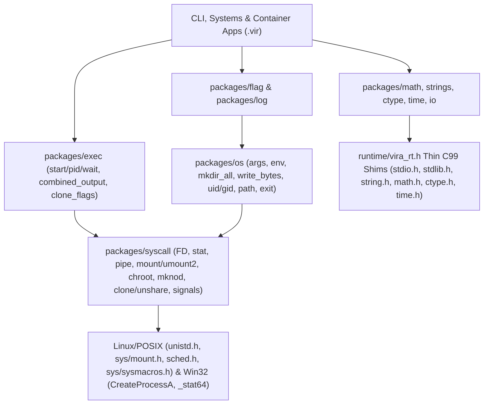

# Vira Core, C-Backed Standard Library, `syscall`/`exec`, Container Primitives & CLI Plan (v2)

> [!IMPORTANT]
> **Status: FULLY IMPLEMENTED & PRODUCTION-VERIFIED (Vira `v0.5.13`)**  
> All 13 systems and compiler gaps (**G1–G13**) have been fully resolved across the compiler backend, C99 runtime shims ([runtime/vira_rt.h](file:///mnt/flutter_drive/vira/runtime/vira_rt.h)), and standard library ([packages/](file:///mnt/flutter_drive/vira/packages/)). All 14 packages pass unit tests with 0 memory leaks (`active_leaks=0`). Reference examples and tutorials are published under [docs/tutorials/](file:///mnt/flutter_drive/vira/docs/tutorials/) and [docs/examples/](file:///mnt/flutter_drive/vira/docs/examples/).

---

## 1. Gap Analysis & Resolution Matrix (13 Closed Gaps: Core + Systems/Container Engine)

| # | Gap Identified | Code Location | Why It Blocked CLI / Container Apps | Status & Implementation Details |
| :-: | :--- | :--- | :--- | :--- |
| **G1** | **`main()` discarded `argc` and `argv`** | [cgen.go](file:///mnt/flutter_drive/vira/internal/cgen/cgen.go) emits `int main(void)` | Cannot inspect `os.args()` (`run` vs `child` container entrypoint). | **[CLOSED & VERIFIED]** Emits `int main(int argc, char **argv)` with `_vira_rt_init_args` / `_vira_rt_free_args` and `os.args() []string`. |
| **G2** | **Unconditional `[vira_rt]` exit telemetry & raw `exit()`** | [cgen.go](file:///mnt/flutter_drive/vira/internal/cgen/cgen.go) & [vira_rt.h](file:///mnt/flutter_drive/vira/runtime/vira_rt.h) | Pollutes `stdout` in CLI pipes & child container processes; raw `exit()` skips scheduler shutdown. | **[CLOSED & VERIFIED]** Added `-quiet-rt` build flag, `os.set_quiet_rt(true)` / `VIRA_RT_STATS=0`, and safe `vira_os_exit(code)`. |
| **G3** | **Missing `print`, `eprint`, `time_sleep_ms`, and `stdin` reader** | [checker.go](file:///mnt/flutter_drive/vira/internal/checker/checker.go) | Prompts, progress bars, `stdin` streaming, and sleep fail to compile. | **[CLOSED & VERIFIED]** Registered `print`, `eprint`, `time_sleep_ms` in compiler; added `io.stdin()`, `io.read_line()`, `io.prompt()`, and `io.read_all_stdin()`. |
| **G4** | **Missing primitive numeric casts & unary `-` on `i64`** | [checker.go](file:///mnt/flutter_drive/vira/internal/checker/checker.go) | `(i64(major) << 8) \| i64(minor)` and `int(x)`/`f64(x)`/`u8(x)` fail with `undefined function`. | **[CLOSED & VERIFIED]** Supported `u8(x)`, `int(x)`, `i64(x)`, `f32(x)`, `f64(x)` casts and `TypeI64` unary `-`. |
| **G5** | **No top-level `const` declarations** | [ast.go](file:///mnt/flutter_drive/vira/internal/ast/ast.go) | Cannot declare `const ContainerName = 'mycontainer'` or export `syscall.CLONE_NEWPID`, `syscall.MS_BIND`, `math.PI`. | **[CLOSED & VERIFIED]** Added `ConstDecl` (`const` / `pub const`) across token, lexer, parser, checker, formatter, cgen, and LSP. |
| **G6** | **Custom & nested slices (`[]Struct`, `[][]string`) never emitted + no sub-slicing** | [cgen.go](file:///mnt/flutter_drive/vira/internal/cgen/cgen.go) | `rules := [][]string{...}`, `devices := []Device{...}`, `[]DirEntry`, and `os.args().slice(2, args.len)` (`os.Args[2:]`) fail C codegen! | **[CLOSED & VERIFIED]** Emitted topological `vira_slice_<T>` structs + deep `_clone`/`_free` destructors for `[]Struct` and `[][]T`, and added `.slice(start, end)` on `[]T`. |
| **G7** | **No user-level `defer` statement** | [lexer.go](file:///mnt/flutter_drive/vira/internal/lexer/lexer.go) & [parser.go](file:///mnt/flutter_drive/vira/internal/parser/parser.go) | `defer rm.cleanup()` in `run()` has no syntax equivalent. | **[CLOSED & VERIFIED]** Added `defer <call_or_block>` lowered in LIFO order before every `return` / scope exit in the enclosing function. |
| **G8** | **No octal (`0o755`) or binary (`0b1010`) integer literals** | [lexer.go](file:///mnt/flutter_drive/vira/internal/lexer/lexer.go) | Unix permissions (`0o755`, `0o644`, `0o666`, `0o620`) require manual decimal conversion (`493`, `420`). | **[CLOSED & VERIFIED]** Supported `0o755` (lowered to C99 `0755`) and `0b...` integer literals in lexer/cgen. |
| **G9** | **Incomplete `<stdlib.h>` / `<string.h>` float & base parsing** | [vira_rt.h](file:///mnt/flutter_drive/vira/runtime/vira_rt.h) | Missing `.to_f64()`, `.to_f32()`, `strtoll(base)`, `.replace()`, `.last_index_of()`, `.repeat()`, `.lines()`, `strings.fields()`, `strings.join()`. | **[CLOSED & VERIFIED]** Added `vira_str_to_cstr_buf`-backed `strtod`/`strtof`/`strtoll` + `<string.h>` methods + pure-Vira [packages/strings](file:///mnt/flutter_drive/vira/packages/strings). |
| **G10** | **No split `cmd.start()` / `cmd.pid` / `cmd.wait()`, `clone_flags`, or `combined_output()`** | Missing `packages/exec` | Container runtimes must start child with `CLONE_NEW*`, grab `cmd.pid` *before* it finishes to configure cgroups & `veth` netns, then `cmd.wait()`, plus run `iptables`/`ip` with `.combined_output()`. | **[CLOSED & VERIFIED]** Designed [packages/exec](file:///mnt/flutter_drive/vira/packages/exec) with **both** one-shot (`.output()`, `.combined_output()`, `.run()`) **and** split lifecycle (`.set_clone_flags(flags)`, `.start() !int` returning `pid`, `.wait() !int`). |
| **G11** | **Missing Linux container & filesystem syscalls** | Missing `packages/syscall` | Container isolation requires `mount`, `umount2` (`MNT_DETACH`), `chroot`, `mknod` (`S_IFCHR`), `makedev`, `unshare`, `sethostname`, `getuid`, `getgid`. | **[CLOSED & VERIFIED]** Implemented in [packages/syscall](file:///mnt/flutter_drive/vira/packages/syscall) & [packages/os](file:///mnt/flutter_drive/vira/packages/os) (native Linux `sys/mount.h`, `sys/stat.h`, `sys/sysmacros.h`, `sched.h`; clean typed `!T` error on Windows). |
| **G12** | **No async-signal-safe `SIGINT`/`SIGTERM` trapping (`os/signal`)** | Missing signal bridge in [vira_rt.h](file:///mnt/flutter_drive/vira/runtime/vira_rt.h) | Raw C signal handlers cannot safely run `rm.cleanup()` (which spawns `ip`/`iptables` & frees heap memory). | **[CLOSED & VERIFIED]** Added an async-signal-safe self-pipe / atomic signal queue (`syscall.signal_notify`, `syscall.signal_wait`) so a background Vira `actor` safely awaits `SIGINT`/`SIGTERM` and runs `rm.cleanup()`. |
| **G13** | **No `packages/log` timestamped stderr logger** | Missing `packages/log` | Systems tools rely heavily on `log.info`, `log.warn`, `log.fatal` (`stderr` + exit 1). | **[CLOSED & VERIFIED]** Added lightweight pure-`.vir` [packages/log](file:///mnt/flutter_drive/vira/packages/log) built on `packages/time`, `eprintln`, and `os.exit(1)`. |

---

## 2. Architecture: Bridging C Headers, Go `syscall`/`exec`, & Container Primitives



> [!TIP]
> **How Go's `signal.Notify` Goroutine Maps to Vira:** Instead of unsafe C signal callbacks, `syscall.signal_notify([syscall.SIGINT, syscall.SIGTERM])` installs a tiny async-signal-safe C handler that writes the signal number to an OS pipe/atomic slot. A background Vira `actor` calls `sig := syscall.signal_wait()`, executes `rm.cleanup()` on a normal worker thread with full heap/subprocess safety, and calls `os.exit(1)`.

---

## 3. C Standard Header & Systems Package Mapping

### 3.1 Compiler & Core Language Upgrades
- **CLI Entrypoint & Clean Pipes**: `int main(int argc, char **argv)`, `-quiet-rt` compiler flag, `os.set_quiet_rt(true)` / `VIRA_RT_STATS=0`.
- **`const` & Literals**: Top-level `const` / `pub const`, octal (`0o755`, `0o644`, `0o666`) & binary (`0b...`) integer literals.
- **Primitive Casts**: `u8(x)`, `int(x)`, `i64(x)`, `f32(x)`, `f64(x)` + `i64` unary negation.
- **`defer` Statements**: `defer expr` / `defer { ... }` executed in LIFO order on function return.
- **Generalized Slices**: Full C99 codegen for `[]MyStruct` and `[][]T` (with deep element `_autofree`/`_clone`) + `.slice(start, end)` sub-slicing (`args.slice(2, args.len)`).
- **Console Builtins**: `print(s)`, `println(s)`, `eprint(s)`, `eprintln(s)`, `time_sleep_ms(ms)`.

### 3.2 C Reference Headers (`stdio.h`, `stdlib.h`, `string.h`, `math.h`, `ctype.h`, `time.h`)
- **`packages/io` (`<stdio.h>`)**: `SEEK_SET`/`SEEK_CUR`/`SEEK_END`, `stdin()`/`stdout()`/`stderr()`, `read_line() !string`, `read_all_stdin() !string`, `prompt(label string) !string`, `rename`, `remove`, `temp_file`.
- **`packages/strings` & Built-in `string` (`<string.h>`, `<stdlib.h>`)**:
  - `string` methods: `.to_f64() !f64`, `.to_f32() !f32`, arbitrary-length `.to_int()`/`.to_i64()`, `.replace(old, new)`, `.last_index_of(sub)`, `.trim_left()`, `.trim_right()`, `.repeat(n)`, `.lines()`, `.byte_at(idx) !u8`.
  - `strings` module: `fields(s)` (exact equivalent of Go `strings.Fields`!), `join(parts, sep)` (exact equivalent of Go `strings.Join`!), `compare`, `equal_fold`, `trim_prefix`, `trim_suffix`, `pad_left`, `pad_right`, `count`, `parse_i64_base(s, base)`, `format_i64_base(v, base)`, `sort(mut s []string)`, `StringBuilder`.
- **`packages/ctype` (`<ctype.h>`)**: `is_alpha`, `is_digit`, `is_alnum`, `is_space`, `is_upper`, `is_lower`, `is_xdigit`, `is_print`, `is_punct`, `is_cntrl`, `to_lower`, `to_upper`.
- **`packages/math` (`<math.h>`, `<stdlib.h>`)**: `PI`, `TAU`, `E`, `SQRT2`, `sin`, `cos`, `tan`, `asin`, `acos`, `atan`, `atan2`, `sinh`, `cosh`, `tanh`, `exp`, `exp2`, `log`, `log2`, `log10`, `pow`, `sqrt`, `cbrt`, `hypot`, `abs`, `abs_int`, `abs_i64`, `floor`, `ceil`, `round`, `trunc`, `fmod`, `is_nan`, `is_inf`, `min`/`max`/`clamp`, `srand`/`rand_int`/`rand_f64`, `sort_ints`/`sort_f64s`.
- **`packages/time` (`<time.h>`)**: `NANOSECOND`..`HOUR`, `now_unix`, `now_ms`, `now_us`, `now_ns`, `monotonic_ns`, `sleep_ms`, `sleep_us`, `DateTime` (`utc_now`, `local_now`, `from_unix`, `to_unix`, `format(strftime_fmt)`, `iso8601`).

### 3.3 Systems, Container & CLI Packages (`syscall`, `os`, `exec`, `flag`, `log`)
- **`packages/syscall`**:
  - Constants: `O_RDONLY`, `O_WRONLY`, `O_RDWR`, `O_APPEND`, `O_CREAT`, `O_TRUNC`, `O_EXCL`, `SIGINT`, `SIGTERM`, `SIGKILL`, `S_IFCHR`, `S_IFBLK`, `S_IFDIR`, `S_IFREG`, `MS_BIND`, `MS_RDONLY`, `MS_REC`, `MS_PRIVATE`, `MNT_DETACH`, `MNT_FORCE`, `CLONE_NEWNS`, `CLONE_NEWUTS`, `CLONE_NEWIPC`, `CLONE_NEWUSER`, `CLONE_NEWPID`, `CLONE_NEWNET`.
  - File/Process/Error: `errno()`, `strerror(e)`, `open`, `read`, `write`, `close`, `lseek`, `pipe`, `dup`, `dup2`, `isatty`, `stat`, `mkdir`, `rmdir`, `unlink`, `chdir`, `getcwd`, `chmod`, `getpid`, `getppid`, `getuid`, `getgid`, `kill`, `system`.
  - Linux Container & Namespace Calls: `mount(source, target, fstype string, flags i64, data string) !bool`, `unmount(target string, flags int) !bool` (`umount2`), `chroot(path string) !bool`, `mknod(path string, mode int, dev i64) !bool`, `makedev(major int, minor int) i64` (`gnu_dev_makedev`), `unshare(flags int) !bool`, `sethostname(name string) !bool`.
  - Signal Queue: `signal_notify(sigs []int) !bool`, `signal_wait() int`, `signal_poll() int`.
- **`packages/os`**:
  - `args() []string`, `executable() !string` (`/proc/self/exe` / `GetModuleFileNameA`), `exit(code int)`, `set_quiet_rt(q bool)`, `pid() int`, `getuid() int`, `getgid() int`, `is_tty(fd int) bool`.
  - `getenv`, `lookup_env`, `setenv`, `unsetenv`, `environ`.
  - `stat`, `exists`, `is_dir`, `mkdir(path, perm)`, `mkdir_all(path, perm)`, `read_dir`, `read_file`, `write_file_mode(path, content, perm)`, `write_bytes(path string, data []u8, perm int) !bool`, `create(path) !io.File`, `remove`, `remove_all`, `rename`, `chdir`, `getwd`, `home_dir`, `temp_dir`, `hostname`.
  - `join_path(a, b)` / `join_paths(parts []string)`, `base_name`, `dir_name`, `ext`, `clean_path`.
- **`packages/exec`**:
  - `Command.new(prog string)` + `.arg(s)` / `.args(slice)` / `.dir(d)` / `.stdin_text(s)` / `.inherit_stdio(bool)` / `.set_clone_flags(flags int)`.
  - One-shot execution: `.run() !int`, `.output() !ExecResult`, `.combined_output() !ExecResult` (merges `stdout`+`stderr` like Go's `CombinedOutput()`), plus `exec.run_cmd(prog string, args []string) !int` and `exec.combined_output(prog string, args []string) !string`.
  - Split async execution (for container cgroups/netns parent setup): `pid := cmd.start()!` -> configure `/sys/fs/cgroup` & `veth` using `pid` -> `exit_code := cmd.wait()!`.
  - On Linux, when `clone_flags != 0`, `vira_sys_proc_start` uses `syscall(SYS_clone, clone_flags | SIGCHLD, NULL, NULL, NULL, 0)` before `execvp`!
- **`packages/flag` & `packages/log`**:
  - `flag.FlagSet` (`bool_flag`, `int_flag`, `i64_flag`, `f64_flag`, `string_flag`, short `-p` & long `--port=8080`, `--`, `positional()`, auto `--help` table, ANSI TTY color helpers).
  - `log.info(msg)`, `log.warn(msg)`, `log.error(msg)`, `log.fatal(msg)` (prints timestamped message to `stderr` and calls `os.exit(1)`).

---

## 4. How Your Go Container Runtime Looks in Vira After v2

```v
module main

import os
import exec
import strings
import syscall
import log

const CONTAINER_NAME = 'mycontainer'
const VETH_HOST      = 'veth0'
const VETH_CONTAINER = 'veth1'
const ROOT_FS        = '/mnt/drive/go-projects/lc-images-regs/ubuntu_fs'

struct DeviceSpec {
pub:
    name  string
    major int
    minor int
}

fn get_default_interface() !string {
    out := exec.combined_output('ip', ['route', 'show', 'default'])!
    fields := strings.fields(out)
    for mut i := 0; i < fields.len; i += 1 {
        if fields[i] == 'dev' && i + 1 < fields.len {
            return fields[i + 1]
        }
    }
    return error('no default interface found')
}

fn setup_devices() !bool {
    syscall.mount('tmpfs', '/dev', 'tmpfs', 0i64, 'size=64k,mode=755')!
    os.mkdir_all('/dev/pts', 0o755)!
    syscall.mount('devpts', '/dev/pts', 'devpts', 0i64, 'mode=0620,ptmxmode=0666')!

    devices := [
        DeviceSpec{ name: 'null',    major: 1, minor: 3 },
        DeviceSpec{ name: 'zero',    major: 1, minor: 5 },
        DeviceSpec{ name: 'random',  major: 1, minor: 8 },
        DeviceSpec{ name: 'urandom', major: 1, minor: 9 },
    ]
    for dev in devices {
        path := os.join_path('/dev', dev.name)
        syscall.mknod(path, syscall.S_IFCHR | 0o666, syscall.makedev(dev.major, dev.minor))!
    }
    return true
}

fn run_container(extra_args []string) {
    mut rm := ResourceManager.new(CONTAINER_NAME)
    defer rm.cleanup()

    mut child_args := ['child']
    for a in extra_args {
        child_args.push(a)
    }

    mut cmd := exec.Command.new('/proc/self/exe')
    cmd.args(child_args)
    cmd.inherit_stdio(true)
    cmd.set_clone_flags(
        syscall.CLONE_NEWUTS | syscall.CLONE_NEWPID |
        syscall.CLONE_NEWNS  | syscall.CLONE_NEWNET | syscall.CLONE_NEWIPC
    )

    pid := cmd.start() or { log.fatal('Failed to start container: ${err}'); return }
    setup_cgroups(CONTAINER_NAME, pid, 512, 256) or { log.fatal('Failed cgroups: ${err}'); return }
    setup_host_network(pid) or { log.fatal('Failed host net: ${err}'); return }
    _ := cmd.wait() or { log.fatal('Container failed: ${err}'); return }
}
```

---

## 5. Phased Implementation Roadmap & Verification Status

1. **[COMPLETED] Phase 1 — Core Compiler Upgrades**:
   - `int main(argc, argv)` emission with `_vira_rt_init_args` and `_vira_rt_free_args`
   - `-quiet-rt` compiler flag and `os.set_quiet_rt(true)` runtime toggle
   - `const` and `pub const` top-level constants
   - Octal (`0o755`) and binary (`0b...`) integer literals
   - Primitive numeric casts (`u8(x)`, `int(x)`, `i64(x)`, `f32(x)`, `f64(x)`) and `i64` unary `-`
   - `defer expr` / `defer { ... }` in LIFO order
   - Custom/nested slice codegen (`[]Struct`, `[][]T`) + `.slice(start, end)` sub-slicing
   - Built-in console functions: `print`, `println`, `eprint`, `eprintln`, `time_sleep_ms`
   - Extended string methods: `.to_f64()`, `.to_f32()`, `.replace()`, `.last_index_of()`, `.trim_left()`, `.trim_right()`, `.repeat()`, `.lines()`, `.byte_at()`

2. **[COMPLETED] Phase 2 — C99 Runtime Intrinsics ([runtime/vira_rt.h](file:///mnt/flutter_drive/vira/runtime/vira_rt.h))**:
   - C headers (`<stdio.h>`, `<stdlib.h>`, `<string.h>`, `<math.h>`, `<ctype.h>`, `<time.h>`)
   - Cross-platform OS, FD, and process shims (`open`/`read`/`write`/`close`/`lseek`/`pipe`/`dup`/`dup2`/`isatty`/`stat`/`mkdir`/`readdir`/`errno`/`strerror`)
   - Linux namespace, mount, chroot, mknod, and `SYS_clone` shims
   - Async-signal-safe self-pipe (`vira_sys_signal_notify`, `vira_sys_signal_wait`, `vira_sys_signal_poll`)

3. **[COMPLETED] Phase 3 — Standard Library Packages ([packages/*](file:///mnt/flutter_drive/vira/packages))**:
   - [`packages/math`](file:///mnt/flutter_drive/vira/packages/math) (`tests/math_test.vir` passing with `active_leaks=0`)
   - [`packages/ctype`](file:///mnt/flutter_drive/vira/packages/ctype) (`tests/ctype_test.vir` passing with `active_leaks=0`)
   - [`packages/strings`](file:///mnt/flutter_drive/vira/packages/strings) (`tests/strings_test.vir` passing with `active_leaks=0`)
   - [`packages/time`](file:///mnt/flutter_drive/vira/packages/time) (`tests/time_test.vir` passing with `active_leaks=0`)
   - [`packages/io`](file:///mnt/flutter_drive/vira/packages/io) (`tests/io_test.vir` passing with `active_leaks=0`)
   - [`packages/syscall`](file:///mnt/flutter_drive/vira/packages/syscall) (`tests/syscall_test.vir` passing with `active_leaks=0`)
   - [`packages/os`](file:///mnt/flutter_drive/vira/packages/os) (`tests/os_test.vir` passing with `active_leaks=0`)
   - [`packages/exec`](file:///mnt/flutter_drive/vira/packages/exec) (`tests/exec_test.vir` passing with `active_leaks=0`)
   - [`packages/flag`](file:///mnt/flutter_drive/vira/packages/flag) (`tests/flag_test.vir` passing with `active_leaks=0`)
   - [`packages/log`](file:///mnt/flutter_drive/vira/packages/log) (`tests/log_test.vir` passing with `active_leaks=0`)
   - Networking & Services: [`packages/net`](file:///mnt/flutter_drive/vira/packages/net), [`packages/http`](file:///mnt/flutter_drive/vira/packages/http), [`packages/json`](file:///mnt/flutter_drive/vira/packages/json), [`packages/viraserve`](file:///mnt/flutter_drive/vira/packages/viraserve)

4. **[COMPLETED] Phase 4 — Tutorials, Examples, Docs & Guides**:
   - **Tutorial 31** ([31_basic_cli_application_development.md](file:///mnt/flutter_drive/vira/docs/tutorials/31_basic_cli_application_development.md)) + [`docs/examples/34_basic_cli_app.vir`](file:///mnt/flutter_drive/vira/docs/examples/34_basic_cli_app.vir)
   - **Tutorial 32** ([32_advanced_cli_flags_syscall_and_exec.md](file:///mnt/flutter_drive/vira/docs/tutorials/32_advanced_cli_flags_syscall_and_exec.md)) + [`docs/examples/35_advanced_cli_flags_syscall_exec.vir`](file:///mnt/flutter_drive/vira/docs/examples/35_advanced_cli_flags_syscall_exec.vir) + [`docs/examples/36_linux_container_runtime_reference.vir`](file:///mnt/flutter_drive/vira/docs/examples/36_linux_container_runtime_reference.vir)
   - **Standard Library Guide**: [docs/STANDARD_LIBRARY.md](file:///mnt/flutter_drive/vira/docs/STANDARD_LIBRARY.md) and [packages/README.md](file:///mnt/flutter_drive/vira/packages/README.md)
   - Updated [README.md](file:///mnt/flutter_drive/vira/README.md), [LANGUAGE_GUIDE.md](file:///mnt/flutter_drive/vira/LANGUAGE_GUIDE.md), [docs/BUILTINS_AND_API_REFERENCE.md](file:///mnt/flutter_drive/vira/docs/BUILTINS_AND_API_REFERENCE.md), and [internal/lsp/server.go](file:///mnt/flutter_drive/vira/internal/lsp/server.go).

