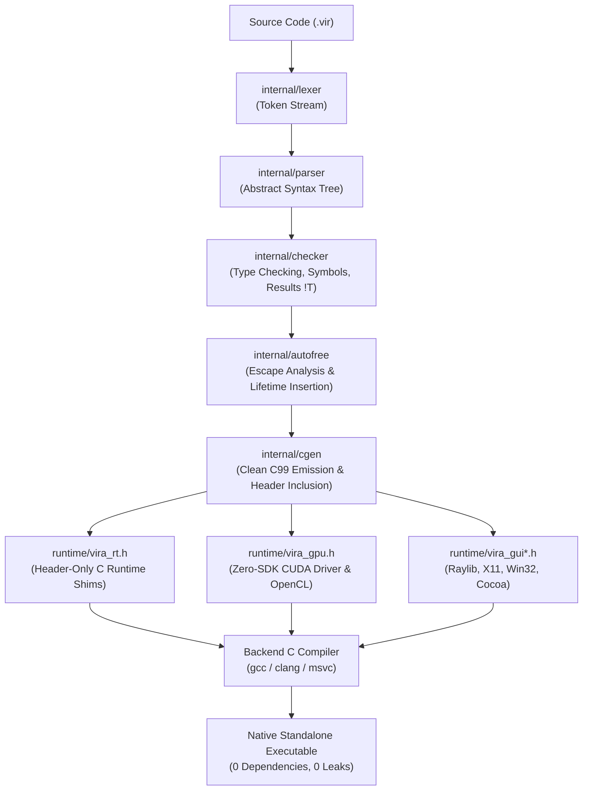
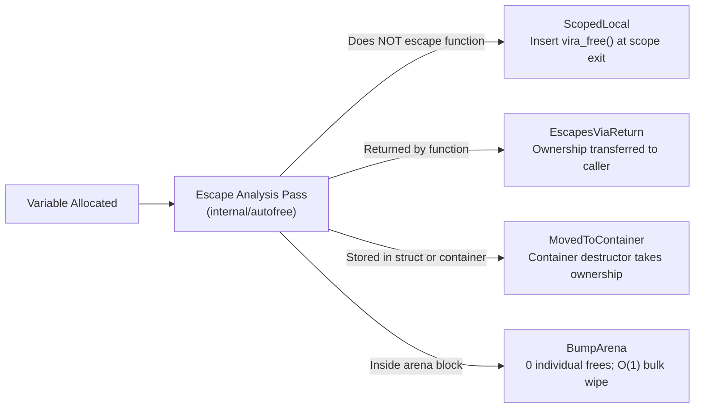
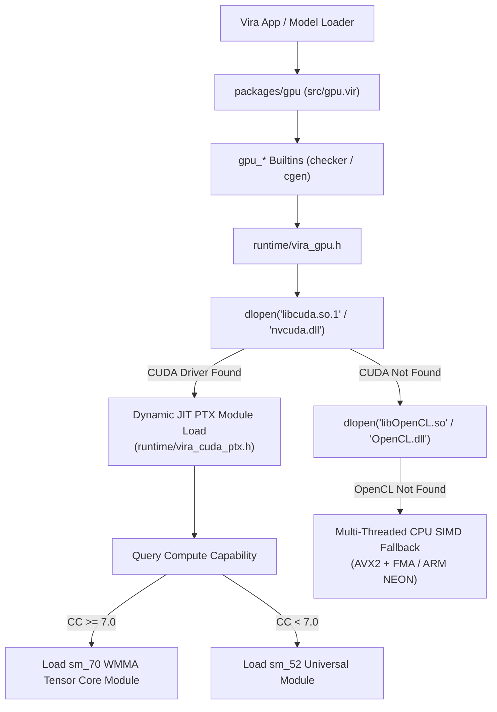
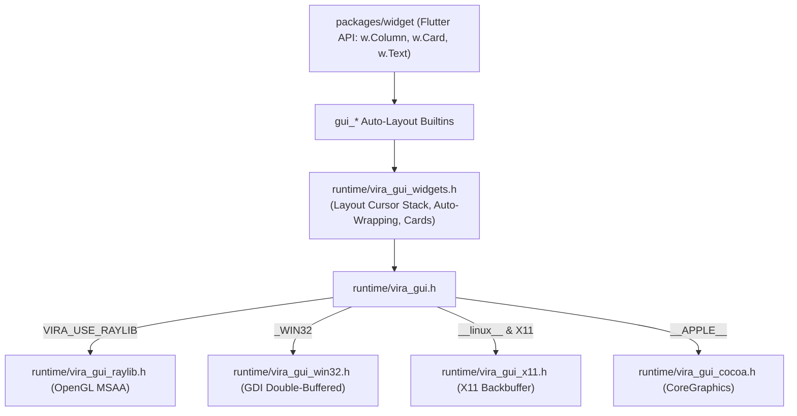

# Vira Language Maintainer's Architecture & Engineering Guide

> [!IMPORTANT]
> **To the Maintainer of Vira:**  
> When the codebase expands rapidly across the compiler, autofree escape analysis, runtime C shims, Zero-SDK GPU drivers, AI GGUF inference, native GUI auto-layout, and standard library packages, it is easy to feel disoriented.  
> **This guide is your single source of truth and architectural compass.** Keep this open whenever you fix bugs, add language features, optimize kernels, or extend standard packages.

---

## Table of Contents

1. [Core Philosophy & Non-Negotiable Invariants](#1-core-philosophy--non-negotiable-invariants)
2. [End-to-End Compiler Pipeline Flow](#2-end-to-end-compiler-pipeline-flow)
3. [Repository Topology & File Map](#3-repository-topology--file-map)
4. [Compiler Frontend & Semantic Internals](#4-compiler-frontend--semantic-internals)
5. [Autofree & Escape Analysis Engine](#5-autofree--escape-analysis-engine)
6. [C99 Code Generator (`internal/cgen`)](#6-c99-code-generator-internalcgen)
7. [The C Standard Runtime (`runtime/vira_rt.h`)](#7-the-c-standard-runtime-runtimevira_rth)
8. [The Zero-SDK GPU Subsystem (`runtime/vira_gpu.h` & `packages/gpu`)](#8-the-zero-sdk-gpu-subsystem-runtimevira_gpuh--packagesgpu)
9. [The Immediate-Mode GUI Engine (`runtime/vira_gui*.h` & `packages/widget`)](#9-the-immediate-mode-gui-engine-runtimevira_guih--packageswidget)
10. [Standard Library Packages Architecture (`packages/`)](#10-standard-library-packages-architecture-packages)
11. [Maintainer Playbooks: How to Extend Vira](#11-maintainer-playbooks-how-to-extend-vira)
    - [Playbook 1: Adding a New Syntax or Language Construct](#playbook-1-adding-a-new-syntax-or-language-construct)
    - [Playbook 2: Adding a New Global Builtin Function](#playbook-2-adding-a-new-global-builtin-function)
    - [Playbook 3: Adding a New GPU Acceleration Kernel](#playbook-3-adding-a-new-gpu-acceleration-kernel)
    - [Playbook 4: Adding a New Native GUI Widget](#playbook-4-adding-a-new-native-gui-widget)
    - [Playbook 5: Adding a New Standard Library Package](#playbook-5-adding-a-new-standard-library-package)
12. [Debugging & Triage Runbook](#12-debugging--triage-runbook)
13. [Verification & Release Checklist](#13-verification--release-checklist)

---

## 1. Core Philosophy & Non-Negotiable Invariants

Every design decision in Vira is governed by five inviolable pillars:

```
┌────────────────────────────────────────────────────────────────────────┐
│                   THE FIVE PILLARS OF VIRA                             │
├────────────────────────────────┬───────────────────────────────────────┤
│ 1. Immutability by Default     │ Variables are immutable unless marked │
│                                │ with `mut`. No sneaky mutations.      │
├────────────────────────────────┼───────────────────────────────────────┤
│ 2. Deterministic Autofree      │ No Garbage Collector (zero pause),    │
│                                │ No Borrow Checker (zero syntax pain). │
│                                │ Static escape analysis + bump arenas. │
├────────────────────────────────┼───────────────────────────────────────┤
│ 3. Zero-SDK Dependencies       │ Binaries never require link-time CUDA │
│                                │ Toolkits, heavy GUI frameworks, or    │
│                                │ Python runtimes. dlopen at runtime.   │
├────────────────────────────────┼───────────────────────────────────────┤
│ 4. Zero Memory Leaks Guarantee │ Every standard package and example    │
│                                │ must pass with `active_leaks=0`.      │
├────────────────────────────────┼───────────────────────────────────────┤
│ 5. Isolated Actor Concurrency  │ Chase-Lev work-stealing pool with     │
│                                │ isolated heaps and fault supervision. │
└────────────────────────────────┴───────────────────────────────────────┘
```

---

## 2. End-to-End Compiler Pipeline Flow

When a user executes `vira run main.vir` or `vira build -prod main.vir`, the compiler executes the following phases in sequence:



---

## 3. Repository Topology & File Map

| Path | Responsibility | Primary Technology |
| :--- | :--- | :--- |
| **`cmd/vira/`** | CLI entry point and subcommands (`main.go`, `bundle.go`, `init_gui.go`). | Go |
| **`internal/token/`** | Token definitions, operators, keywords, literal constants. | Go |
| **`internal/lexer/`** | Unicode-aware lexical scanner, string interpolation `${...}` tokenizer. | Go |
| **`internal/ast/`** | AST node interfaces, declarations, statements, expressions, 4-quadrant structs. | Go |
| **`internal/parser/`** | Pratt parser, grammar rules, precedence climbing, module scoping. | Go |
| **`internal/checker/`** | Type inference, type checking, Result Monad (`!T`), built-in function registry. | Go |
| **`internal/autofree/`** | Static escape analysis, variable lifetime tracking, auto-destructor insertion. | Go |
| **`internal/cgen/`** | AST-to-C99 code generator, temporary string hoisting, topological struct sorting. | Go |
| **`internal/lsp/`** | Language Server Protocol server (diagnostics, hover, definition, completion). | Go |
| **`internal/mod/`** | `vira.mod` manifest parser, dependency graph solver, `vira.lock` manager. | Go |
| **`internal/pkg/`** | Standard library package resolver, import path locator. | Go |
| **`runtime/vira_rt.h`** | Header-only C runtime (autofree tracker, actors, bump arenas, strings, slices, threads). | C99 |
| **`runtime/vira_gpu.h`** | Zero-SDK GPU compute driver (CUDA Driver API JIT, OpenCL fallback, weight caching). | C99 |
| **`runtime/vira_cuda_ptx.h`**| Embedded PTX assembly kernels (FP32 Linear, GEMM, sm_70+ WMMA Tensor Cores). | PTX ISA |
| **`runtime/vira_gui*.h`** | Cross-platform immediate-mode GUI backends (Raylib, Win32 GDI, X11, Cocoa). | C99 / Obj-C |
| **`runtime/vira_gui_widgets.h`**| Auto-layout stacks, auto-wrapping text, cards, tables, inputs, scroll containers. | C99 |
| **`packages/`** | 16 standard library packages (`os`, `exec`, `syscall`, `flag`, `log`, `strings`, `math`, `time`, `ctype`, `io`, `net`, `http`, `json`, `viraserve`, `widget`, `gpu`). | Pure `.vir` |
| **`docs/examples/`** | 45 runnable production examples covering CLI, HTTP, Tensors, GGUF LLMs, GUI. | Pure `.vir` |
| **`docs/tutorials/`** | 41 step-by-step masterclass tutorials. | Markdown |

---

## 4. Compiler Frontend & Semantic Internals

### The AST and Expression Hierarchy (`internal/ast`)
All nodes implement the `Node` interface:
- **`Decl`**: `FnDecl`, `StructDecl`, `InterfaceDecl`, `ConstDecl`, `ModuleDecl`, `ImportDecl`, `ActorDecl`.
- **`Stmt`**: `VarStmt`, `AssignStmt`, `IfStmt`, `ForStmt`, `SwitchStmt`, `ReturnStmt`, `DeferStmt`, `ExprStmt`.
- **`Expr`**: `IdentExpr`, `BinaryExpr`, `UnaryExpr`, `CallExpr`, `IndexExpr`, `SliceExpr`, `StructInitExpr`, `ArrayInitExpr`, `InterpolatedStringExpr`.

### Symbol Resolution & Type Checking (`internal/checker`)
The typechecker verifies types before code generation:
1. **Builtins Registry (`c.functions`):** Every global function (`println`, `gui_lbl`, `gpu_is_available`, etc.) is registered in `c.registerBuiltins()`.
2. **Result Monad (`!T`):** When a function signature returns `!T`, the checker enforces that call sites either unwrap via `or { ... }` or re-bubble with `return error(...)`.
3. **4-Quadrant Struct Encapsulation:** Enforces field access rules:
   - `default`: private immutable
   - `mut:`: private mutable
   - `pub:`: public immutable
   - `pub mut:`: public mutable
4. **Structural Interfaces:** Checks whether a struct implements all interface methods implicitly (without an `implements` keyword).

---

## 5. Autofree & Escape Analysis Engine

Vira achieves **C-like memory performance with Python-like developer ergonomics** through compile-time escape analysis:



### The Ownership Rule

Every heap value has exactly one owner. **Storing a value somewhere new copies it, unless the analyzer proves the source is never read again; then it moves.** Function arguments are borrowed (the callee clones whatever it stores). The pieces in `internal/autofree/autofree.go`:

| Function / field | What it decides |
| :--- | :--- |
| `canMove` | Same-block move: the source is declared in the current block, mentioned once in the statement, not used later or in a `defer`. The variable is retired (`StateMovedToContainer`, no destructor). |
| `canMoveOuter` | Move out of a variable declared in an **enclosing** block, through `if` / `switch` bodies only (no loop, arena, defer or or-block in between), with no later use at any level. Recorded in `ZeroOnMove`: the variable keeps its destructor and cgen zeroes it at the move (`movedIdentExpr`), so the destructor frees nothing. |
| `tryMove` | Tries `canMove`, then `canMoveOuter`. Used for `b := a`, `x = y`, struct fields, and slice stores. |
| `MovedStoreArgs` | `xs.push(v)` / `set` / `insert` arguments that move instead of being cloned by `emitSliceStoreArg`. |
| `hoistTemporaryStrings` / `walkAndHoistCallArgs` | Bind fresh temporaries (interpolations, string calls, `+` chains, struct literals, slices) to `_vira_tmp_*` variables freed right after the statement. They descend into call arguments, `+` operands (a nested `+` is flattened, not hoisted), interpolations, struct-literal fields and array literals. |
| `isAllocatedOnArena` | Which values live on the arena slab inside `arena { }` (tensor ops, interpolations, `+` chains). |

When adding an expression form that can produce a fresh heap value, teach `walkAndHoistCallArgs`, `maybeHoistSubExpr` and `wouldHoistSubExpr` about it, and add a run test that counts calls and checks `active_leaks=0` under `-sanitize` (see `testdata/run/13_temporaries_in_initializers.vir`).

### The Autofree Invariant
- **Rule:** If memory is allocated locally and does not escape, `cgen` **must** insert the matching destructor before every return path and at the end of the enclosing block.
- **Verification:** The runtime tracks all allocations when compiled without `-prod` via `_vira_active_heap_allocs` and prints diagnostics via `vira_report_mem_stats()`. At process exit or test teardown, `_vira_active_heap_allocs` (`active_leaks`) must be `0`.

---

## 6. C99 Code Generator (`internal/cgen`)

The code generator (`internal/cgen/cgen.go`) transforms the validated AST into clean, readable, portable C99:

1. **Topological Struct Ordering:** Emits structs in dependency order so nested value structs compile without forward declaration errors.
2. **Specialized Slice Types:** Generates `vira_slice_<T>` and deep clone/free functions (`vira_slice_<T>_free`) for custom types (`[]MyStruct`, `[][]string`).
3. **Temporary String Hoisting:**
   - When expressions like `'User: ${name}'` are passed directly into functions (`println`, `gui_lbl`), `cgen` hoists them to temporary variables or calls the `_temp` variant (`vira_gui_lbl_temp`), ensuring the temporary string is freed immediately after execution.
4. **Header Emission:** Emits `#include "vira_rt.h"` and conditionally `#include "vira_gui.h"` whenever GUI builtins are referenced.
5. **String `+`:** `emitStringConcat` flattens a chain into one `vira_str_concat_n` call (or `vira_arena_str_concat_n` inside an arena); each leaf is evaluated once, left to right, into a local array. `s += t` is emitted in the `AssignStmt` case and frees the old value last. `emitStringInterp` binds string sub-expressions to temporaries so `%.*s` never evaluates a call twice.
6. **Actor Handles:** `cType` of an actor is `T*`. `emitActorInitExpr` mallocs the actor and initializes its context; `T_release(T**)` destroys it (waits for queued messages, frees fields and the object). Every actor-typed expression is already a pointer, so sends, field reads (`->`) and `mut` arguments never take an address. `emitActorSliceDefinition` emits `[]Actor` as a slice of handles: growth needs no quiescing, `pop` hands a handle to the caller, `set`/`clear`/`free` release.
7. **Operator Checks:** `checker.checkBinaryOperator` rejects operators on types they are not defined for, so cgen's final `(a op b)` fallback is only reached for C-compatible operands.

---

## 7. The C Standard Runtime (`runtime/vira_rt.h`)

`runtime/vira_rt.h` is a self-contained, header-only C99 runtime library providing:

### Memory Architecture
- **`vira_string`**: 16 bytes, `{ const uint8_t *data; int32_t len; bool is_lit; bool is_borrowed; }`. `is_lit` means "do not free": a static literal, or a borrowed view (`is_borrowed`) into an arena or another string, which `vira_str_own` copies before it is stored.
- **`vira_slice_<T>`**: Growable dynamic slice `{ T *data; int32_t len; int32_t cap; bool is_arena; }`.
- **Bump Arena (`arena { ... }`)**: 64-byte cache-line aligned memory pool with instant $O(1)$ pointer reset.

### Actor Work-Stealing Concurrency (`rt/scheduler/scheduler.h`)
- **Pool:** one worker per logical core, clamped to 2–16; `VIRA_WORKERS` overrides (1–32). Each worker owns a lock-free Chase-Lev deque of `VIRA_WS_CAP` (4,096) tasks; extra tasks go to a shared overflow queue.
- **Mailbox:** a lock-free MPSC queue per actor. `scheduled` is a three-state machine (`IDLE`, `SCHEDULED`, `NOTIFIED`); the drain task's last access to the actor is the CAS that releases it, so `vira_actor_ctx_destroy` (via `vira_actor_quiesce`) can trust `IDLE`.
- **Message states (`vira_task.done`):** `0` queued, `VIRA_TASK_RUNNING` claimed by the drain loop with a CAS, `1` finished, `VIRA_TASK_DETACHED` fire-and-forget (the drain loop frees the envelope), `VIRA_TASK_SELF_MANAGED` drain tasks. A waiter can abandon a message only with a successful CAS `0 -> DETACHED`, which proves it never started.
- **Wait-for graph:** an actor that awaits another actor publishes an edge (`vira_actor_await_msg`) in a slot table that is never freed. While waiting it walks the edges from its target; a cycle back to itself, or to an actor suspended beneath it on the same thread, seen identically on two walks, is a deadlock, and the waiter whose message has not started gets `deadlock avoided: actors are waiting on each other`. Synchronous calls from inside an actor go through a future so they can be abandoned.
- **Isolated Heaps:** Each actor allocates scratch memory in its private arena (wiped after every message); message arguments are deep-copied into the envelope.
- **Fault Supervision (`OneForOne`):** A panic, bounds error, empty `pop` or integer division by zero inside a handler is caught via `setjmp`/`longjmp`; the arena is wiped and `T_supervisor_reset` resets mutable fields (immutable fields and child actors are kept).

---

## 8. The Zero-SDK GPU Subsystem (`runtime/vira_gpu.h` & `packages/gpu`)

Vira uses a **Zero-SDK runtime driver architecture**:



### Key Technical Assets in GPU Runtime:
1. **Dynamic Driver Binding:** Never links against `-lcuda` or `-lcudart`. Binaries compile on any Linux, Windows, or macOS machine without CUDA installed.
2. **Runtime PTX JIT:** Embedded PTX strings (`_vira_cuda_kernel_ptx`, `_vira_cuda_wmma_kernel_ptx`) are JIT-compiled on the user's machine via `cuModuleLoadDataEx`.
3. **Persistent Weight Caching:** 4096-entry hash cache stores model weights in VRAM across token generation cycles, eliminating repeated host-to-device PCIe bandwidth overhead.
4. **WMMA Tensor Cores:** Dynamically dispatches FP16-weight matrix multiplication to hardware Tensor Cores on Volta, Turing, Ampere, Ada Lovelace, and Hopper GPUs (`compute_capability >= 7.0`).

---

## 9. The Immediate-Mode GUI Engine (`runtime/vira_gui*.h` & `packages/widget`)

Vira features a native, hardware-accelerated **Immediate-Mode GUI (IMGUI)** with zero external framework dependencies:



### Core GUI Systems:
1. **Layout Cursor Stack (`_vira_layout_stack`):** Manages nested coordinates for `VStack`, `HStack`, `Card`, and `ScrollView`.
2. **Automatic Word-Wrapping Engine (`_vira_gui_draw_text_wrapped`):** Greedily breaks text into lines, parses `\n`, splits unbroken words character-by-character, and clamps against the window edge so labels never bleed off-canvas.
3. **Hardware Scissor Clipping:** Constrains scroll containers and text inputs (`vira_gui_set_clip` / `vira_gui_reset_clip`).
4. **Dynamic Card Expansion:** Cards compute their height dynamically from child cursors (`closed.cur_y - closed.start_y + padding`), cached in `_vira_card_heights[256]`.

---

## 10. Standard Library Packages Architecture (`packages/`)

Vira ships with 16 self-contained packages under `packages/`:

| Package | Purpose | Core Files |
| :--- | :--- | :--- |
| **`os`** | Process args, environment, paths, files, exit codes. | `packages/os/src/os.vir` |
| **`exec`** | Subprocess spawning, pipes, clone flags, `combined_output`. | `packages/exec/src/exec.vir` |
| **`syscall`** | Linux kernel calls, namespaces, mount, mknod, pipes. | `packages/syscall/src/syscall.vir` |
| **`flag`** | CLI argument parsing, flags, automated `--help`. | `packages/flag/src/flag.vir` |
| **`log`** | Leveled stderr logging (`INFO`, `WARN`, `ERROR`, `FATAL`). | `packages/log/src/log.vir` |
| **`strings`** | String split, join, replace, trim, pad, sort, `StringBuilder`. | `packages/strings/src/strings.vir` |
| **`math`** | Mathematical constants and C99 math intrinsics. | `packages/math/src/math.vir` |
| **`time`** | Wall-clock time, monotonic clock, sleep, `Duration`. | `packages/time/src/time.vir` |
| **`ctype`** | Fast ASCII classification (`is_alpha`, `is_digit`, `to_lower`). | `packages/ctype/src/ctype.vir` |
| **`io`** | Streams, `Reader`, `Writer`, interactive console `prompt`. | `packages/io/src/io.vir` |
| **`net`** | TCP/UDP sockets, non-blocking polling, listeners. | `packages/net/src/net.vir` |
| **`http`** | HTTP/1.1 request/response parser, headers, SSE streams. | `packages/http/src/http.vir` |
| **`json`** | RFC 8259 parser, validator, JSON builders. | `packages/json/src/json.vir` |
| **`viraserve`**| Actor-backed asynchronous web microframework. | `packages/viraserve/src/viraserve.vir` |
| **`widget`** | Declarative Flutter-inspired UI toolkit. | `packages/widget/src/*.vir` |
| **`gpu`** | Telemetry, device queries, memory allocation, backends. | `packages/gpu/src/gpu.vir` |

---

## 11. Maintainer Playbooks: How to Extend Vira

### Playbook 1: Adding a New Syntax or Language Construct
1. **Token (`internal/token/token.go`):** Define a new `TokenType` constant and register its string representation in `keywords` or `tokens`.
2. **Lexer (`internal/lexer/lexer.go`):** If it requires custom lexing (e.g. a new literal format), add a branch in `scanToken()`.
3. **AST (`internal/ast/ast.go`):** Define the AST struct implementing `Stmt` or `Expr`.
4. **Parser (`internal/parser/parser.go`):** Add parsing logic in `parseStatement()` or Pratt expression parsing table.
5. **Checker (`internal/checker/checker.go`):** Implement `typecheckStmt` or `typecheckExpr` to validate types and symbols.
6. **Autofree (`internal/autofree/autofree.go`):** Track variable lifetimes and escape classifications for the new node.
7. **CGen (`internal/cgen/cgen.go`):** Translate the AST node into target C99 statements or expressions.
8. **Test:** Add an automated unit test in `compiler_test.go` and verify with `go test ./...`.

### Playbook 2: Adding a New Global Builtin Function
1. **Register in Checker (`internal/checker/checker.go`):**
   ```go
   c.functions["my_builtin"] = &FnSig{
       Name:       "my_builtin",
       IsPub:      true,
       Params:     []ParamInfo{{Name: "x", Type: TypeInt}},
       ReturnType: TypeString,
   }
   ```
2. **Emit C Call in CGen (`internal/cgen/cgen.go`):**
   ```go
   case "my_builtin":
       return fmt.Sprintf("vira_my_builtin(%s)", strings.Join(argStrs, ", "))
   ```
3. **Implement in C Runtime (`runtime/vira_rt.h`):**
   ```c
   static inline vira_string vira_my_builtin(int32_t x) {
       // C implementation returning vira_string
   }
   ```
4. **Rebuild & Verify:**
   ```bash
   go build -o vira ./cmd/vira
   go test ./...
   ```

### Playbook 3: Adding a New GPU Acceleration Kernel
1. **PTX Kernel (`runtime/vira_cuda_ptx.h`):** Add the `.entry` PTX assembly function to `_vira_cuda_kernel_ptx` (or `_vira_cuda_wmma_kernel_ptx` for Tensor Cores).
2. **C Driver Function (`runtime/vira_gpu.h`):**
   - Add function pointer and kernel handle in `_vira_gpu_state`.
   - Resolve kernel symbol via `_vira_cuModuleGetFunction` inside `_vira_gpu_init_cuda_locked`.
   - Implement dispatch function (e.g. `vira_gpu_my_op(...)`) with CUDA stream launch and CPU-SIMD fallback.
3. **Compiler Builtin:** Register `gpu_my_op` in `checker.go` and `cgen.go`.
4. **Expose in Standard Package (`packages/gpu/src/gpu.vir`):** Wrap the builtin in idiomatic Vira API.
5. **Test:** Add verification in `packages/gpu/tests/gpu_test.vir` and verify with `./vira test packages/gpu/tests/gpu_test.vir`.

### Playbook 4: Adding a New Native GUI Widget
1. **Runtime Implementation (`runtime/vira_gui_widgets.h`):**
   - Implement widget drawing and event handling.
   - Advance active layout node cursor (`node->cur_x` or `node->cur_y`).
   - If using temporary strings, implement the `_temp` variant freeing `vira_str_free`.
2. **Register Builtin (`internal/checker/checker.go` & `internal/cgen/cgen.go`):**
   - Register function signature in `checker.go`.
   - Add emission case in `cgen.go` (ensure prefix `gui_` triggers `c.usesGUI = true`).
3. **Expose in Flutter Widget Kit (`packages/widget/src/`):**
   - Wrap the primitive in `packages/widget/src/controls.vir` or `layout.vir`.
4. **Test:** Add an automated test case in `packages/widget/tests/widget_test.vir`.

### Playbook 5: Adding a New Standard Library Package
1. **Create Package Directory:** `packages/<name>/`
2. **Manifest (`packages/<name>/vira.mod`):**
   ```vira
   module <name>
   version '0.1.0'
   description 'Standard library package description'
   ```
3. **Source Code (`packages/<name>/src/<name>.vir`):** Implement public functions using `pub fn`.
4. **Unit Test (`packages/<name>/tests/<name>_test.vir`):** Implement assertions and test cases.
5. **Verify Zero Leaks:**
   ```bash
   ./vira test packages/<name>/tests/<name>_test.vir
   # Output must show: active_leaks=0 [Zero Memory Leaks Verified]
   ```

---

## 12. Debugging & Triage Runbook

### When the Compiler Fails or Rejects Valid Code
- **Check parser output:** Run with verbose diagnostics.
- **Inspect generated C code:**
  ```bash
  ./vira build -keep-c my_app.vir
  cat build/my_app.c
  # or print it directly
  ./vira cgen my_app.vir
  ```
- **Check C compiler error:** Compile the generated `.c` file directly with `gcc -std=c99 -I./runtime build/my_app.c` to see raw compiler warnings.

### When Memory Leaks Are Reported (`active_leaks > 0`)
1. **Compile with Debug Sanitizer:**
   ```bash
   ./vira build -sanitize my_app.vir
   ./my_app
   ```
   AddressSanitizer (ASan) will pinpoint the exact line allocating unreleased memory.
2. **Check Temporary Hoisting:** A fresh value created inside another expression (a call argument, a `+` operand, an interpolation, a struct-literal field) must be hoisted by `walkAndHoistCallArgs`; if a new expression form leaks, that function is the usual place to fix.
3. **Check Container Destructors:** Verify that custom slices invoke `vira_slice_<T>_free` on scope exit.
4. **Count calls:** a value computed twice (once leaked) shows up as a call that runs twice; `testdata/run/13_temporaries_in_initializers.vir` shows how to test for it.

### When an Actor Program Hangs
1. Build with `-sanitize` and run with `VIRA_WORKERS=1` and with a larger count; a hang that depends on the count usually involves work-helping.
2. A wait cycle between actors should return `deadlock avoided: actors are waiting on each other`. If it hangs instead, check that every await path goes through `vira_actor_await_msg` / `_vira_future_wait_or_detach`.
3. Build the generated C with ThreadSanitizer:
   ```bash
   ./vira cgen app.vir > app.c
   gcc -std=c99 -O1 -g -fwrapv -fsanitize=thread -pthread -Iruntime app.c -o app -lm
   ./app
   ```

### When GPU Compute Fails or Falls Back to CPU
- **Check driver library:** Verify `libcuda.so.1` (Linux) or `nvcuda.dll` (Windows) is located in standard dynamic linker search paths.
- **Inspect error code:** Check `gpu.status()` / `gpu.backend_name()`.
- **Force backend:** Run with `--gpu-backend cuda` or `--gpu-backend opencl` to isolate driver initialization.

---

## 13. Verification & Release Checklist

Before committing any major changes or tagging a new Vira release, execute the full validation suite:

```bash
# 1. Rebuild Compiler
go build -o vira ./cmd/vira

# 2. Run Compiler Go Unit Tests (Uncached)
#    Includes every testdata/run program under ASan+UBSan with an active_leaks=0 check,
#    and every testdata/checker program against its `// ERROR:` annotations.
go test -count=1 ./...

# 3. Test GPU Subsystem (Zero Leaks)
./vira test packages/gpu/tests/gpu_test.vir

# 4. Test Native Widget Subsystem (Zero Leaks)
./vira test packages/widget/tests/widget_test.vir

# 5. Run GPU Compute & OOM Fallback Reference Example
./vira run docs/examples/44_gpu_compute_acceleration.vir

# 6. Verify CLI Chat Engine Help
./vira run docs/examples/43_qwen2_5_gguf_chat_inference.vir --help

# 7. Verify GUI Chat Studio Help
./vira run docs/examples/45_gui_qwen2_5_gguf_chat_studio.vir --help

# 8. Build Standalone Production Binaries
./vira build -prod -o test_gui docs/examples/21_declarative_gui.vir
rm -f test_gui

# 9. Actor runtime changes: ThreadSanitizer on the actor tests, and a before/after benchmark
for f in testdata/run/03_actor_high_concurrency_stress.vir testdata/run/07_actor_supervision_and_identity.vir \
         testdata/run/10_actor_handles.vir testdata/run/11_actor_await_cycles.vir; do
  ./vira cgen $f > /tmp/t.c && gcc -std=c99 -O1 -g -fwrapv -fsanitize=thread -pthread -Iruntime /tmp/t.c -o /tmp/t -lm && /tmp/t
done
VIRA=./vira-old bash scripts/bench_actors.sh && bash scripts/bench_actors.sh
```

### Regression Tests by Area

| Area | Tests |
| :--- | :--- |
| Ownership, aliasing, moves | `testdata/run/04_*`, `05_*`, `08_*`, `12_ownership_moves.vir` |
| Arenas, defers, early returns | `testdata/run/06_*` |
| Strings `+` / `+=` | `testdata/run/09_string_concat.vir` |
| Temporaries inside initializers | `testdata/run/13_temporaries_in_initializers.vir` |
| Actor supervision, faults | `testdata/run/07_*` |
| Actor handles, slices of actors | `testdata/run/10_actor_handles.vir` |
| Actor wait cycles | `testdata/run/11_actor_await_cycles.vir` |
| Checker: actor isolation and ownership | `testdata/checker/03_*`, `05_actor_ownership.vir` |
| Checker: operator types | `testdata/checker/04_operator_types.vir` |
| Scheduler internals (C harness) | `TestSchedulerMailboxConcurrentSendersAndParkTimeout` in `compiler_test.go` |

---

*Keep this guide updated as Vira continues to evolve. You built a world-class systems programming language from scratch—use this blueprint to steer it forward with confidence.*

