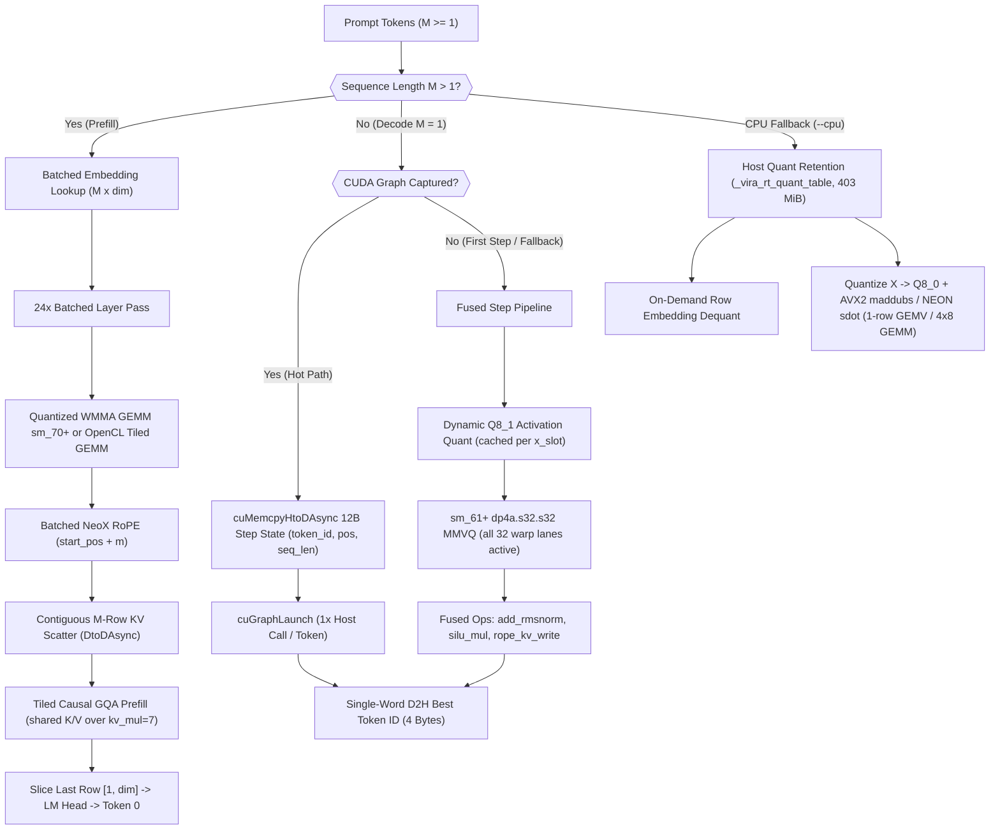

# Implementation Plan: CUDA & CPU-SIMD Inference Parity with `llama.cpp`

## 1. Executive Summary & Benchmark Baseline

Side-by-side benchmarking on Google Colab **NVIDIA Tesla T4 (`sm_75`, 14,912 MiB VRAM)** using `/content/models/qwen2.5-0.5b-instruct-q4_0.gguf` (`403.20 MiB`, `630.17M` params, `layers=24`, `dim=896`, `ffn_dim=4864`, `14 Q / 2 KV`, `head_dim=64`, `vocab=151,936`) exposed three structural bottlenecks between [`43_qwen2_5_gguf_chat_inference.vir`](file:///c:/Users/hp/vex/docs/examples/43_qwen2_5_gguf_chat_inference.vir) and `llama-bench` (`build: a4d4f2f`):

| Metric (`qwen2.5-0.5b-instruct-q4_0`) | Vira Current (T4 / Colab CPU) | `llama-bench` Measured | Gap Factor | Target After Plan |
|---|---|---|---|---|
| **GPU Prefill** (`pp32` / Turn 1 ~32 tok) | `~118 tok/s` (`271 ms`) | `2,696.35 tok/s` | ~23x slower | `>= 2,000 tok/s` |
| **GPU Prefill** (`pp128` / `pp512`, `fa=1`) | `~90-120 tok/s` (`M=1` loop) | `5,335 – 13,701 tok/s` | ~45x–115x slower | `4,500 – 9,500+ tok/s` |
| **GPU Decode** (`tg64` / `tg128`) | `~107 – 149 tok/s` | `321.45 – 324.74 tok/s` | ~2.15x slower | `295 – 335 tok/s` |
| **CPU Decode** (`ngl=0, tg128`) | `~10 tok/s` | `46.23 – 49.21 tok/s` | ~4.7x slower | `40 – 50 tok/s` |
| **CPU Prefill** (`ngl=0, pp128`) | `~29 – 57 tok/s` (`557 ms`) | `1,404.13 – 1,507.10 tok/s` | ~25x–50x slower | `1,000 – 1,400+ tok/s` |

### Core Non-Negotiable Constraints Preserved
1. **Zero SDK Dependencies**: Pure C99 compilation with dynamic `nvcuda.dll` / `libcuda.so.1` and `OpenCL.dll` / `libOpenCL.so.1` resolution inside [`runtime/vira_gpu.h`](file:///c:/Users/hp/vex/runtime/vira_gpu.h). No `nvcc`, `cuda.h`, or `libcudart` required.
2. **Backend & Fallback Determinism**: Full numerical parity and fallback continuity (`CUDA -> OpenCL -> CPU-SIMD`), honoring `simulate_oom` and preserving `_vira_active_allocs == 0` (`active_leaks=0`).

---

## 2. Verified Root-Cause Matrix

| Bottleneck Area | Verified Code Location | Architectural Cause |
|---|---|---|
| **Sequential `M=1` Prefill Loop** | [`generate_reply`](file:///c:/Users/hp/vex/docs/examples/43_qwen2_5_gguf_chat_inference.vir#L524-L542) | Iterates `for idx < turn_tokens.len` calling single-token `qwen2_forward_step(...)`. Never batches prompt tokens `[M, dim]`. |
| **No Quantized Batched GEMM (`M > 1`)** | [`vira_gpu_linear`](file:///c:/Users/hp/vex/runtime/vira_gpu.h#L3926-L3957), [`L4009-4050`](file:///c:/Users/hp/vex/runtime/vira_gpu.h#L4009-L4050) | Routes **all** GGUF quants (`Q4_0..Q6_K`) through `gemv` kernels with grid `gy = M`, reloading the entire `403 MiB` weights `M` times. [`vira_cu_wmma_linear_h`](file:///c:/Users/hp/vex/runtime/vira_cuda_ptx.h#L4494-L4872) only handles `VIRA_WFMT_F16`. |
| **Single-Token RoPE, Copy, & Attention** | [`vira_gpu_rope`](file:///c:/Users/hp/vex/runtime/vira_gpu.h#L4410-L4520), [`_vira_gpu_copy_row`](file:///c:/Users/hp/vex/runtime/vira_gpu.h#L5271-L5345), [`vira_gpu_gqa_attention`](file:///c:/Users/hp/vex/runtime/vira_gpu.h#L5139-L5269) | RoPE accepts one scalar `float pos_f`; `_vira_gpu_copy_row` copies 1 row; GQA attention processes 1 query step without causal masking over `[M, n_heads, head_dim]`. |
| **Scalar Non-DP4A Decode PTX (`sm_52`)** | [`vira_cu_gemv_q4_0`](file:///c:/Users/hp/vex/runtime/vira_cuda_ptx.h#L9-L150) | Reads `FP32` activations `x` (`4x` bandwidth vs `Q8_1`), unpacks each nibble to `s32 -> f32` + `fma.rn.f32` instead of Turing `dp4a.s32.s32`. Leaves 4 of 32 warp lanes idle on `K = 896` (`num_blocks_k = 28 < 32`). |
| **Host Dispatch & Arena Churn (~195 launches/tok)** | [`qwen2_forward_step`](file:///c:/Users/hp/vex/docs/examples/43_qwen2_5_gguf_chat_inference.vir#L427-L462), [`_vira_gpu_invalidate_activations`](file:///c:/Users/hp/vex/runtime/vira_gpu.h#L1881-L1900) | Each token executes ~195 separate GPU launches, each locking `_vira_gpu.lock` and probing caches, plus `24` per-layer `arena` tear-downs scanning `act_ring[240]` and synchronous `cuStreamSynchronize` + 2x D2H inside [`_vira_gpu_argmax_f32`](file:///c:/Users/hp/vex/runtime/vira_gpu.h#L5475-L5484). No CUDA Graph API bindings exist at [`L152-182`](file:///c:/Users/hp/vex/runtime/vira_gpu.h#L152-L182). |
| **Tied LM-Head Duplication & Print Overhead** | [`main`](file:///c:/Users/hp/vex/docs/examples/43_qwen2_5_gguf_chat_inference.vir#L750-L752), [`L556-559`](file:///c:/Users/hp/vex/docs/examples/43_qwen2_5_gguf_chat_inference.vir#L556-L559) | `tok_emb.clone()` duplicates `151936x896` in host RAM and VRAM (`482 MB` cached vs `403 MB` model). Also unbuffered per-token `print` sits inside decode timing. |
| **CPU `FP32` Inflation & Unblocked Linear** | [`vira_gguf_load_tensor`](file:///c:/Users/hp/vex/runtime/vira_rt.h#L6712-L6948), [`_vira_linear_job_fn`](file:///c:/Users/hp/vex/runtime/vira_rt.h#L2795-L2870), [`vira_tensor_embedding`](file:///c:/Users/hp/vex/runtime/vira_rt.h#L7336-L7353) | Dequantizes all GGUF tensors to `FP32` (`~2.0 GB` RAM) and frees `raw_q` (`L6734` etc.), forcing CPU linear to stream 4x–5x excess memory bandwidth without `Q4_0 x Q8_0` AVX2/NEON integer dot products or `M > 1` blocking. |

---

## 3. Target Architecture Overview



---

## 4. Phased Implementation Roadmap

### Phase 0: Benchmarking Discipline & Zero-Cost Cleanups
**Expected Gain**: GPU `149 → ~165 tok/s`; load time `2.2s → ~1.5s`; clean apples-to-apples timing vs `llama-bench`.

1. **Use Compiled `-prod` Binaries for Timing** ([`cmd/vira/main.go`](file:///c:/Users/hp/vex/cmd/vira/main.go#L1310-L1333)):
   - `vira run` without `-prod` compiles C99 at `-O2 -march=native` and includes compile latency if timed end-to-end. Standardize benchmark runs via `vira build -prod -quiet-rt -o qwen_chat docs/examples/43_qwen2_5_gguf_chat_inference.vir` (`-O3 -march=native`), matching `./build/bin/llama-bench`.
   - Optionally expose `--bench-p <int>` and `--bench-n <int>` CLI flags in [`43_qwen2_5_gguf_chat_inference.vir`](file:///c:/Users/hp/vex/docs/examples/43_qwen2_5_gguf_chat_inference.vir#L620-L680) to benchmark pure prefill (`pp`) and decode (`tg`) rates without tokenizer/stdout formatting jitter.
2. **Eliminate Per-Layer Arena Churn** ([`43_qwen2_5_gguf_chat_inference.vir`](file:///c:/Users/hp/vex/docs/examples/43_qwen2_5_gguf_chat_inference.vir#L427-L462)):
   - Move `arena { ... }` **outside** `for l < meta.n_layers` (or chunk 6 layers per arena / pass explicit arena parameter), eliminating 24 `malloc`/`free` arena cycles and 24 [`_vira_gpu_invalidate_activations`](file:///c:/Users/hp/vex/runtime/vira_gpu.h#L1881-L1900) mutex+scan passes per token. Note: Ensure `VIRA_GPU_ACT_RING_CAP` (`240`) recycles cleanly or bump it to `512` if holding full 24-layer arena slots before bulk reset.
3. **Avoid Tied `out_weight` Weight Duplication** ([`43_qwen2_5_gguf_chat_inference.vir`](file:///c:/Users/hp/vex/docs/examples/43_qwen2_5_gguf_chat_inference.vir#L750-L752)):
   - When `output.weight` is absent from GGUF, avoid `tok_emb.clone()` duplicating `151,936 x 896` bytes (`~80 MB` VRAM Q8_0/Q4_0 + `~545 MB` host FP32). Let `out_weight` reference a read-only view or share the GGUF weight entry (`has_tied_out = true`, skip separate `out_weight` upload/free).

---

### Phase 1: Batched Prompt Prefill + Quantized Tensor Cores
**Expected Gain**: Prefill jumps from **`~118 tok/s` (`271 ms`) → `4,500–8,500+ tok/s` (`< 8–20 ms` for 128 tokens)** on Tesla T4.

#### 1.1 Quantized Tensor Core (`WMMA m16n16k16`) & Tiled OpenCL GEMM (`M > 4`)
- **CUDA PTX ([`runtime/vira_cuda_ptx.h`](file:///c:/Users/hp/vex/runtime/vira_cuda_ptx.h))**:
  - Extend `_vira_cuda_wmma_kernel_ptx` (`.version 6.3`, `.target sm_70`) with quantized batched GEMM kernels:
    - `vira_cu_wmma_gemm_q4_0` (first priority — powers Qwen2.5 `q4_0` model weights)
    - `vira_cu_wmma_gemm_q8_0` (second priority — covers Q8_0 tensors and `output.weight` / `v` if Q8_0)
    - `vira_cu_wmma_gemm_q4_1`, `q5_0`, `q5_1`, `q4_k`, `q5_k`, `q6_k`
  - **Tile Geometry (`BM=32, BN=32, BK=32`)**: Aligns `BK=32` natively to GGUF quant block boundaries (`QK=32`), avoiding split-block edge checks inside the inner K loop:
    - Each CTA uses `4` warps (`128` threads) arranged `(2 x 2)` on `16x16` C tiles.
    - Stage 1 (cooperative shared memory fill): threads dequantize `[32, 32]` quantized weight blocks into shared `half` buffer `smem_B[32][32+8]` (8-half bank padding) and convert `[32, 32]` `FP32` activation tile `x` into `smem_A[32][32+8]` (`cvt.rn.f16.f32`).
    - Stage 2: two `k_step = 0, 16` iterations of `wmma.load.a.sync.aligned.row.m16n16k16.f16`, `wmma.load.b.sync.aligned.col.m16n16k16.f16`, and `wmma.mma.sync.aligned.row.col.m16n16k16.f32.f32`.
    - Bounds-safe epilogue: store FP32 accumulators directly via `wmma.store.d.sync` when aligned, or staged through shared memory when `M < 16` or `(M % 16) != 0`.
  - Keep existing [`vira_cu_linear_tiled_f32`](file:///c:/Users/hp/vex/runtime/vira_gpu.h#L3958-L3966) / tiled FP16 fallback for `cc < 7.0` (`sm_52`).
- **OpenCL Tiled Quantized GEMM ([`runtime/vira_gpu.h`](file:///c:/Users/hp/vex/runtime/vira_gpu.h))**:
  - Add `vira_cl_gemm_q4_0`, `vira_cl_gemm_q8_0`, `vira_cl_gemm_q4_k`, etc., dequantizing a `16 x 32` block tile into `__local float` once per `16` prompt rows (`16x` weight-bandwidth reduction on AMD/Intel/non-TC NVIDIA GPUs).
- **Dispatch Rule ([`vira_gpu_linear`](file:///c:/Users/hp/vex/runtime/vira_gpu.h#L3921-L4100))**:
  - `M <= 4`: Keep low-latency GEMV (`M=1..4` speculative/decode).
  - `M > 4` with quant format: If `CUDA && has_tensor_cores && (N % 16 == 0 || N >= 16) && (K % 32 == 0)`, dispatch `vira_cu_wmma_gemm_*`; else dispatch tiled OpenCL/PTX `gemm_*`.

#### 1.2 Batched Sequence Operators
1. **Batched Token Embedding (`tensor_embedding_batch`)**:
   - New builtin `tensor_embedding_batch(table tensor[f32], token_ids []int) tensor[f32]` returning `[M, dim]` where `M = token_ids.len`.
   - Gathers `M` rows on CPU (`memcpy` or on-demand quant row dequant in Phase 4) in one single allocation before GPU upload (eliminates `M` separate embeddings + `M` H2D transfers).
2. **Batched NeoX RoPE (`gpu_rope_seq` / `vira_gpu_rope_seq`)**:
   - Signature: `gpu_rope_seq(q tensor[f32], start_pos i64, n_heads int, freq_base f32) tensor[f32]` (for tensor shaped `[M * n_heads, head_dim]`).
   - Kernel computes `seq_idx = r / n_heads`, `pos = start_pos + seq_idx`, `angle = (float)pos * freq_base^(-(2*i)/cols)`. Same single kernel dispatch rotates all `M * n_heads` rows in one launch (`vira_cu_rope_seq_f32`, `vira_cl_rope_seq_f32`).
3. **Batched KV Cache Scatter (`copy_rows` / `vira_gpu_copy_rows`)**:
   - Add tensor method `k_cache.copy_rows(dst_row_start int, src tensor[f32])` copying `src.rows` contiguous rows into `dst` starting at `dst_row_start` in **one** async `cuMemcpyDtoDAsync(dst_cu + dst_off, src_cu, src_bytes, stream)` (or `clEnqueueCopyBuffer`), replacing `M` sequential row copies per layer.
4. **Batched Causal GQA FlashAttention Prefill (`gpu_gqa_prefill`)**:
   - Signature: `gpu_gqa_prefill(q_seq tensor[f32], k_cache tensor[f32], v_cache tensor[f32], start_pos i64, seq_len int, n_heads int, scale f32) tensor[f32]` where `q_seq` is `[seq_len * n_heads, head_dim]`, and `k_cache`, `v_cache` hold all tokens `0 .. start_pos + seq_len - 1`.
   - **Kernel Design (`vira_cu_gqa_prefill_f32` & `vira_cl_gqa_prefill_f32`)**:
     - Grid: `gx = kv_head` (`0 .. n_kv_heads - 1`), `gy = ceil(seq_len / Q_TILE)` (`Q_TILE = 8` or `16`).
     - Shared-memory K/V tiling (`BKV = 16`): cooperatively load `k_cache[t .. t+15]` and `v_cache[t .. t+15]` into shared memory **once** and score against `kv_mul = n_heads / n_kv_heads` (`7` Q heads per KV head in Qwen2.5-0.5B) simultaneously!
     - Causal guard: for query row `m`, ignore keys `t > start_pos + m`.
     - Online softmax update (`m_i`, `l_i`, `acc[head_dim]`) with warp shuffle reductions, storing `[seq_len * n_heads, head_dim]` directly to VRAM.
     - Fallback `_vira_cpu_gqa_prefill` implements exact online/two-pass causal attention using SIMD dot products in [`runtime/vira_gpu.h`](file:///c:/Users/hp/vex/runtime/vira_gpu.h).

#### 1.3 Compiler, Stdlib & Application Wiring
- Register `tensor_embedding_batch`, `gpu_rope_seq`, `gpu_gqa_prefill` in [`internal/checker/checker.go`](file:///c:/Users/hp/vex/internal/checker/checker.go#L680-L713), add `copy_rows` tensor method in [`checker.go`](file:///c:/Users/hp/vex/internal/checker/checker.go#L2683-L2698), mark all new builtins arena-allocated in [`internal/autofree/autofree.go`](file:///c:/Users/hp/vex/internal/autofree/autofree.go#L684-L702), emit C calls in [`internal/cgen/cgen.go`](file:///c:/Users/hp/vex/internal/cgen/cgen.go#L2800-L2842) and [`L3388-3398`](file:///c:/Users/hp/vex/internal/cgen/cgen.go#L3388-L3398), and mirror wrappers in [`packages/gpu/src/gpu.vir`](file:///c:/Users/hp/vex/packages/gpu/src/gpu.vir#L95-L122).
- Add `qwen2_forward_prefill(...)` in [`43_qwen2_5_gguf_chat_inference.vir`](file:///c:/Users/hp/vex/docs/examples/43_qwen2_5_gguf_chat_inference.vir) (chunked at max `512` tokens per batch to bound intermediate VRAM for large `-c` contexts), slicing `x.slice_rows(m - 1, m)` before `out_norm` & `out_weight` so `151,936`-vocab LM-head matmul runs **only once** for the final prompt token! Mirror cleanly in [`45_gui_qwen2_5_gguf_chat_studio.vir`](file:///c:/Users/hp/vex/docs/examples/45_gui_qwen2_5_gguf_chat_studio.vir).

---

### Phase 2: Turing `DP4A` Quantized Decode Kernels
**Expected Gain**: Decode throughput rises from **`~149 tok/s` → `~230–275 tok/s`** by cutting weight-dequant ALU ops by `~6x` and activation global reads by `3.2x`, while fixing small-`K` warp under-utilization.

#### 2.1 Dynamic `Q8_1` Activation Format & `x_slot` Cache Reuse
- Define 36-byte aligned (or 40-byte stride for PTX vector loads) `block_q8_1`:
  - `fp16 d` (2B scale), `fp16 s` (2B pre-sum `d * sum(qs[0..31])`), `int8 qs[32]` (`8 x uint32` packed words).
  - Precomputing `s = d_x * sum(qs)` allows `Q4_0` dot products without subtracting zero-point `-8` in the inner loop:
    $$\text{dot}(w_{Q4\_0}, x_{Q8\_1}) = d_w \left( d_x \cdot \text{dp4a}(q4_{\text{nibble}}, qs) - 8 \cdot \text{sum}(qs) \right) = d_w d_x \cdot \text{dp4a}(q4_{\text{raw}}, qs) - 8 d_w s$$
- Add `vira_cu_quantize_q8_1` PTX kernel (`1` warp per 32 floats or `1` block of `256` threads = 8 `Q8_1` blocks) and extend `_vira_gpu_act_entry` ([`runtime/vira_gpu.h`](file:///c:/Users/hp/vex/runtime/vira_gpu.h#L213-L225)) with `vira_cu_deviceptr cu_q8_buf; size_t q8_bytes; uint64_t q8_epoch;` (cleared cleanly in `_vira_gpu_act_entry_reset` and freed alongside `cu_buf`):
  - **Shared Quantization Reuse**: When Qwen2.5 launches `xn.gpu_linear(l_wq[l])`, `xn.gpu_linear(l_wk[l])`, `xn.gpu_linear(l_wv[l])`, only the **first** projection quantizes `xn` into `x_slot->cu_q8_buf`; `wk` and `wv` see `x_slot->q8_epoch == current_write_gen` and skip quantization completely! Same for `ffn_gate` and `ffn_up` sharing `x2n`.

#### 2.2 `sm_61+` PTX `dp4a.s32.s32` MMVQ Kernels
- Generate a dedicated static PTX string `_vira_cuda_dp4a_kernel_ptx` (`.version 6.3`, `.target sm_61`, `.address_size 64`) in [`runtime/vira_cuda_ptx.h`](file:///c:/Users/hp/vex/runtime/vira_cuda_ptx.h), compiled alongside `_vira_cuda_wmma_kernel_ptx` inside `_vira_gpu_init_cuda_locked` when `compute_capability_major >= 7 || (major == 6 && minor >= 1)`.
  - Preserves 100% compatibility with Maxwell (`sm_52`) GPUs via existing fallback kernels.
- Implement `vira_cu_mmvq_q4_0`, `q4_1`, `q5_0`, `q5_1`, `q8_0`, `q4_k`, `q5_k`, `q6_k`:
  - Inside `Q4_0` kernel, use `.reg .u32`: unpack 4 bytes of nibble pairs with shift/mask (`and.b32 q_lo, packed, 0x0F0F0F0F` and `shr.u32 + and.b32 q_hi`), then issue two `dp4a.s32.s32 acc, q_bytes, x_bytes, acc` instructions per 4 weight bytes!
- **Eliminate Idle Warp Lanes & Boost Occupancy on Small `K` (`K = 896`)**:
  - Current `vira_cu_gemv_q4_0` uses `32` threads across `28` blocks (`num_blocks_k = 896 / 32 = 28`), wasting 4 lanes on every warp and putting all `N` rows through sequential single-block steps.
  - **Fix**: Map **multi-subwarp (`8` threads per output row, `16` or `32` rows per CTA)** or **vectorized 2-rows-per-warp** across K blocks with `__shfl_down` reduction across only `8` or `4` lanes (`0xFFFFFFFF` / butterfly width `4`/`8`), ensuring:
    1. Zero idle warp lanes when `K = 896` (`28 / 4 = 7` full iterations per subwarp!).
    2. Higher active thread/block concurrency on Tesla T4 (`40 SMs`) during `K = 896, N = 128` (`k_proj`, `v_proj`) and `N = 151,936` (`out_weight`) projections.

---

### Phase 3: Kernel Fusion & Zero-SDK CUDA Graph Replay
**Expected Gain**: Decode advances from **`~230–275 tok/s` → `~305–335 tok/s`**, matching `llama-bench` `tg128` (`321–323 tok/s`).

#### 3.1 Fused Elementwise & Attention-Prep Kernels
Adding these compound operators cuts decode launch count from **~195 launches/token → ~100 launches/token** and saves ~50 global VRAM round-trips per token:

1. **`gpu_add_rmsnorm(mut_res tensor[f32], delta tensor[f32], weight tensor[f32], eps f32) tensor[f32]`**:
   - Performs `mut_res[r, c] += delta[r, c]` in registers **and immediately** reduces sum-of-squares across the row to output normalized `out[r, c]` — eliminating separate `+` kernel + `x.copy_row(0, x_next)` + redundant global read before `rmsnorm` ([`43:450-459`](file:///c:/Users/hp/vex/docs/examples/43_qwen2_5_gguf_chat_inference.vir#L450-L459)).
2. **`gpu_silu_mul(gate tensor[f32], up tensor[f32]) tensor[f32]`**:
   - Computes `out[i] = (gate[i] / (1.0f + expf(-gate[i]))) * up[i]` in a single pass, removing the standalone [`vira_tensor_silu`](file:///c:/Users/hp/vex/runtime/vira_rt.h#L7113-L7134) write+read of `[M, 4864]` (`24` fewer launches/tok).
3. **`gpu_rope_kv_write(...)` (Fused QKV Bias + NeoX RoPE + KV Cache Scatter)**:
   - Takes `q_lin, bq, k_lin, bk, v_lin, bv, k_cache, v_cache, pos, n_heads, n_kv_heads, head_dim, freq_base`:
     - In one grid launch across `(n_heads + 2 * n_kv_heads)` heads: applies `q_lin + bq` + NeoX RoPE -> `q_heads`, applies `k_lin + bk` + NeoX RoPE -> `k_cache[pos]`, and adds `v_lin + bv` -> `v_cache[pos]`.
     - Eliminates `3` binary add kernels + `2` RoPE launches + `2` `cuMemcpyDtoDAsync` calls per layer (`~120` fewer driver calls/token across 24 layers!).
4. Provide clean CUDA PTX + OpenCL + CPU-SIMD implementations and checker/autofree/cgen/stdlib wiring for all three compound ops.

#### 3.2 Zero-SDK CUDA Driver API Graph Capture & Replay
- **Dynamic CUDA Driver Symbols ([`runtime/vira_gpu.h`](file:///c:/Users/hp/vex/runtime/vira_gpu.h#L152-L182))**:
  - Dynamically load (gracefully optional; falls back to standard stream launches if driver < CUDA 10):
    - `cuStreamBeginCapture` (try `cuStreamBeginCapture_v2`, fallback `cuStreamBeginCapture`), `cuStreamEndCapture`
    - `cuGraphInstantiate` (try `cuGraphInstantiateWithFlags`, fallback `cuGraphInstantiate_v2` / `cuGraphInstantiate`)
    - `cuGraphLaunch`, `cuGraphExecDestroy`, `cuGraphDestroy`
    - `cuStreamIsCapturing`
- **Graph-Invariant Decode Step Architecture**:
  A captured CUDA Graph bakes kernel grid/block dimensions and argument pointers into the driver command graph. To replay the exact same graph at every `pos = 0, 1, 2, ... max_context - 1` without re-capturing:
  1. **Pinned Device Step Control Block (`CUdeviceptr cu_step_ctrl`, 16 bytes)**: Holds `{ int32 token_id; int32 kv_pos; int32 seq_len; int32 pad; }`. Updated once per token via a single async `cuMemcpyHtoDAsync(cu_step_ctrl, &step_host, 12, stream)`.
  2. **Graph-Safe Indirect Kernel Variants**: Add lightweight wrappers reading `*pos_ptr` / `*seq_len_ptr` / `*tok_id_ptr` from `cu_step_ctrl` in constant cache (`ld.global.nc`):
     - `vira_cu_emb_gather_indirect(d_table, cu_step_ctrl, d_x_buf, dim)` — gathers embedding directly on GPU when `tok_emb` is cached in VRAM (`0` CPU embedding `memcpy`, `0` per-step H2D!).
     - `vira_cu_rope_kv_write_indirect(..., cu_step_ctrl)` — reads `pos` from `cu_step_ctrl[1]`.
     - `vira_cu_gqa_attention_indirect(..., cu_step_ctrl)` — reads `seq_len` from `cu_step_ctrl[2]`. Keep grid dimensions fixed cleanly (`n_heads` CTAs).
     - `vira_cu_argmax_final_f32` — adds a 1-CTA stage-2 reduction reducing `256` partial candidates on GPU down to a **single `int32` device word** (`cu_best_tok_dev`), replacing two `256`-element D2H transfers + host scan with **one `4`-byte `cuMemcpyDtoH`**.
  3. **Persistent Scratch Buffers Across Decode Steps**:
     - Allocate one fixed set of decode scratch activation slots keyed to the model session (`cu_decode_x`, `cu_qkv_buf`, `cu_attn_buf`, `cu_ffn_buf`, `cu_logits_buf`) instead of `arena`-driven dynamic pointer churn — ensuring every buffer pointer baked into the CUDA Graph stays constant across all `1..N` decode tokens.
  4. **Capture Lifecycle & Safety**:
     - Step `0` of decode (or on pointer invalidation) executes with stream capture enabled (`CU_STREAM_CAPTURE_MODE_THREAD_LOCAL = 1`), instantiating `cu_decode_graph_exec`.
     - Steps `1..N` run with a **single `_vira_gpu.lock` acquisition**: validate graph signature (context gen, weight/KV pointers untouched, `!simulate_oom`), `cuMemcpyHtoDAsync(cu_step_ctrl)`, `cuGraphLaunch(cu_decode_graph_exec, stream)`, `cuMemcpyDtoH(&best_tok, cu_best_tok_dev, 4)` (implicit stream sync).
     - **Strict Invalidation**: Automatically destroy and clear `cu_decode_graph_exec` inside `gpu.set_enabled()`, `gpu.set_backend()`, `gpu.set_device()`, `gpu.simulate_oom(true)`, `evict_ptr` on any bound KV cache/weight, and [`vira_gpu_shutdown`](file:///c:/Users/hp/vex/runtime/vira_gpu.h#L3555).

---

### Phase 4: Quantized Host Weight Retention & Integer-SIMD CPU Engine
**Expected Gain**: Host RAM drops **`~2.0 GB → ~450 MB`**, model load drops **`2.2s → < 0.35s`**, CPU decode climbs **`~10 → 40–50 tok/s`**, CPU prefill climbs **`~30–50 → 1,000–1,400+ tok/s`**.

#### 4.1 Stop Losing Raw GGUF Blocks in `runtime/vira_rt.h`
- Currently [`vira_gguf_load_tensor`](file:///c:/Users/hp/vex/runtime/vira_rt.h#L6712-L6948) expands every quantized block into `FP32` `t.data`, uploads to GPU via `_vira_gpu_register_quant`, and immediately calls `free(raw_q)`.
- **Changes**:
  1. Introduce a lightweight host quant registry (`_vira_rt_quant_table` open-addressed hash map keyed by `t.data`) holding `{uint32_t gguf_dtype; void *raw_q; size_t raw_bytes; size_t elems;}`.
  2. When transferring ownership on [`vira_tensor_f32_free`](file:///c:/Users/hp/vex/runtime/vira_rt.h#L3288-L3296), free `entry->raw_q` alongside `t->raw_alloc` (preserving `_vira_active_allocs == 0`). Duplicate raw blocks cleanly inside [`vira_tensor_f32_clone`](file:///c:/Users/hp/vex/runtime/vira_rt.h#L3304-L3315).
  3. Add lazy-FP32 mode (`VIRA_LAZY_HOST_FP32=1` default for large 2D quantized tensors where `(rows * cols >= 65536)`): allocate tiny sentinel/deferred buffer or keep `t.data` un-dequantized until a cold host reader (`tensor_sum`, `.get()`, `matmul`, CPU fallback for an unsupported op) calls `_vira_rt_ensure_fp32_host(&t)`!
  4. Update [`vira_tensor_embedding`](file:///c:/Users/hp/vex/runtime/vira_rt.h#L7336-L7353) and `tensor_embedding_batch` to check `_vira_rt_quant_find(table.data)` and dequantize **only the `1` (or `M`) selected rows** (`896` floats instead of all `136,134,656` floats!).

#### 4.2 Quantized Integer-SIMD CPU Linear (`AVX2` + `FMA` & `ARM64 NEON`)
- Inside [`vira_tensor_linear`](file:///c:/Users/hp/vex/runtime/vira_rt.h#L2883-L2967):
  - When falling back to CPU (`--cpu` or OOM), check `_vira_rt_quant_find(w.data)`.
  - Quantize `x` (`M` rows of length `K`) once into stacked `block_q8_0` (`int16/fp16 d`, `int8 qs[32]`) or `block_q8_K` (for K-quants) inside a thread-local / stack scratch buffer.
  - Dispatch worker pool [`_vira_quant_linear_job_fn`](file:///c:/Users/hp/vex/runtime/vira_rt.h#L2925-L2955) with two paths:
    - **Decode (`M == 1`)**: Vectorized row-major `Q4_0 x Q8_0` (`q4_1`, `q5_0`, `q5_1`, `q8_0`, `q4_k`, `q5_k`, `q6_k`) kernels using:
      - **x86_64 AVX2**: expand nibbles with `_mm256_shuffle_epi8` / mask+shift, compute sign-magnitude pair dot products via `_mm256_sign_epi8` + `_mm256_maddubs_epi16` + `_mm256_madd_epi16` + `_mm256_cvtepi32_ps` + `_mm256_fmadd_ps`.
      - **ARM64 NEON**: `vdotq_s32` (`__ARM_FEATURE_DOTPROD`) or `vmull_s8` + `vmlal_s8` accumulation.
    - **Batched Prefill (`M >= 4`)**: `4x4` / `4x8` register-blocked loop computing 4 output elements across 4 prompt rows simultaneously (`16` partial accumulators in YMM registers) per loaded weight block — cutting DDR weight traffic by `4x` on CPU and pushing prefill near `1,200+ tok/s`.

---

## 5. Verification Plan & Acceptance Gates

### 5.1 Automated Test Suite Additions ([`packages/gpu/tests/gpu_test.vir`](file:///c:/Users/hp/vex/packages/gpu/tests/gpu_test.vir))
Add deterministic unit and integration tests executable under both `vira test packages/gpu/tests/` and `--gpu-backend cpu`:
1. **`test_gpu_quant_wmma_prefill_parity`**: Tests `Q4_0`, `Q8_0`, `Q4_K` linear layers at `M = 1, 5, 17, 64` (`K = 896`, `N = 896`, `N = 4864`) against FP32 CPU reference (`max_err < 2e-2`).
2. **`test_gpu_batched_prefill_exact_equivalence`**: Runs 16-token sequence through batched (`tensor_embedding_batch` -> `gpu_rope_seq` -> `copy_rows` -> `gpu_gqa_prefill`) vs 16 single-token steps, verifying final logits match (`max_abs_diff < 1e-4`) and greedy argmax token matches identically.
3. **`test_gpu_dp4a_mmvq_parity`**: Validates `Q4_0`, `Q8_0`, `Q6_K` decode (`M = 1`, `K = 896` & `4864`) on `sm_61+` DP4A kernels vs scalar FMA / CPU reference (`rel_l2 < 1e-3`).
4. **`test_gpu_fused_ops_and_oom_fallback`**: Verifies `gpu_add_rmsnorm`, `gpu_silu_mul`, and `gpu_rope_kv_write` parity plus graceful `simulate_oom(true)` CPU fallback increments `gpu.oom_fallbacks()`.
5. **`test_cuda_graph_decode_lifecycle`**: Captures and replays 16 autoregressive steps via CUDA Graph, tests `/reset` (`pos = 0` reuse), tests `/gpu` toggle invalidation + re-capture, and asserts `active_leaks == 0` on shutdown.
6. **`test_cpu_quant_simd_linear_and_zero_leak`**: Forces `--gpu-backend cpu`, verifies AVX2/NEON `Q4_0 x Q8_0` `M = 1` and `M = 16` parity against reference and asserts zero heap leaks when freeing cloned/loaded tensors.

### 5.2 Colab Tesla T4 End-to-End Validation Protocol
1. Build production binary:
   ```bash
   ~/.vir/bin/vira build -prod -quiet-rt -o qwen_chat docs/examples/43_qwen2_5_gguf_chat_inference.vir
   ```
2. Verify GPU prefill + decode throughput parity:
   ```bash
   VIRA_NO_RAYLIB=1 ./qwen_chat --gpu-backend cuda --gpu -c 2044 -n 128 -p "Write a detailed guide on systems programming."
   ```
   - **Pass Gate GPU**: `prefill >= 4,500 tok/s` on `128+` prompt tokens; `gen >= 295 tok/s` (`>= 90%` of `llama-bench` `321–325 tok/s`).
3. Verify CPU fallback parity:
   ```bash
   VIRA_NO_RAYLIB=1 ./qwen_chat --gpu-backend cpu --cpu -c 512 -n 128 -p "Write a detailed guide on systems programming."
   ```
   - **Pass Gate CPU**: `gen >= 38 tok/s` (`>= 80%` of `llama-bench` `46–49 tok/s`); model load `< 500 ms`; host RAM `< 650 MiB`.

---

## 6. Recommended Execution Order
1. **Phase 0 + Phase 1 (Batched Prefill + Quantized WMMA)**: Solves the largest measured disparity (`~23x–115x` prefill gap) immediately.
2. **Phase 2 (`Q8_1` + `DP4A` MMVQ)**: Brings decode kernel efficiency into Turing's native integer dot-product sweet spot (`~149 → 250+ tok/s`).
3. **Phase 3 (Fused Ops + CUDA Graph Replay)**: Eliminates host driver launch overhead (`~250 → 315–335 tok/s`).
4. **Phase 4 (Host Quant Retention + CPU-SIMD)**: Fixes the `4.7x` CPU fallback gap, cuts RAM usage by `4x`, and shrinks load latency (`2.2s → <0.35s`).
5. **Phase 5 (Parity Suite + Colab Verification)**: Locks down numerical correctness and memory safety across CUDA, OpenCL, and CPU backends.
