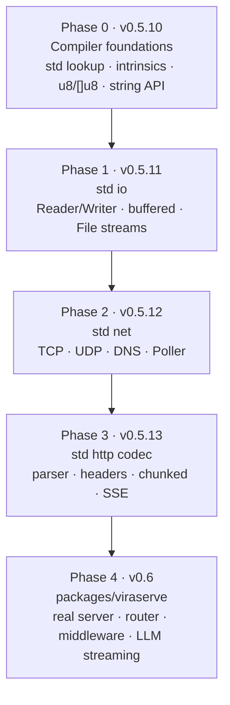
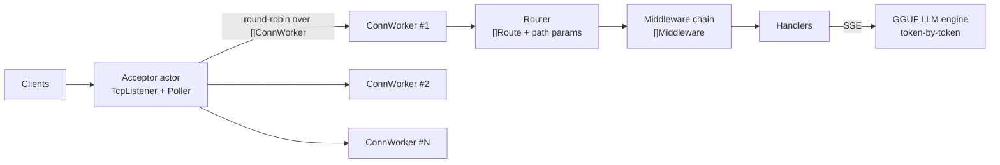

# Plan: Built-in Standard Packages (`io`, `net` TCP/UDP) → then ViraServe (v0.6)

## Goal

1. Ship a **standard library** in [`packages/`](file:///mnt/flutter_drive/vira/packages) that comes with the compiler (like `runtime/`).
2. Build **low-level packages first**: `io`, `net` (TCP + UDP + DNS + polling).
3. Rebuild **ViraServe as its own package** on top of them, with real sockets, routing, SSE and LLM streaming.
4. Use native collections (`[]T`, `[N]T`, `for … in`) all through the API.

---

## What I found in the codebase

| Area | Current state | Impact on the plan |
| :--- | :--- | :--- |
| `packages/viraserve` | **Simulated.** `dispatch_request` takes hand-built `Request` objects. No socket is ever opened. Routes are hard-coded `if` chains (`RouteID.home()` …). | Needs a rewrite on top of real `net`. |
| Net builtins | 5 thin wrappers in [vira_rt.h:1237-1350](file:///mnt/flutter_drive/vira/runtime/vira_rt.h#L1237-L1350): `net_listen/accept/read/write/close`. TCP only, IPv4 only, blocking only, no errors (returns `int`). | Replace with a full `runtime/vira_net.h`. |
| Adding a builtin | Takes **3 manual edits**: `checker.go` (`c.functions[...]`), `cgen.go` (`case "net_listen":`), `vira_rt.h`. | Too costly for ~60 net/io functions → add a **std intrinsic binding** mechanism. |
| Strings | Only `.len` and `.contains`. No `index_of`, `substr`, `split`, `starts_with`, `trim`, `to_int`. | HTTP parsing in pure Vira **can't be done today**. |
| Bytes | No `u8` type, so no `[]u8`. | Binary protocols / UDP datagrams need a `[]u8` byte buffer. |
| Slices | Generic over primitives **and structs** (`vira_slice_<Struct>`), with autofree. | ✅ Good fit for `[]IpAddr`, `[]Event`, `[]Header`, `[]Route`. |
| Imports | [main.go:855-899](file:///mnt/flutter_drive/vira/cmd/vira/main.go#L855-L899) merges every imported file into **one flat namespace**. Search order is in [`pkg.ResolveImportCandidates`](file:///mnt/flutter_drive/vira/internal/pkg/manager.go#L80). The LSP keeps its own copy of this logic. | Std packages need a lookup tier. Name clashes are possible (see open question 1). |
| Shipping | `runtime/*.h` is built into the binary with `go:embed` ([embed.go](file:///mnt/flutter_drive/vira/runtime/embed.go)) and extracted to `~/.vira/runtime`. | Use the same approach for `packages/`. |

---

## Phase overview



---

## Phase 0 — Compiler foundations (v0.5.10)

### 0.1 Standard library lookup
- New tier **0** in `ResolveImportCandidates`, in this order:
  1. `$VIRA_ROOT/packages/`
  2. `<exe dir>/packages/`
  3. Embedded copy extracted to `~/.vira/std/<version>/`
- **Reserved std names** (`io`, `net`, `http`, `strings`, `bytes`, `viraserve`) always resolve to std, so a local folder can't shadow them.
- New `packages/embed.go` (`//go:embed */src/*.vir */vira.mod`) plus a `resolveStdDir()` that works like `resolveRuntimeDir()`.
- Mirror the same change in [`internal/lsp/server.go`](file:///mnt/flutter_drive/vira/internal/lsp/server.go) so go-to-definition and hover work on std code.

### 0.2 Std intrinsic bindings (internal FFI, a precursor to v0.7 `extern "C"`)
Let std `.vir` files declare runtime C functions without touching `checker.go` / `cgen.go`:
```v
// packages/net/src/sys.vir
@[intrinsic: 'vira_tcp_connect']
fn sys_tcp_connect(host string, port int) !int
```
- **Parser:** allow an `@[...]` attribute plus a function with no body.
- **Checker:** register the signature. Only allowed in files under the std root, so it is not a public FFI yet.
- **Cgen:** emit a direct call to the named C symbol and wrap `!T` the way existing Result builtins do.

### 0.3 `u8` primitive and `[]u8` byte buffers
- Add `PrimU8` in [types.go](file:///mnt/flutter_drive/vira/internal/checker/types.go). Add `VIRA_DEFINE_SLICE(u8, uint8_t)` in the runtime.
- Builtins: `[]u8.to_string()`, `string.bytes() []u8`, `[]u8.append_slice(other)`, `[]u8.slice_copy(start, end)`.

### 0.4 String API (needed for protocol parsing)
`index_of`, `last_index_of`, `substr(start, end)`, `starts_with`, `ends_with`, `split(sep) []string`, `trim`, `to_lower`, `to_upper`, `to_int() !int`, `to_i64() !i64`, `replace`, `repeat`.
- Each one is checked by autofree. New strings are heap-owned. `[]string` results are freed through `CleanupSlice`.
- Leave the old `net_*` builtins in place as deprecated shims, so existing examples and tests still pass.

---

## Phase 1 — `packages/io` (v0.5.11)

```
packages/io/
├── vira.mod
├── README.md
├── src/
│   ├── traits.vir      // Reader, Writer, Closer interfaces
│   ├── buffered.vir    // BufReader, BufWriter
│   ├── file.vir        // File handle: open/create/read/write/seek/close
│   ├── std_streams.vir // stdin(), stdout(), stderr()
│   ├── util.vir        // copy(), read_all(), read_line(), write_all()
│   └── sys.vir         // @[intrinsic] bindings → runtime/vira_io.h
├── tests/io_test.vir
└── examples/copy_file.vir
```

**Core API** (structural interfaces, so any type with matching methods qualifies):
```v
pub interface Reader { mut: read(mut buf []u8, max int) !int }   // returns 0 at EOF
pub interface Writer { mut: write(data []u8) !int }
pub interface Closer { mut: close() ! }

pub struct BufReader { … }
pub fn BufReader.new(r Reader, cap int) BufReader
pub fn (mut b BufReader) read_line() !string
pub fn (mut b BufReader) read_until(delim u8) ![]u8
pub fn (mut b BufReader) lines() ![]string     // collection result

pub fn File.open(path string) !File
pub fn File.create(path string) !File
pub fn (mut f File) seek(offset i64, whence int) !i64
```

Runtime: new `runtime/vira_io.h` with POSIX `open/read/write/lseek` and Win32 `CreateFile/ReadFile`.

---

## Phase 2 — `packages/net` (v0.5.12): TCP, UDP, DNS, polling

```
packages/net/
├── src/
│   ├── addr.vir   // IpAddr (v4/v6), SocketAddr, parse/format
│   ├── dns.vir    // resolve(host) ![]IpAddr   (getaddrinfo)
│   ├── tcp.vir    // TcpListener, TcpStream (implements io.Reader/Writer/Closer)
│   ├── udp.vir    // UdpSocket, Datagram
│   ├── poll.vir   // Poller (epoll / kqueue / WSAPoll), Event
│   ├── options.vir// timeouts, nodelay, reuseaddr, nonblocking, buffer sizes
│   ├── errors.vir // error codes: refused, timeout, would_block, addr_in_use…
│   └── sys.vir    // @[intrinsic] → runtime/vira_net.h
├── tests/ (tcp_echo_test.vir, udp_loopback_test.vir, dns_test.vir, poll_test.vir)
└── examples/ (tcp_echo_server.vir, tcp_client.vir, udp_chat.vir, poller_server.vir)
```

### TCP
```v
pub fn TcpListener.bind(addr string) !TcpListener            // "0.0.0.0:8080", "[::]:8080"
pub fn (mut l TcpListener) accept() !TcpStream
pub fn (mut l TcpListener) set_nonblocking(on bool) !
pub fn (l TcpListener) local_addr() SocketAddr
pub fn (mut l TcpListener) close() !

pub fn TcpStream.connect(addr string) !TcpStream
pub fn TcpStream.connect_timeout(addr string, ms int) !TcpStream
pub fn (mut s TcpStream) read(mut buf []u8, max int) !int
pub fn (mut s TcpStream) read_string(max int) !string
pub fn (mut s TcpStream) write(data []u8) !int
pub fn (mut s TcpStream) write_all(data []u8) !
pub fn (mut s TcpStream) write_str(msg string) !
pub fn (mut s TcpStream) set_read_timeout(ms int) !
pub fn (mut s TcpStream) set_nodelay(on bool) !
pub fn (mut s TcpStream) shutdown(how int) !
pub fn (s TcpStream) peer_addr() SocketAddr
```

### UDP
```v
pub struct Datagram { pub: data []u8  from SocketAddr }

pub fn UdpSocket.bind(addr string) !UdpSocket
pub fn (mut u UdpSocket) send_to(data []u8, addr string) !int
pub fn (mut u UdpSocket) recv_from(max int) !Datagram
pub fn (mut u UdpSocket) connect(addr string) !          // fixed peer
pub fn (mut u UdpSocket) set_broadcast(on bool) !
pub fn (mut u UdpSocket) join_multicast(group string) !
```

### Poller (non-blocking event loop, the base layer for ViraServe)
```v
pub struct Event { pub: fd int  readable bool  writable bool  hangup bool }
pub fn Poller.new() !Poller
pub fn (mut p Poller) add(fd int, read bool, write bool) !
pub fn (mut p Poller) modify(fd int, read bool, write bool) !
pub fn (mut p Poller) remove(fd int) !
pub fn (mut p Poller) wait(timeout_ms int) ![]Event      // returns a slice of ready events
```

### Runtime work (`runtime/vira_net.h`)
- Move the existing socket code out of `vira_rt.h`. Add IPv6 via `getaddrinfo`, `SO_REUSEADDR`, `TCP_NODELAY`, `SO_RCVTIMEO`.
- Map `errno` / `WSAGetLastError` to stable Vira error strings.
- `epoll` on Linux, `kqueue` on macOS/BSD, `WSAPoll` on Windows.
- Ignore `SIGPIPE` on POSIX so a dead peer can't kill the process.
- Must keep `active_leaks=0`. Byte buffers come from the slice allocator, so actor arenas still clean up in O(1).

---

## Phase 3 — `packages/http` codec (v0.5.13)

This is a transport-agnostic HTTP/1.1 codec. ViraServe uses it, and a future HTTP client can reuse it.
- `Header` / `Headers` (`[]Header`, case-insensitive `get`/`set`/`has`)
- `parse_request(raw []u8) !Request`: request line, headers, `Content-Length`, chunked body, query string → `[]QueryParam`
- `ResponseWriter`: status, headers, body, `Connection: keep-alive`
- `SseWriter`: `text/event-stream`, `send(event, data)`, flush per token
- Limits for header size and body size, to protect against slowloris and oversized bodies

---

## Phase 4 — `packages/viraserve` rewrite (v0.6, the roadmap's "Phase 1")



- **Real I/O:** `app.listen(':8080')`. Requests come from `net.TcpStream` and are parsed with `http.parse_request`.
- **Router:** `[]Route{method, pattern, handler}` with dynamic params (`/v1/users/:id`) and `[]PathParam` results. This replaces the hard-coded `RouteID` `if` chains.
- **Middleware:** an interface `Middleware { mut: handle(mut ctx Context) ! }` stored in `[]Middleware`. Includes CORS, bearer auth, request timing and access logging.
- **Connection pool:** one acceptor/poller loop plus `[]ConnWorker` actors. Workers keep connections alive. Supervisor restarts are reused for crashed handlers.
- **SSE / LLM streaming:** `POST /v1/chat/completions` uses an OpenAI-compatible SSE format and streams GGUF tokens.
- **`json_encode`:** a struct-to-JSON builtin for OpenAI-shaped responses.
- **Graceful shutdown** and live telemetry (keep the current `ServerStats`).

---

## Verification (per the ROADMAP quality table)

| Layer | How |
| :--- | :--- |
| Compiler (Phase 0) | `go test ./...` with new parser/checker/cgen tests for intrinsics, `u8`, and string methods |
| std packages | `vira test packages/<pkg>`. Every test asserts `active_leaks=0`. |
| Networking | Loopback tests: TCP echo round-trip, UDP send/recv, poller with 1k connections, connect-refused and timeout errors |
| Memory | `-sanitize` (ASan/UBSan) runs on the net tests |
| Cross-platform | Linux (epoll), macOS (kqueue), Windows/MinGW (WSAPoll) |
| ViraServe | `curl`/`wrk` load test, SSE stream checked with `curl -N` |
| Docs | Each phase ships a **tutorial and a runnable example** (`docs/tutorials/28_…`, `docs/examples/29_…`) and updates `ROADMAP.md` |

---

## Open questions

1. **Namespacing.** Imports currently merge into one flat namespace.
   - **(A, recommended for now)** Flat names with clear prefixes: `TcpStream`, `UdpSocket`, `BufReader`, `http_parse_request`. Fast, and no compiler rewrite needed.
   - **(B)** Qualified access (`net.TcpStream`, `io.copy()`) with name mangling such as `net__TcpStream`. Cleaner for a real stdlib, but it is a big checker/cgen/LSP change that would add roughly one phase.
2. **Concurrency model for sockets.** Blocking calls inside actors tie up a Chase-Lev worker thread (the pool is capped at 16). The plan provides **both** blocking APIs and a `Poller`, and ViraServe uses the Poller. Is that OK?
3. **Socket cleanup.** Should `TcpStream`/`UdpSocket` be **closed automatically by autofree** at scope exit (RAII-style)? The alternative is an explicit `close()`. Auto-close needs a "resource" escape rule so a stream can move into an actor.
4. **Where `http` lives.** As a separate std package (recommended, reusable for a future client), or inside `viraserve`?
5. **Naming.** The roadmap says **"VexServe"** but the package is `viraserve`. Should I rename the roadmap entry to **ViraServe**?
