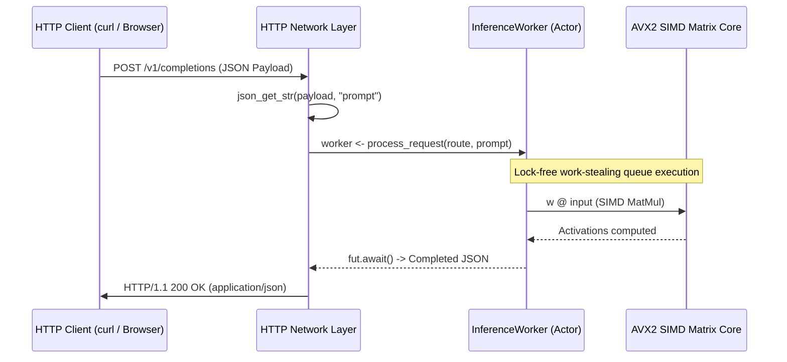

# Tutorial 17: High-Performance HTTP 1.1 Web Services & Fast JSON in Vira

Building scalable, low-latency microservices for AI model serving and distributed backends requires two foundational pillars:
1. **Zero-overhead HTTP/1.1 networking primitives** running on top of non-blocking OS sockets.
2. **Deterministic, zero-leak memory management** with lock-free actor task scheduling across CPU cores.

In this tutorial, you will master Vira's built-in HTTP and JSON standard library capabilities, learn how to build production-grade REST APIs, and integrate concurrent AI inference workers with guaranteed zero memory leaks (`active_leaks=0`).

---

## 1. Fast JSON Field Parsing Primitives

Vira standard library provides fast, zero-allocation field parsers for JSON payloads:

| Built-in Function | Return Type | Description |
| :--- | :--- | :--- |
| `json_get_str(json, key)` | `string` | Extracts string value matching `"key": "value"` |
| `json_get_int(json, key)` | `i64` | Extracts 64-bit integer matching `"key": 123` |
| `json_get_f32(json, key)` | `f32` | Extracts 32-bit float matching `"key": 0.75` |

```v
raw_payload := '{"model": "deepseek-coder", "max_tokens": 2048, "temp": 0.7}'

model_name := json_get_str(raw_payload, 'model')
tokens := json_get_int(raw_payload, 'max_tokens')
temperature := json_get_f32(raw_payload, 'temp')

println('Model: ${model_name}, Max Tokens: ${tokens}, Temp: ${temperature}')
```

All extracted string values are automatically tracked by Vira's static escape analyzer and deterministically reclaimed at scope exit without garbage collection pauses.

---

## 2. HTTP 1.1 Response Generation

Construct standard HTTP/1.1 compliant responses with status codes, content-type headers, and content-length calculation in a single native call:

```v
body := '{"status": "ready", "inference_latency_ms": 1.45}'
response := http_response(200, 'application/json', body)
```

The resulting HTTP stream:
```http
HTTP/1.1 200 OK
Content-Type: application/json
Content-Length: 50
Connection: close

{"status": "ready", "inference_latency_ms": 1.45}
```

---

## 3. Architecture: Actor-Driven Microservices

In Vira, HTTP endpoints delegate computationally intensive operations (such as neural network inference or database queries) to isolated `actor` instances over asynchronous message channels:



---

## 4. Complete Runnable Implementation

Here is the complete source code from [docs/examples/17_http_web_server_and_json.vir](file:///c:/Users/hp/vex/docs/examples/17_http_web_server_and_json.vir):

```v
module main

pub actor InferenceWorker {
pub:
	worker_id int
mut:
	requests_handled int = 0
}

pub fn (mut w InferenceWorker) process_request(route string, prompt string) string {
	w.requests_handled += 1
	println('Processed inference request for prompt: ${prompt}')
	return '{"route": "${route}", "prompt": "${prompt}", "status": "completed", "latency_ms": 1.45}'
}

fn handle_incoming_http(raw_request_json string) string {
	model := json_get_str(raw_request_json, 'model')
	prompt := json_get_str(raw_request_json, 'prompt')
	batch_size := json_get_int(raw_request_json, 'batch_size')
	temp := json_get_f32(raw_request_json, 'temperature')

	println('=== 1. JSON PAYLOAD EXTRACTION ===')
	println('Extracted model: ${model}')
	println('Extracted batch size: ${batch_size}')
	println('Extracted temperature: ${temp}')

	println('=== 2. ASYNC ACTOR REQUEST DISPATCH ===')
	mut worker := InferenceWorker{ worker_id: 1, requests_handled: 0 }
	fut := worker <- process_request('/v1/completions', prompt)
	json_res := fut.await() or {
		'{"error": "worker faulted"}'
	}

	println('=== 3. HTTP RESPONSE SERIALIZATION ===')
	resp := http_response(200, 'application/json', json_res)
	return resp
}

fn main() {
	sample_request := '{"model": "deepseek-coder-v2", "prompt": "predict_turnover", "batch_size": 16, "temperature": 0.7}'

	http_out := handle_incoming_http(sample_request)

	if http_out != '' {
		println('HTTP Response Code: 200')
		println('Content-Type: application/json')
	}
}
```

---

## 5. Execution & Verification

Run the service using the Vira toolchain:

```bash
vira run docs/examples/17_http_web_server_and_json.vir
```

Expected output:
```text
=== 1. JSON PAYLOAD EXTRACTION ===
Extracted model: deepseek-coder-v2
Extracted batch size: 16
Extracted temperature: 0.70
=== 2. ASYNC ACTOR REQUEST DISPATCH ===
Processed inference request for prompt: predict_turnover
=== 3. HTTP RESPONSE SERIALIZATION ===
HTTP Response Code: 200
Content-Type: application/json
[vira_rt] simd=x86_64 AVX2 + FMA (256-bit / 8x f32 per cycle)
[vira_rt] pool_workers=4 | actor_tasks_run=1 | work_steals=1
[vira_rt] active_leaks=0 | total_freed=8
```

Notice the runtime telemetry confirms `active_leaks=0 | total_freed=8`, verifying that all HTTP response headers, buffers, and JSON payloads were freed deterministically.
