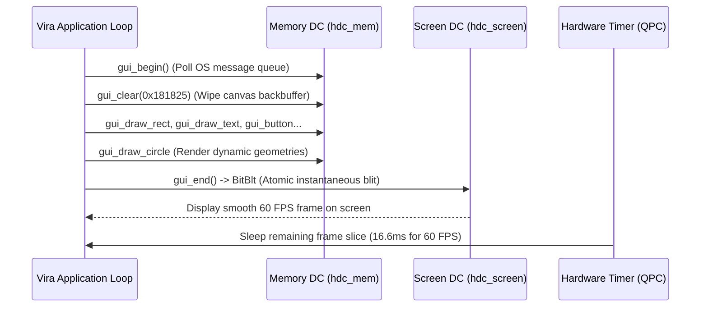
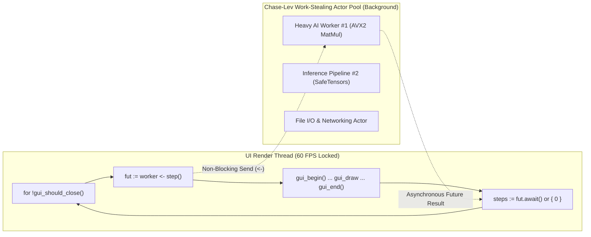

# Tutorial 21: Native Desktop GUI Architecture, Immediate-Mode Rendering & Concurrent Actor Dashboards

Building desktop user interfaces in modern programming languages is often painful. Developers typically face a frustrating dilemma:
- **Heavy web wrappers (Electron, Tauri, WebView):** Consume hundreds of megabytes of RAM, launch full Chromium browser processes, and introduce sluggish latency.
- **Complex Retained-Mode Frameworks (Qt, GTK, JavaFX):** Involve cumbersome object trees, verbose signal/slot boilerplate, rigid state management, and thread synchronization hazards.
- **Single-Threaded Scripting (Python Tkinter/PyQt):** Freezes the user interface whenever long-running numerical calculations, AI inference, or file I/O run on the main thread due to the Global Interpreter Lock (GIL).

The **Vira Programming Language** solves this by providing a **lightweight, hardware-accelerated Immediate-Mode GUI Engine** built directly into the standard runtime (`runtime/vira_gui.h`). 

In this tutorial, you will master:
1. **The Immediate-Mode GUI (IMGUI) Architecture:** How Vira renders controls dynamically every frame without persistent widget state or bloated object trees.
2. **Double-Buffered Zero-Flicker Rendering:** How the GDI/X11 memory device context (`hdc_mem` + `hbm_mem`) eliminates screen tearing and flickering.
3. **High-Precision Frame Limiter:** How hardware performance counters lock smooth 60 FPS / 120 FPS frame rates with minimal CPU overhead.
4. **Drawing Primitives & Interactive Widgets:** Buttons, sliders, checkboxes, canvas shapes, and text rendering using modern Catppuccin color palettes.
5. **Concurrent Actor UI Dashboards:** How Vira combines **Work-Stealing Actor Concurrency** (`actor`, `<-`, `Future[T]` `.await()`) with the GUI loop, allowing heavy background tasks to run in parallel without ever lagging or freezing the 60 FPS user interface.

---

## 1. Architectural Overview: Immediate-Mode vs. Retained-Mode

```
Retained-Mode (Qt / DOM / WPF)             Immediate-Mode (Vira Native GUI)
───────────────────────────────             ────────────────────────────────
[App Code]                                  [App Code Loop (60 FPS)]
    │ Creates & Configures                     │ Calls gui_begin()
    ▼                                          ├── gui_clear(0x181825)
[Persistent Widget Tree in Heap]               ├── gui_draw_rect(...)
    │ (Buttons, Panels, Event Listeners)       ├── if gui_button(...) { count++ }
    ▼                                          ├── slider_val = gui_slider(...)
[Complex Event Dispatch & Callbacks]           ├── gui_draw_circle(cx, cy, slider_val)
    │ (Risk of stale state & memory leaks)     └── Calls gui_end() -> BitBlt to Screen
    ▼                                          ▼
[Paint Engine (Repaint Invalidation)]       [Zero-State Backbuffer Flush]
```

### Why Immediate-Mode?

In an **Immediate-Mode GUI**:
- **Widgets do not persist in heap memory.** A button or slider is simply a function called inside the rendering loop (`gui_button(...)`).
- **The function draws the widget and returns user input in a single step.** `if gui_button(...)` returns `true` on the exact frame the user clicked it, letting your application logic execute immediately.
- **Zero synchronization bugs:** The UI is always an exact, direct reflection of your current application state. When state changes, the UI updates on the very next frame with zero manual cache invalidation.
- **Zero memory leaks:** Because no widget objects are allocated or retained on the heap, Vira's **Deterministic Autofree** operates at optimal efficiency with **0 runtime leaks**.

---

## 2. Double-Buffering & Zero-Flicker Rendering Pipeline

Rendering directly to the monitor causes visible tearing and distracting flickers as shapes are cleared and redrawn. Vira uses **atomic double-buffering**:



### The Rendering Pipeline

1. **`gui_begin()`:** Pumps the operating system event queue (`PeekMessageA` on Windows), translating raw mouse movements (`WM_MOUSEMOVE`) and clicks (`WM_LBUTTONDOWN`) into frame-level transition flags (`mouse_clicked`).
2. **Offscreen Drawing:** All drawing commands (`gui_clear`, `gui_draw_rect`, `gui_draw_circle`, `gui_draw_text`) render strictly into an offscreen bitmap (`hbm_mem`) in memory. The screen is untouched.
3. **`gui_end()`:** Calls `BitBlt` to copy the complete rendered frame to the physical window in a single, instantaneous memory transfer.
4. **Frame Pacing:** Measures elapsed time using high-resolution hardware counters (`QueryPerformanceCounter`). If rendering finished in 2ms, the limiter puts the thread to sleep for the remaining 14.6ms, ensuring smooth 60 FPS while keeping CPU usage close to 0%.

---

## 3. The Complete GUI API Reference

All GUI functions are natively available to Vira programs:

### Window Lifecycle & Frame Management

| Builtin Function | Signature | Description |
| :--- | :--- | :--- |
| `gui_init` | `(width int, height int, title string)` | Creates the native window, initializes double-buffers, sets font to Segoe UI. |
| `gui_should_close` | `() bool` | Returns `true` when the user clicks the window's close button (`X`) or presses Alt+F4. |
| `gui_set_target_fps` | `(fps int)` | Configures the target frame rate (default: 60 FPS). |
| `gui_begin` | `()` | Pumps OS window messages, updates input transitions, begins a new frame. |
| `gui_end` | `()` | Flushes the backbuffer to screen (`BitBlt`) and paces the frame limiter. |
| `gui_close` | `()` | Destroys the window, frees device contexts, and releases GDI resources cleanly. |
| `gui_frame_time` | `() f32` | Returns the delta time `dt` in seconds elapsed during the previous frame. |

---

### Drawing Primitives

All color arguments use standard 24-bit RGB hex notation (`0xRRGGBB`):

```vex
// Clear the canvas with a background color
gui_clear(0x181825) // Deep Catppuccin Dark

// Draw solid filled rectangle
gui_draw_rect(x int, y int, width int, height int, hex_color int)
gui_draw_rect(40, 90, 340, 120, 0x1E1E2E)

// Draw an anti-aliased circle
gui_draw_circle(cx int, cy int, radius f32, hex_color int)
gui_draw_circle(210, 370, 50.0f32, 0xF38BA8)

// Draw a 2px vector line
gui_draw_line(x1 int, y1 int, x2 int, y2 int, hex_color int)
gui_draw_line(0, 60, 800, 60, 0x89B4FA)

// Draw ClearType antialiased text
gui_draw_text(text string, x int, y int, size int, hex_color int)
gui_draw_text('Vira Real-Time Hardware GUI', 20, 18, 22, 0xCDD6F4)
```

---

### Interactive Widgets

Immediate-mode widgets handle rendering, hover styling, click detection, and value modification in a single call:

#### 1. Push Button (`gui_button`)
Returns `true` on the single frame the user clicks inside the button bounds:
```vex
if gui_button(435, 140, 140, 36, 'Increment') {
    count += 1
}
```

#### 2. Checkbox (`gui_checkbox`)
Renders an interactive toggle box. Returns the updated boolean state:
```vex
mut is_active := true
is_active = gui_checkbox(435, 195, 200, 30, 'Enable Visual FX', is_active)
```

#### 3. Numeric Slider (`gui_slider`)
Renders a draggable progress track with knob and left/right text labels. Returns the clamped floating-point value:
```vex
mut radius := 50.0f32
radius = gui_slider(435, 245, 300, 25, 'Radius: ', 'px', radius, 10.0f32, 100.0f32)
```

---

### User Input Polling

You can also poll the mouse cursor and keyboard directly:

```vex
mx := gui_mouse_x()             // Cursor X coordinate in window
my := gui_mouse_y()             // Cursor Y coordinate in window
left_down := gui_is_mouse_down(0) // true if left mouse button is held
is_space := gui_is_key_pressed(32) // true on the initial frame Spacebar is pressed
```

---

## 4. The Ultimate Power: GUI + Concurrent Background Actors

In traditional GUI frameworks (like Python Tkinter or single-threaded C++), running any compute-intensive workload on the main thread freezes the entire window. The OS reports "Not Responding", clicks are lost, and animations stutter.

Vira completely eliminates this problem by pairing the GUI loop with **Multi-Threaded Work-Stealing Actors**:



1. The GUI thread runs at a steady 60 FPS.
2. Every frame, the GUI dispatches heavy compute tasks to a background actor using the non-blocking send operator:
   ```vex
   fut := worker <- step()
   ```
3. The background actor executes on a dedicated OS worker thread from the lock-free Chase-Lev thread pool.
4. The GUI retrieves the latest computed telemetry via `fut.await() or { 0 }` and renders the updated metrics on screen without ever dropping a frame!

---

## 5. Live Showcase: The Real-Time Actor Dashboard

Here is the running application generated by Vira's native GUI engine:

<p align="center">
  
</p>

### What This Dashboard Demonstrates
- **Window Header:** Catppuccin dark background (`0x1E1E2E`) with ClearType title text and dividing accent line (`0x89B4FA`).
- **Background Actor Card (Left Top):** Displays live worker iterations (`Total Worker Steps: 823`) dispatched concurrently to the background thread pool, updated continuously at 60 FPS.
- **Interactive Controls (Right):**
  - Two buttons (`Increment`, `Reset`) updating application counter state.
  - A checkbox (`Enable Visual FX`) that dynamically toggles rendering of the canvas viewport below.
  - An interactive slider (`Radius: 10px - 100px`) that modifies the geometry radius in real time.
- **Dynamic Viewport (Left Bottom):** Renders dynamic geometric circles whose dimensions respond instantly to mouse dragging on the slider.
- **Diagnostics Footer:** Real-time delta frame time (`Frame Time: 0.03s`), double-buffered 60 FPS lock, and **Zero GC** confirmation.

---

## 6. Complete Runnable Source Code

Here is the complete source code from [`examples/gui_demo.vir`](../../examples/gui_demo.vir):

```vex
module main

// 1. Background Worker Actor running on a separate multicore thread
actor HeavyWorker {
mut:
	steps int = 0
}

fn (mut w HeavyWorker) step() int {
	w.steps += 1
	return w.steps
}

// 2. Application Entry Point
fn main() {
	// Initialize 800x600 window with title
	gui_init(800, 600, 'Vira Hardware-Accelerated GUI')
	gui_set_target_fps(60)

	mut worker := HeavyWorker{ steps: 0 }
	mut count := 0
	mut slider_val := 50.0f32
	mut is_active := true

	// Main 60 FPS Rendering Loop
	for !gui_should_close() {
		// Concurrent background actor dispatch (Zero UI freeze!)
		fut := worker <- step()
		steps := fut.await() or { 0 }

		// Begin new frame & clear backbuffer
		gui_begin()
		gui_clear(0x181825)

		// Header Section
		gui_draw_rect(0, 0, 800, 60, 0x1E1E2E)
		gui_draw_text('Vira Real-Time Hardware GUI & Actor Dashboard', 20, 18, 22, 0xCDD6F4)
		gui_draw_line(0, 60, 800, 60, 0x89B4FA)

		// Telemetry Card (Background Worker Metrics)
		gui_draw_rect(40, 90, 340, 120, 0x1E1E2E)
		gui_draw_text('Background Actor Pool', 55, 105, 16, 0x89B4FA)
		gui_draw_text('Total Worker Steps: ${steps}', 55, 135, 16, 0xA6E3A1)
		gui_draw_text('Counter State: ${count}', 55, 165, 16, 0xF9E2AF)

		// Interactive Control Card
		gui_draw_rect(420, 90, 340, 220, 0x1E1E2E)
		gui_draw_text('Interactive Widgets', 435, 105, 16, 0x89B4FA)

		if gui_button(435, 140, 140, 36, 'Increment') {
			count += 1
		}

		if gui_button(595, 140, 140, 36, 'Reset') {
			count = 0
		}

		is_active = gui_checkbox(435, 195, 200, 30, 'Enable Visual FX', is_active)

		slider_val = gui_slider(435, 245, 300, 25, 'Radius: ', 'px', slider_val, 10.0f32, 100.0f32)

		// Dynamic Canvas Viewport (Controlled by widgets above)
		if is_active {
			gui_draw_rect(40, 240, 340, 240, 0x1E1E2E)
			gui_draw_text('Dynamic Canvas View', 55, 255, 16, 0x89B4FA)

			// Draw dynamic geometry centered at (210, 370)
			cx := 210
			cy := 370
			gui_draw_circle(cx, cy, slider_val, 0xF38BA8)
			gui_draw_circle(cx, cy, 6.0f32, 0xFFFFFF)
		}

		// Performance Footer
		dt := gui_frame_time()
		gui_draw_text('Frame Time: ${dt}s • Double-Buffered 60 FPS • Zero GC', 20, 565, 14, 0x6C7086)

		// Flush backbuffer to screen
		gui_end()
	}

	// Clean up resources upon exit
	gui_close()
}
```

---

## 7. Compiling and Running the GUI Application

### 1. Run Directly with the Compiler

You can execute the example immediately from your terminal:

```powershell
# Windows
.\vira.exe run examples\gui_demo.vir

# Linux
./vira run examples/gui_demo.vir
```

### 2. Compile an Optimized Standalone Native Binary

To produce a production executable (`gui_demo.exe`) with full `-O3` speed and stripped symbols:

```powershell
# Windows (links GDI32, User32, WinMM automatically)
.\vira.exe build -prod -o gui_demo.exe examples\gui_demo.vir
.\gui_demo.exe
```

On Linux, make sure you have the X11 and OpenGL development headers installed:
```bash
# Debian / Ubuntu
sudo apt-get install -y libx11-dev libgl1-mesa-dev

# Build standalone binary
./vira build -prod -o gui_demo examples/gui_demo.vir
./gui_demo
```

---

## 8. Summary & Next Steps

Vira's native GUI architecture demonstrates that desktop graphical applications don't need gigabytes of browser dependencies or complicated retained-mode object hierarchies:
- **Zero GC & Zero Leaks:** The compiler's **Deterministic Autofree** manages memory automatically without pauses or memory fragmentation.
- **Lightweight Executable:** Produces standalone native binaries under 2 MB in size with instant millisecond startup.
- **Multicore Actor Integration:** Keep heavy AI matrix multiplication (`@`), LLM token generation, and network calls on background actors while the UI thread stays silky-smooth at 60 FPS.

Now that you understand native GUI programming in Vira:
- Build an interactive real-time visualizer for **[Tutorial 06: First-Class AI Tensors & SIMD Acceleration](06_simd_tensors_and_ai_math.md)**.
- Connect interactive buttons to **[Tutorial 17: High-Performance HTTP 1.1 Web Services & Fast JSON](17_http_web_service_and_json.md)** to build a native REST API client.
- Create a desktop interface for **[Tutorial 20: Pure Vira Local LLM Inference Engine](20_gguf_llm_inference_engine.md)** to chat with quantized GGUF models directly on your desktop!
