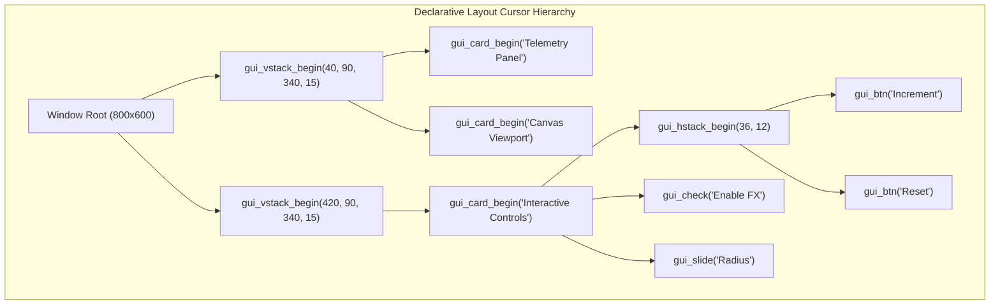

# Tutorial 22: Declarative GUI Auto-Layout Engine: VStacks, HStacks, Auto-Cards & Zero-Math Widget Composition

In [Tutorial 21](21_native_gui_desktop_applications.md), you learned the fundamentals of Vira's native Immediate-Mode GUI (IMGUI) engine: window lifecycle, double-buffering, performance counters, and basic shape rendering.

However, in primitive immediate-mode interfaces, developers often have to manually calculate `(x, y, width, height)` coordinates for every button, label, and card:
```vex
// The tedious manual way:
gui_draw_rect(40, 90, 340, 120, 0x1E1E2E)
gui_draw_text('Title', 55, 105, 16, 0x89B4FA)
gui_button(435, 140, 140, 36, 'Increment') // Calculating 435, 140 by hand!
```
Manual coordinate math is fragile, tedious, and breaks as soon as labels change or the window resizes.

In this tutorial, you will master **Vira's Declarative Auto-Layout Engine**:
1. **Vertical Stacks (`gui_vstack_begin`) & Horizontal Rows (`gui_hstack_begin`):** How layout containers automatically place and space child elements.
2. **Auto-Sized Cards (`gui_card_begin`):** Automatic background containers with title headers and internal padding.
3. **Auto-Positioned Widgets (`gui_btn`, `gui_check`, `gui_slide`, `gui_lbl`):** Controls that take their dimensions from the enclosing layout container without manual coordinates.
4. **Zero-Allocation Architecture:** How the layout cursor operates on an in-memory stack wiped in O(1) time every frame—with **0 heap allocations** and **0 GC pauses**.

---

## 1. How the Layout Cursor Stack Works

Instead of creating persistent widget tree objects in the heap (like Flutter or Qt), Vira maintains an internal **Layout Cursor Stack** inside the GUI runtime context (`runtime/vira_gui.h`):

```
Frame Begin (gui_begin) -> layout_depth = 0
│
├── gui_vstack_begin(x: 40, y: 90, width: 340, spacing: 15)  [Stack Level 1: VStack]
│   │
│   ├── gui_card_begin('Telemetry Panel')                    [Stack Level 2: Card (Nested VStack)]
│   │   ├── gui_lbl('Line 1')   --> placed at cur_x, cur_y; cur_y advances
│   │   ├── gui_lbl('Line 2')   --> placed at cur_x, cur_y; cur_y advances
│   │   └── gui_card_end()      --> pops Level 2; advances parent Level 1 cur_y
│   │
│   └── gui_stack_end()         --> pops Level 1
```



### The In-Memory Cursor Rules
1. **Vertical Stacks (`VStack`):** Each child is placed at `(cur_x, cur_y)`. When the child finishes rendering, `cur_y` automatically advances by `height + spacing`.
2. **Horizontal Rows (`HStack`):** Children are placed side-by-side along the row. `cur_x` automatically advances by `width + spacing`.
3. **Closing a Stack (`gui_stack_end()`):** When a nested stack closes, it reports the total consumed area to its parent, and the parent cursor advances automatically!

---

## 2. Declarative Layout API Reference

### Layout Containers

| Function | Signature | Description |
| :--- | :--- | :--- |
| `gui_vstack_begin` | `(x int, y int, width int, spacing int)` | Begins a vertical layout column. Children stack downwards automatically. |
| `gui_hstack_begin` | `(height int, spacing int)` | Begins a horizontal row of the specified height. Children arrange left-to-right. |
| `gui_stack_end` | `()` | Closes the current layout stack and advances the parent container cursor. |
| `gui_card_begin` | `(title string, width int)` | Renders a styled dark container panel (`0x1E1E2E`) with a header and 15px internal padding. |
| `gui_card_end` | `()` | Closes the card container. |
| `gui_spacing` | `(pixels int)` | Adds custom spacing along the active stack axis. |

---

### Auto-Positioned Widgets (Zero Coordinate Arguments!)

Unlike primitive widgets that require `(x, y, width, height)`, auto-widgets determine their position and size from the active layout container:

#### 1. Push Button: `gui_btn(label string) bool`
- In a `VStack`: Automatically stretches to full container width with 36px height.
- In a `HStack`: Divides space evenly across the row.
- Returns `true` on the single frame clicked:
```vex
if gui_btn('Increment (+1)') {
    count += 1
}
```

#### 2. Checkbox: `gui_check(label string, checked bool) bool`
- Auto-positions vertically with hover animations and a green active indicator (`0xA6E3A1`).
- Returns the updated boolean:
```vex
is_active = gui_check('Enable Dynamic Canvas FX', is_active)
```

#### 3. Draggable Slider: `gui_slide(left string, right string, val f32, min f32, max f32) f32`
- Auto-positions track bar, draggable thumb knob, and left/right labels.
- Returns the updated clamped floating-point value:
```vex
slider_val = gui_slide('Radius: ', 'px', slider_val, 10.0f32, 100.0f32)
```

#### 4. Text Label: `gui_lbl(text string)`
- Renders Segoe UI ClearType text at the current cursor and advances `cur_y` by 22px:
```vex
gui_lbl('Active Counter Value: ${count}')
```

---

## 3. Side-by-Side Comparison

Look how much simpler, cleaner, and less error-prone the declarative auto-layout style is:

### Before: Imperative Manual Coordinates
```vex
// Requires manual calculation of every coordinate:
gui_draw_rect(420, 90, 340, 220, 0x1E1E2E)
gui_draw_text('Interactive Widgets', 435, 105, 16, 0x89B4FA)

if gui_button(435, 140, 140, 36, 'Increment') { count += 1 }
if gui_button(595, 140, 140, 36, 'Reset')     { count = 0 }

is_active = gui_checkbox(435, 195, 200, 30, 'Enable Visual FX', is_active)
slider_val = gui_slider(435, 245, 300, 25, 'Radius: ', 'px', slider_val, 10.0f32, 100.0f32)
```

### After: Declarative Auto-Layout
```vex
// Clean, hierarchical, and ZERO manual coordinates:
gui_vstack_begin(420, 90, 340, 15)
    gui_card_begin('Interactive Control Center', 340)
        // Auto-aligned 2-button row!
        gui_hstack_begin(36, 12)
            if gui_btn('Increment (+1)') { count += 1 }
            if gui_btn('Reset (0)')      { count = 0 }
        gui_stack_end()

        gui_spacing(10)
        is_active = gui_check('Enable Dynamic Canvas FX', is_active)

        gui_spacing(10)
        slider_val = gui_slide('Radius: ', 'px', slider_val, 10.0f32, 100.0f32)
    gui_card_end()
gui_stack_end()
```

---

## 4. Complete Runnable Program Walkthrough

Here is the complete source code from [`docs/examples/21_declarative_gui.vir`](../examples/21_declarative_gui.vir):

```vex
module main

// Vira Declarative Auto-Layout GUI Demonstration
// Features: Vertical Stacks (VStack), Horizontal Rows (HStack), Auto-Cards,
// and auto-positioned buttons, sliders, checkboxes, and labels without manual pixel math.

fn main() {
	gui_init(800, 600, 'Vira Declarative Auto-Layout Engine')
	gui_set_target_fps(60)

	mut count := 0
	mut slider_val := 45.0f32
	mut is_active := true

	for !gui_should_close() {
		gui_begin()
		gui_clear(0x181825)

		// Header Section
		gui_draw_rect(0, 0, 800, 60, 0x1E1E2E)
		gui_draw_text('Vira Declarative Auto-Layout Engine', 20, 18, 22, 0xCDD6F4)
		gui_draw_line(0, 60, 800, 60, 0x89B4FA)

		// ==========================================================
		// COLUMN 1: Telemetry & Canvas (NO MANUAL PIXEL COORDINATES!)
		// ==========================================================
		gui_vstack_begin(40, 90, 340, 15)
			gui_card_begin('System Telemetry Panel', 340)
				gui_lbl('Engine: Double-Buffered Immediate Mode')
				gui_lbl('Target FPS: 60 (Hardware-Locked)')
				gui_lbl('Active Counter Value: ${count}')
				gui_lbl('Circle Radius: ${slider_val}px')
			gui_card_end()

			if is_active {
				gui_card_begin('Dynamic Canvas Viewport', 340)
					gui_spacing(100)
					gui_draw_circle(210, 360, slider_val, 0xF38BA8)
					gui_draw_circle(210, 360, 6.0f32, 0xFFFFFF)
				gui_card_end()
			}
		gui_stack_end()

		// ==========================================================
		// COLUMN 2: Controls & Widgets (NO MANUAL PIXEL COORDINATES!)
		// ==========================================================
		gui_vstack_begin(420, 90, 340, 15)
			gui_card_begin('Interactive Control Center', 340)
				// 2-Column Horizontal Button Row (Auto-arranged!)
				gui_hstack_begin(36, 12)
					if gui_btn('Increment (+1)') {
						count += 1
					}
					if gui_btn('Reset (0)') {
						count = 0
					}
				gui_stack_end()

				gui_spacing(10)
				is_active = gui_check('Enable Dynamic Canvas FX', is_active)

				gui_spacing(10)
				slider_val = gui_slide('Radius: ', 'px', slider_val, 10.0f32, 100.0f32)
			gui_card_end()
		gui_stack_end()

		// Footer Telemetry
		dt := gui_frame_time()
		gui_draw_text('Frame Time: ${dt}s • 0 Heap Allocations • Zero GC', 20, 565, 14, 0x6C7086)

		gui_end()
	}

	gui_close()
}
```

---

## 5. Compiling & Running the Declarative GUI

### Verify Escape Analysis & Mutability Checks

Run the semantic checker to verify zero heap allocations:

```powershell
.\vira.exe check docs\examples\21_declarative_gui.vir
```

Output:
```text
✓ docs/examples/21_declarative_gui.vir passed syntax, 4-quadrant mutability, and type checks (0 errors)

1. Structs Requiring Generated `_autofree` Destructors:

2. Function Escape Analysis & Injected LIFO Destructors:
   [fn main]
     └── (pure stack primitives — 0 heap allocations)
```

### Run Immediately

```powershell
.\vira.exe run docs\examples\21_declarative_gui.vir
```

### Build an Optimized Standalone Binary

```powershell
.\vira.exe build -prod -o declarative_gui.exe docs\examples\21_declarative_gui.vir
.\declarative_gui.exe
```

---

## 6. Summary & Key Advantages

1. **Zero Manual Pixel Math:** Coordinates and element bounds are tracked by the runtime layout cursor.
2. **Zero Compiler Complexity:** Built using Vira's existing procedural language semantics—no risky compiler overhauls needed.
3. **0 Heap Allocations & Zero GC:** Layout nodes are tracked on a fixed 16-level stack in static memory. No objects are allocated on the heap during the 60 FPS animation loop.
4. **Instant Reactivity:** Directly read and mutate your local variables inside `if gui_btn(...)` or `slider_val = gui_slide(...)`.

Continue to **[Tutorial 07: Actor Concurrency & Fault Supervision](07_actor_concurrency_and_supervisors.md)** to learn how to dispatch background machine learning inference from this declarative UI!
