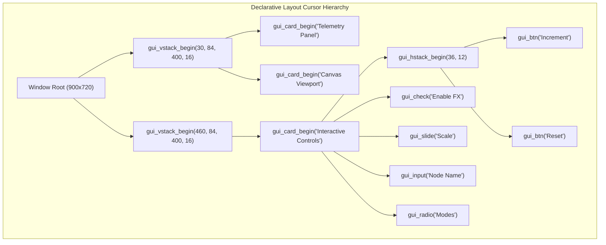

# Tutorial 22: Declarative GUI Auto-Layout Engine: VStacks, HStacks, Auto-Cards & Zero-Math Widget Composition

In [Tutorial 21](21_native_gui_desktop_applications.md), you learned the fundamentals of Vira's native Immediate-Mode GUI (IMGUI) engine: window lifecycle, double-buffering, performance counters, and basic shape rendering.

However, in primitive immediate-mode interfaces, developers often have to manually calculate `(x, y, width, height)` coordinates for every button, label, and card:
```vex
// The tedious manual way:
gui_draw_rect(40, 90, 340, 120, 0x1E1E2E)
gui_draw_text('Title', 55, 105, 16, 0x89B4FA)
gui_button(435, 140, 140, 36, 'Increment') // Calculating 435, 140 by hand!
```
Manual coordinate math is fragile, tedious, and breaks as soon as labels change or the window resizes.

In this tutorial, you will master **Vira's Declarative Auto-Layout Engine**:
1. **Vertical Stacks (`gui_vstack_begin`) & Horizontal Rows (`gui_hstack_begin`):** How layout containers automatically place and space child elements.
2. **Auto-Sized Adaptive Cards (`gui_card_begin`):** Automatic background containers with title headers, adaptive height fitting, and internal padding.
3. **Comprehensive Widget Library:**
   - **Interactive Inputs:** Text inputs (`gui_input`), push buttons (`gui_btn`), toggle checkboxes (`gui_check`), draggable sliders (`gui_slide`), radio buttons (`gui_radio`).
   - **Display & Telemetry:** Text labels (`gui_lbl`), progress bars (`gui_progress`), status badges (`gui_badge`), and section dividers (`gui_separator`).
4. **Zero-Allocation Architecture:** How the layout cursor operates on an in-memory stack wiped in O(1) time every frame—with **0 heap allocations** and **0 GC pauses**.

---

## 1. How the Layout Cursor Stack Works

Instead of creating persistent widget tree objects in the heap (like Flutter, Electron, or Qt), Vira maintains an internal **Layout Cursor Stack** inside the GUI runtime context (`runtime/vira_gui.h`):

```
Frame Begin (gui_begin) -> layout_depth = 0
│
├── gui_vstack_begin(x: 30, y: 84, width: 400, spacing: 16)  [Stack Level 1: VStack]
│   │
│   ├── gui_card_begin('System Telemetry Panel', 400)        [Stack Level 2: Card (Nested VStack)]
│   │   ├── gui_badge('ONLINE', 0x2D4A3E, 0xA6E3A1)          --> placed at cur_x, cur_y; advances cur_y
│   │   ├── gui_lbl('Line 1')                                --> placed at cur_x, cur_y; advances cur_y
│   │   ├── gui_separator()                                  --> draws horizontal 1px line; advances cur_y
│   │   ├── gui_progress(0.75)                               --> renders filled progress bar; advances cur_y
│   │   └── gui_card_end()                                   --> pops Level 2; auto-sizes card; advances Level 1
│   │
│   └── gui_stack_end()                                      --> pops Level 1
```



### The In-Memory Cursor Rules
1. **Vertical Stacks (`VStack`):** Each child is placed at `(cur_x, cur_y)`. When the child finishes rendering, `cur_y` automatically advances by `height + spacing`.
2. **Horizontal Rows (`HStack`):** Children are placed side-by-side along the row. `cur_x` automatically advances by `width + spacing`.
3. **Closing a Stack (`gui_stack_end()`):** When a nested stack closes, it reports the total consumed area to its parent, and the parent cursor advances automatically!
4. **Adaptive Cards (`gui_card_begin` / `gui_card_end`):** Measures the combined height of all enclosed widgets on frame $N$, automatically sizing the card border and background to fit cleanly on frame $N+1$.

---

## 2. Declarative Layout & Widget API Reference

### Layout Containers

| Function | Signature | Description |
| :--- | :--- | :--- |
| `gui_vstack_begin` | `(x int, y int, width int, spacing int)` | Begins a vertical layout column. Children stack downwards automatically. |
| `gui_hstack_begin` | `(height int, spacing int)` | Begins a horizontal row of the specified height. Children arrange left-to-right. |
| `gui_stack_end` | `()` | Closes the current layout stack and advances the parent container cursor. |
| `gui_card_begin` | `(title string, width int)` | Renders an adaptive styled dark container panel (`0x1E1E2E`) with a header and 15px internal padding. |
| `gui_card_end` | `()` | Closes the card container and locks its dynamic bounding box. |
| `gui_spacing` | `(pixels int)` | Adds custom spacing along the active stack axis. |

---

### Declarative Auto-Positioned Widgets (Zero Coordinate Math!)

Unlike primitive widgets that require manual `(x, y, width, height)` calculations, auto-widgets determine their position and size from the active layout container:

#### 1. Push Button: `gui_btn(label string) bool`
- In a `VStack`: Automatically stretches to full container width with 36px height.
- In a `HStack`: Divides space evenly across the row (140px default).
- Returns `true` on the single frame clicked:
```vex
if gui_btn('Increment (+1)') {
    count += 1
}
```

#### 2. Checkbox: `gui_check(label string, checked bool) bool`
- Auto-positions vertically with hover animations and a Catppuccin green active indicator (`0xA6E3A1`).
- Returns the updated boolean:
```vex
is_active = gui_check('Enable Dynamic Canvas FX', is_active)
```

#### 3. Draggable Slider: `gui_slide(left string, right string, val f32, min f32, max f32) f32`
- Auto-positions track bar, draggable thumb knob, and left/right labels.
- Returns the updated clamped floating-point value:
```vex
slider_val = gui_slide('Scale: ', 'px', slider_val, 10.0f32, 100.0f32)
```

#### 4. Interactive Text Input: `gui_input(placeholder string, text string) string`
- Provides an editable single-line text box with mouse focus, cursor blinking (`|`), ASCII typing, and Backspace handling.
- **Zero Heap Allocations:** Backed by static internal buffers so typing at 60 FPS produces 0 GC garbage and 0 heap leaks.
- Returns the updated string:
```vex
mut node_name := 'ComputeNode-01'
node_name = gui_input('Enter node name...', node_name)
```

#### 5. Progress Bar: `gui_progress(percent f32)`
- Visual progress bar with animated Catppuccin green fill (`0xA6E3A1`) and centered percentage readout (e.g. `75%`).
- Takes a float between `0.0` and `1.0` (or `0.0` to `100.0`):
```vex
gui_progress(slider_val / 100.0f32)
```

#### 6. Radio Button: `gui_radio(label string, is_selected bool) bool`
- Clean circular radio button selector with hover animations and Catppuccin blue ring highlight (`0x89B4FA`).
- Returns `true` if clicked to select this option:
```vex
if gui_radio('High-Throughput (AVX2 SIMD)', mode == 1) {
    mode = 1
}
```

#### 7. Section Divider: `gui_separator()`
- Draws a subtle 1px divider line (`0x313244`) spanning the active container width (or height in an HStack) with automatic vertical spacing:
```vex
gui_separator()
```

#### 8. Status Badge / Tag: `gui_badge(text string, hex_bg int, hex_fg int)`
- Renders a compact, rounded status tag with custom background and foreground colors:
```vex
gui_badge('ONLINE', 0x2D4A3E, 0xA6E3A1) // Green success badge
gui_badge('STANDBY', 0x313244, 0x89B4FA) // Blue info badge
```

#### 9. Text Label: `gui_lbl(text string)`
- Renders text at the current cursor and advances `cur_y` by 22px:
```vex
gui_lbl('Active Counter: ${count}')
```

---

### Explicit Coordinate Counterparts Reference

For canvas overlays, HUDs, games, or custom absolute positioning, each widget also has an explicit coordinate version:

| Declarative Auto-Widget | Explicit Coordinate Function | Signature |
| :--- | :--- | :--- |
| `gui_btn` | `gui_button` | `(x int, y int, w int, h int, label string) bool` |
| `gui_check` | `gui_checkbox` | `(x int, y int, w int, h int, label string, checked bool) bool` |
| `gui_slide` | `gui_slider` | `(x int, y int, w int, h int, left string, right string, val f32, min f32, max f32) f32` |
| `gui_input` | `gui_text_input` | `(x int, y int, w int, h int, placeholder string, text string) string` |
| `gui_progress` | `gui_progress_bar` | `(x int, y int, w int, h int, percent f32)` |
| `gui_radio` | `gui_radio_button` | `(x int, y int, label string, is_selected bool) bool` |
| `gui_badge` | `gui_draw_badge` | `(x int, y int, text string, hex_bg int, hex_fg int)` |
| `gui_lbl` | `gui_label` | `(x int, y int, w int, h int, text string)` |

---

## 3. Side-by-Side Comparison

Look how much simpler, cleaner, and less error-prone the declarative auto-layout style is:

### Before: Imperative Manual Coordinates
```vex
// Requires tedious manual calculation of every coordinate:
gui_draw_rect(420, 90, 340, 360, 0x1E1E2E)
gui_draw_text('Interactive Widgets', 435, 105, 16, 0x89B4FA)

if gui_button(435, 140, 140, 36, 'Increment') { count += 1 }
if gui_button(595, 140, 140, 36, 'Reset')     { count = 0 }

is_active = gui_checkbox(435, 195, 200, 30, 'Enable Visual FX', is_active)
slider_val = gui_slider(435, 245, 300, 25, 'Radius: ', 'px', slider_val, 10.0f32, 100.0f32)
node_name = gui_text_input(435, 290, 300, 34, 'Node name...', node_name)
```

### After: Declarative Auto-Layout
```vex
// Clean, hierarchical, and ZERO manual coordinates:
gui_vstack_begin(460, 84, 400, 16)
    gui_card_begin('Interactive Control Center', 400)
        // Auto-aligned 2-button row!
        gui_hstack_begin(36, 12)
            if gui_btn('Increment (+1)') { count += 1 }
            if gui_btn('Reset (0)')      { count = 0 }
        gui_stack_end()

        gui_spacing(6)
        is_active = gui_check('Enable Dynamic Canvas FX', is_active)

        gui_spacing(6)
        slider_val = gui_slide('Scale: ', 'px', slider_val, 10.0f32, 100.0f32)

        gui_separator()
        gui_lbl('Target Node Name:')
        node_name = gui_input('Enter node name...', node_name)
    gui_card_end()
gui_stack_end()
```

---

## 4. Complete Runnable Program Walkthrough

Here is the complete source code from [`examples/declarative_gui.vir`](../../examples/declarative_gui.vir) and [`docs/examples/21_declarative_gui.vir`](../examples/21_declarative_gui.vir):

```vex
module main

// Vira Declarative Auto-Layout GUI Demonstration
// Demonstrates: Vertical Stacks (VStack), Horizontal Stacks (HStack), Auto-sized Cards,
// Text Inputs (gui_input), Progress Bars (gui_progress), Radio Buttons (gui_radio),
// Separators (gui_separator), Badges (gui_badge), Buttons (gui_btn), Sliders (gui_slide),
// Checkboxes (gui_check), and Labels (gui_lbl) WITHOUT manual pixel math!

fn main() {
	gui_init(900, 720, 'Vira Declarative Auto-Layout Engine')
	gui_set_target_fps(60)

	mut count := 0
	mut slider_val := 45.0f32
	mut is_active := true
	mut node_name := 'ComputeNode-01'
	mut mode := 0 // 0 = Standard, 1 = Turbo SIMD, 2 = Low Latency

	for !gui_should_close() {
		gui_begin()
		gui_clear(0x181825)

		// Top Header Banner
		gui_draw_rect(0, 0, 900, 64, 0x1E1E2E)
		gui_draw_text('Vira Declarative Auto-Layout Engine', 24, 18, 20, 0xCDD6F4)
		gui_draw_badge(520, 20, 'ONLINE', 0x2D4A3E, 0xA6E3A1)
		gui_draw_badge(620, 20, 'NATIVE GDI/X11', 0x313244, 0x89B4FA)
		gui_draw_badge(790, 20, 'ZERO-LEAK', 0x45475A, 0xF9E2AF)
		gui_draw_line(0, 64, 900, 64, 0x89B4FA)

		// ==========================================================
		// COLUMN 1: System Telemetry & Canvas
		// ==========================================================
		gui_vstack_begin(30, 84, 400, 16)
			gui_card_begin('System Telemetry Panel', 400)
				gui_badge('ARCHITECTURE: C99 / NATIVE WIN32 & X11', 0x181825, 0x89B4FA)
				gui_spacing(4)
				gui_lbl('Engine: Double-Buffered Immediate Mode')
				gui_lbl('Target FPS: 60 (Hardware Timed)')
				gui_lbl('Active Counter: ${count}')
				gui_lbl('Circle Radius: ${slider_val}px')
				gui_lbl('Assigned Node: ${node_name}')
				gui_separator()
				gui_lbl('Hardware Utilization:')
				gui_progress(slider_val / 100.0f32)
			gui_card_end()

			if is_active {
				gui_card_begin('Dynamic Canvas Viewport', 400)
					gui_spacing(100)
					gui_draw_circle(215, 490, slider_val, 0xF38BA8)
					gui_draw_circle(215, 490, 6.0f32, 0xFFFFFF)
				gui_card_end()
			}
		gui_stack_end()

		// ==========================================================
		// COLUMN 2: Interactive Controls & Workload Settings
		// ==========================================================
		gui_vstack_begin(460, 84, 400, 16)
			gui_card_begin('Interactive Control Center', 400)
				// 2-Column Horizontal Button Row
				gui_hstack_begin(36, 12)
					if gui_btn('Increment (+1)') {
						count += 1
					}
					if gui_btn('Reset (0)') {
						count = 0
					}
				gui_stack_end()

				gui_spacing(6)
				is_active = gui_check('Enable Dynamic Canvas FX', is_active)

				gui_spacing(6)
				slider_val = gui_slide('Scale: ', 'px', slider_val, 10.0f32, 100.0f32)

				gui_separator()
				gui_lbl('Target Node Name (Editable Input):')
				node_name = gui_input('Enter node name...', node_name)

				gui_separator()
				gui_lbl('Execution Mode Profile:')
				if gui_radio('Standard Balanced (Single-Thread)', mode == 0) {
					mode = 0
				}
				if gui_radio('High-Throughput (AVX2 / NEON SIMD)', mode == 1) {
					mode = 1
				}
				if gui_radio('Low-Latency Actor Queue', mode == 2) {
					mode = 2
				}
			gui_card_end()
		gui_stack_end()

		// Footer Telemetry
		dt := gui_frame_time()
		gui_draw_text('Frame Time: ${dt}s • 0 Heap Allocations • Zero GC Pauses • 16-level Layout Stack', 24, 680, 14, 0x6C7086)

		gui_end()
	}

	gui_close()
}
```

---

## 5. Compiling & Running the Declarative GUI

### Verify Escape Analysis & Mutability Checks

Run the semantic checker to verify zero heap allocations:

```bash
vira check examples/declarative_gui.vir
```

Output:
```text
✓ examples/declarative_gui.vir passed syntax, 4-quadrant mutability, and type checks (0 errors)

1. Structs Requiring Generated `_autofree` Destructors:

2. Function Escape Analysis & Injected LIFO Destructors:
   [fn main]
     ├── var node_name    (string  ) : SCOPED_LOCAL (autofree injected)
     └── INJECTED FREE: vira_str_free(&node_name) [string] (function scope exit)
```

### Run Immediately

```bash
vira run examples/declarative_gui.vir
```

### Build an Optimized Standalone Native Binary

On Linux:
```bash
vira build -prod -o declarative_gui examples/declarative_gui.vir
./declarative_gui
```

On Windows:
```powershell
.\vira.exe build -prod -o declarative_gui.exe examples\declarative_gui.vir
.\declarative_gui.exe
```

The resulting native binary links directly against the OS windowing subsystem (Win32 GDI on Windows, X11 on Linux) with **no dynamic DLL dependencies** and weighs only ~30 KB!

---

## 6. Summary & Key Advantages

1. **Zero Manual Pixel Math:** Coordinates, card sizes, and element bounds are tracked by the runtime layout cursor.
2. **Complete Native Widget Suite:** Buttons, sliders, checkboxes, text inputs, progress bars, radio buttons, separators, and status badges.
3. **0 Heap Allocations & Zero GC:** Layout nodes and text input buffers are tracked in static memory. No objects are allocated on the heap during the 60 FPS animation loop.
4. **Instant Reactivity:** Directly read and mutate your local variables inside `if gui_btn(...)`, `node_name = gui_input(...)`, or `slider_val = gui_slide(...)`.

Continue to **[Tutorial 07: Actor Concurrency & Fault Supervision](07_actor_concurrency_and_supervisors.md)** to learn how to dispatch background machine learning inference from this declarative UI!
