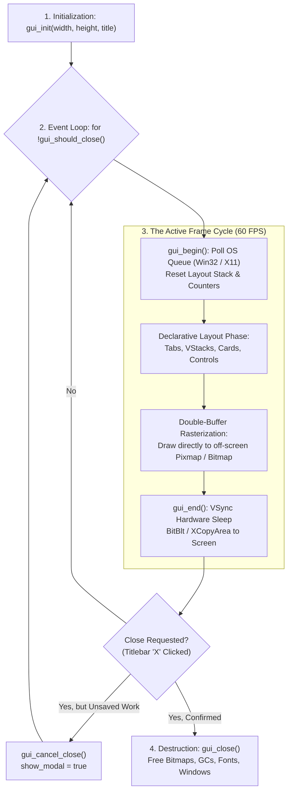

# Tutorial 23: GUI Window Navigation, View Routing, Modal Dialogs & Lifecycle Interception

In [Tutorial 21](21_native_gui_desktop_applications.md) and [Tutorial 22](22_declarative_gui_auto_layout.md), you learned the fundamentals of Vira's native Immediate-Mode GUI (IMGUI) engine and its declarative layout cursor stack (`gui_vstack_begin`, `gui_hstack_begin`, `gui_card_begin`, and auto-widgets).

In real-world desktop applications, developers face two critical architectural requirements:
1. **Window Navigation & Multi-View Routing:** How to organize complex applications into multiple screens, tabs, split-views, and modal dialogs without complex object graphs or memory leaks.
2. **Window Lifecycle & Close Interception:** How the OS window communicates state changes (minimize, resize, focus, close requests) and how to intercept close events (`WM_CLOSE` / `WM_DELETE_WINDOW`) to display "Unsaved Changes" confirmation dialogs.

In this tutorial, you will master **Vira's Window Navigation and Lifecycle Architecture**.

---

## 1. The Anatomy of a Vira Window Lifecycle

Unlike retained-mode frameworks (such as Flutter, Qt, or Electron) that maintain heavy heap-allocated component trees and complex lifecycle hooks (`initState`, `dispose`, `componentDidMount`), Vira operates on a **pure state-driven immediate-mode lifecycle**:



### The 4 Lifecycle Stages

1. **Initialization (`gui_init`)**:
   - **Windows:** Registers `WNDCLASSEXA`, instantiates native `HWND`, creates compatible memory DC and double-buffering `HBITMAP`, and binds Segoe UI ClearType font.
   - **Linux:** Connects to X Server via `XOpenDisplay`, creates native X11 `Window`, sets `WM_DELETE_WINDOW` atom protocols, configures window manager sizing hints, and initializes off-screen `Pixmap` backbuffer.
2. **Event Polling & Frame Reset (`gui_begin`)**:
   - Non-blockingly drains the native OS event queue (`PeekMessageA` on Win32, `XPending` on X11).
   - Resets per-frame layout stacks (`_vira_layout_depth = 0`), card counters, and text input focus counters in $O(1)$ time.
   - Sets single-frame transition flags (`mouse_clicked`, `keys_pressed`, character queues).
3. **Double-Buffered Presentation & Hardware Timer (`gui_end`)**:
   - Copies the entire off-screen memory buffer onto the hardware display (`BitBlt` / `XCopyArea`) in a single pass, guaranteeing **zero screen flicker**.
   - Measures elapsed time using high-precision performance timers (`QueryPerformanceCounter` on Win32, `clock_gettime(CLOCK_MONOTONIC)` on Linux).
   - Sleeps for the exact remaining time to achieve the target frame rate (60 FPS = 16.66ms), preventing idle CPU consumption.
4. **Teardown & Cleanup (`gui_close`)**:
   - Releases all GDI/X11 handles, fonts, memory DCs, and closes the window.

---

## 2. Window Close Request Interception (Handling Unsaved Changes)

In standard applications, clicking the titlebar `X` button instantly destroys the window. However, professional tools must warn users if they have uncommitted work.

Vira provides `gui_cancel_close()` to intercept and abort an OS termination request:

```v
mut is_dirty := true
mut show_exit_modal := false

for {
    // Intercept OS Close Request (Titlebar 'X' clicked)
    if gui_should_close() {
        if is_dirty {
            // Cancel close and activate modal confirmation!
            gui_cancel_close()
            show_exit_modal = true
        } else {
            break // Clean exit when no unsaved changes
        }
    }

    gui_begin()
    gui_clear(0x181825)

    // ... your application UI ...

    // Render Modal Dialog on top of the UI
    if show_exit_modal {
        gui_modal_begin('Unsaved Changes Detected', 480, 210)
            gui_lbl('You have uncommitted modifications.')
            gui_lbl('Do you want to save before closing?')
            gui_separator()
            gui_hstack_begin(36, 12)
                if gui_btn('Save & Exit') {
                    save_database()
                    break // Exit loop
                }
                if gui_btn('Discard & Exit') {
                    break // Exit loop
                }
                if gui_btn('Keep Working') {
                    show_exit_modal = false // User continues in application!
                }
            gui_stack_end()
        gui_modal_end()
    }

    gui_end()
}

gui_close()
```

---

## 3. Multi-View Navigation & Routing Patterns

Immediate-mode GUI makes view routing simple, clean, and declarative. Because there are no retained component trees to mount or unmount, **navigation is simply state switching**.

### Pattern A: Tab Bar Navigation (`gui_tab_item`)

Use `gui_tab_item(label, is_active)` inside an `HStack` to build modern horizontal navigation bars:

```v
mut active_tab := 0 // 0 = Telemetry, 1 = Settings, 2 = Logs

gui_hstack_begin(38, 8)
    if gui_tab_item('📊 Telemetry', active_tab == 0) {
        active_tab = 0
    }
    if gui_tab_item('⚙️ Configuration', active_tab == 1) {
        active_tab = 1
    }
    if gui_tab_item('📜 System Logs', active_tab == 2) {
        active_tab = 2
    }
gui_stack_end()

gui_separator()

// Conditional Viewport Routing
if active_tab == 0 {
    render_telemetry_dashboard()
} else if active_tab == 1 {
    render_configuration_editor()
} else {
    render_audit_log_viewer()
}
```

### Pattern B: Sidebar Navigation (Split View)

Divide the window horizontally into a left sidebar navigation rail and a right dynamic content viewport:

```v
// LEFT SIDEBAR (Navigation Rail)
gui_vstack_begin(20, 80, 200, 10)
    gui_card_begin('Navigation', 200)
        if gui_btn('📊 Telemetry') { active_tab = 0 }
        if gui_btn('⚙️ Settings')  { active_tab = 1 }
        if gui_btn('🚀 Workloads') { active_tab = 2 }
    gui_card_end()
gui_stack_end()

// RIGHT CONTENT VIEWPORT (Auto-sized to remaining window width)
gui_vstack_begin(235, 80, gui_window_width() - 255, 10)
    if active_tab == 0 {
        render_telemetry_dashboard()
    } else if active_tab == 1 {
        render_configuration_editor()
    } else {
        render_workloads_manager()
    }
gui_stack_end()
```

---

## 4. Modal Dialogs & Popups (`gui_modal_begin` / `gui_modal_end`)

Modal dialogs must:
1. Overlay on top of all existing UI elements.
2. Dim the underlying application with a dark backdrop (`0x0C0C14`).
3. Center a focused dialog card on the screen.

```v
if show_reset_modal {
    gui_modal_begin('Confirm State Reset', 460, 200)
        gui_lbl('Are you sure you want to reset cluster metrics?')
        gui_lbl('All counter increments will return to zero.')
        gui_separator()
        gui_hstack_begin(36, 12)
            if gui_btn('Yes, Reset (0)') {
                count = 0
                show_reset_modal = false
            }
            if gui_btn('Cancel') {
                show_reset_modal = false
            }
        gui_stack_end()
    gui_modal_end()
}
```

---

## 5. Zero-Leak Guarantee for Dynamic String Interpolation

In interactive dashboards, text labels and telemetry strings are dynamically formatted every frame:
```v
gui_lbl('Active Counter: ${count}')
gui_lbl('Assigned Node: ${node_name}')
gui_draw_text('FPS: ${fps} • Frame Time: ${dt}s', 20, 600, 14, 0x6C7086)
```

In naive runtimes, generating dynamic strings at 60 FPS creates hundreds of thousands of heap allocations per minute. 

In Vira, the C code generator automatically detects anonymous string expressions passed to GUI display functions and dispatches them to **auto-freeing wrappers** (`vira_gui_lbl_temp`, `vira_gui_draw_text_temp`, `vira_gui_badge_temp`, etc.). The generated C code automatically releases the temporary formatted string immediately after rasterization into the double-buffer:

```c
// Emitted C code:
vira_gui_lbl_temp(vira_str_format("Active Counter: %d", count));
// -> renders into backbuffer, then calls vira_str_free(&temp)
```

This guarantees **`active_leaks = 0`** even after running for hours or days!

---

## 6. Complete Runnable Application

Here is the complete source code from [`examples/gui_navigation_lifecycle.vir`](../../examples/gui_navigation_lifecycle.vir):

```v
module main

// Vira Window Navigation & Lifecycle Demonstration
// Demonstrates:
// 1. Lifecycle: Window creation, event loop, close request interception (WM_CLOSE / WM_DELETE_WINDOW)
// 2. Navigation: Multi-view Tab Navigation (gui_tab_item) with state routing
// 3. Modals: Modal popups with dimmed backdrop (gui_modal_begin / gui_modal_end)
// 4. Close Cancellation: gui_cancel_close() to prevent exit on unsaved work

fn main() {
	gui_init(920, 680, 'Vira Window Navigation & Lifecycle Manager')
	gui_set_target_fps(60)

	mut active_tab := 0 // 0 = Overview, 1 = Workloads, 2 = Logs
	mut count := 0
	mut progress_val := 0.65f32
	mut node_name := 'ComputeCluster-Alpha'
	mut is_dirty := true
	mut show_exit_modal := false
	mut show_reset_modal := false

	for {
		// Lifecycle: Intercept OS Close Request (Titlebar 'X' clicked)
		if gui_should_close() {
			if is_dirty {
				gui_cancel_close()
				show_exit_modal = true
			} else {
				break // Clean exit
			}
		}

		gui_begin()
		gui_clear(0x181825)

		// Top Header with Navigation Tabs
		gui_draw_rect(0, 0, 920, 60, 0x1E1E2E)
		gui_draw_text('Vira Lifecycle & Navigation', 20, 18, 20, 0xCDD6F4)

		if is_dirty {
			gui_draw_badge(330, 18, 'UNSAVED CHANGES', 0x45475A, 0xF9E2AF)
		} else {
			gui_draw_badge(330, 18, 'SAVED & SYNCED', 0x2D4A3E, 0xA6E3A1)
		}

		// Navigation Tab Bar (HStack)
		gui_vstack_begin(20, 75, 880, 15)
			gui_hstack_begin(38, 8)
				if gui_tab_item('Overview & Telemetry', active_tab == 0) {
					active_tab = 0
				}
				if gui_tab_item('Workload Configuration', active_tab == 1) {
					active_tab = 1
				}
				if gui_tab_item('System Audit Logs', active_tab == 2) {
					active_tab = 2
				}
			gui_stack_end()

			gui_separator()

			// VIEW ROUTING: Render different screens based on active_tab
			if active_tab == 0 {
				// VIEW 1: Overview & Telemetry
				gui_card_begin('Real-Time Telemetry Dashboard', 880)
					gui_lbl('Active Cluster: ${node_name}')
					gui_lbl('Processed Frames / Ticks: ${count}')
					gui_lbl('Memory Status: Zero GC Pauses • 0 Heap Leaks')
					gui_spacing(8)
					gui_lbl('Workload Completion:')
					gui_progress(progress_val)
					gui_spacing(10)
					gui_hstack_begin(36, 12)
						if gui_btn('Trigger Frame Step (+1)') {
							count += 1
							is_dirty = true
						}
						if gui_btn('Request Reset') {
							show_reset_modal = true
						}
					gui_stack_end()
				gui_card_end()

			} else if active_tab == 1 {
				// VIEW 2: Workload Configuration
				gui_card_begin('Node Configuration & Parameters', 880)
					gui_lbl('Cluster Node Identifier:')
					node_name = gui_input('Enter cluster name...', node_name)
					gui_spacing(8)
					gui_separator()
					gui_lbl('Progress Target Ratio:')
					progress_val = gui_slide('Target: ', '%', progress_val * 100.0f32, 0.0f32, 100.0f32) / 100.0f32
					gui_spacing(10)
					if gui_btn('Commit & Save Configuration') {
						is_dirty = false
					}
				gui_card_end()

			} else {
				// VIEW 3: System Audit Logs
				gui_card_begin('Lifecycle Event Log', 880)
					gui_lbl('[INIT] Window created: Win32/X11 Native Subsystem')
					gui_lbl('[POLL] Non-blocking OS event dispatch active')
					gui_lbl('[SYNC] Double-buffered VSync locked to 60 FPS')
					gui_lbl('[STATUS] Navigation tabs routing 3 distinct viewports')
					gui_spacing(10)
					if gui_btn('Clear Audit History') {
						is_dirty = true
					}
				gui_card_end()
			}
		gui_stack_end()

		// Footer Telemetry
		dt := gui_frame_time()
		gui_draw_text('Window: ${gui_window_width()}x${gui_window_height()} • Frame Time: ${dt}s • Double-Buffered', 20, 645, 14, 0x6C7086)

		// -------------------------------------------------------------
		// MODAL DIALOG 1: Confirm Reset
		// -------------------------------------------------------------
		if show_reset_modal {
			gui_modal_begin('Confirm State Reset', 460, 200)
				gui_lbl('Are you sure you want to reset cluster metrics?')
				gui_lbl('All counter increments will return to zero.')
				gui_separator()
				gui_hstack_begin(36, 12)
					if gui_btn('Yes, Reset (0)') {
						count = 0
						is_dirty = true
						show_reset_modal = false
					}
					if gui_btn('Cancel') {
						show_reset_modal = false
					}
				gui_stack_end()
			gui_modal_end()
		}

		// -------------------------------------------------------------
		// MODAL DIALOG 2: Intercepted Close Request (Unsaved Changes)
		// -------------------------------------------------------------
		if show_exit_modal {
			gui_modal_begin('Unsaved Changes Detected', 480, 210)
				gui_lbl('You have uncommitted modifications in your cluster.')
				gui_lbl('Do you want to save your state before closing?')
				gui_separator()
				gui_hstack_begin(36, 12)
					if gui_btn('Save & Exit') {
						break // Exit main loop
					}
					if gui_btn('Discard & Exit') {
						break // Exit main loop
					}
					if gui_btn('Keep Working') {
						show_exit_modal = false // Cancel close!
					}
				gui_stack_end()
			gui_modal_end()
		}

		gui_end()
	}

	gui_close()
	println('Window lifecycle closed cleanly.')
}
```

---

## 7. Compiling & Running

### Run with the Interpreter/JIT Runner
```bash
vira run examples/gui_navigation_lifecycle.vir
```

### Build a Production Standalone Binary
```bash
vira build -prod -o navigation_lifecycle examples/gui_navigation_lifecycle.vir
./navigation_lifecycle
```

---

## 8. Summary of Navigation & Lifecycle APIs

| Function | Signature | Description |
| :--- | :--- | :--- |
| `gui_should_close` | `() bool` | Checks if the user or window manager requested the window to close. |
| `gui_cancel_close` | `()` | Resets the close request flag to abort window termination (e.g. for unsaved confirmation modals). |
| `gui_window_width` | `() int` | Returns current window client width in pixels. |
| `gui_window_height` | `() int` | Returns current window client height in pixels. |
| `gui_tab_item` | `(label string, is_active bool) bool` | Renders a styled navigation tab item with hover states and active bottom highlight bar. |
| `gui_modal_begin` | `(title string, width int, height int)` | Renders a dimmed backdrop over the entire window and begins a centered modal card dialog. |
| `gui_modal_end` | `()` | Closes the modal card dialog and layout container. |
