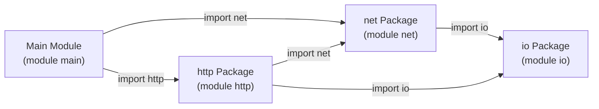

# Tutorial 30: Package Namespacing, Modules & Dependency Management

> **Language Version:** Vira `v0.5.9-dev`+  
> **Reference Example:** [`docs/examples/31_package_namespacing_and_modules.vir`](file:///mnt/flutter_drive/vira/docs/examples/31_package_namespacing_and_modules.vir)  
> **Standard Packages:** [`packages/io`](file:///mnt/flutter_drive/vira/packages/io), [`packages/net`](file:///mnt/flutter_drive/vira/packages/net), [`packages/http`](file:///mnt/flutter_drive/vira/packages/http), [`packages/viraserve`](file:///mnt/flutter_drive/vira/packages/viraserve)

---

## 1. Overview & Architecture

In large-scale systems programming, naming collisions and ambiguous symbol lookups are significant sources of defects. Vira introduces a clean, first-class **Module Namespace System**:

1. **Isolated Module Scopes**: Every package declares its module identity via `module <name>` (e.g., `module net`, `module http`).
2. **Explicit Qualification**: Symbols imported from other packages are qualified with their package or alias name (`net.TcpStream`, `http.HeaderMap`, `http.Response`).
3. **Intra-Module Brevity**: Types and functions defined within the same module are directly accessible unqualified.
4. **Deterministic Symbol Mangling**: In generated C99 code, every symbol is mangled by its true owning package (`net__TcpStream`, `http__Response_with_status`), guaranteeing zero link-time collisions.
5. **Cryptographic Dependency Locking**: Every package tracks dependencies via canonical `vira.mod` manifests and deterministic SHA-256 `vira.lock` lockfiles.



---

## 2. Module Declarations & Visibility Rules

### 2.1 Declaring a Module
At the top of every `.vir` source file, declare its owning module:

```vira
module http
```

If omitted, standalone files default to `module main`.

### 2.2 Visibility & Quadrant Rules

| Scope | Unqualified Access | Qualified Access (`pkg.Symbol`) |
| :--- | :--- | :--- |
| **Same Module** (`module http` accessing `HeaderMap`) | ✅ Yes (`headers HeaderMap`) | Optional (`http.HeaderMap`) |
| **Imported Module** (`module main` accessing `net.TcpStream`) | ❌ No (`TcpStream` alone errors) | ✅ Mandatory (`net.TcpStream`) |
| **Private Symbol** (unexported struct or function) | ✅ Within owning module | ❌ Compiler Error (private symbol) |

---

## 3. Importing Packages & Aliasing

### 3.1 Standard Package Import
```vira
import net
import http
import io
```

### 3.2 Namespace Aliasing (`import as`)
To disambiguate similarly named packages or shorten lengthy namespaces, use `as`:

```vira
import net as mynet
import http as web
```

All types and static calls use the alias:
```vira
mut stream := mynet.TcpStream.connect('127.0.0.1:8080')!
res := web.Response.ok('hello', 'text/plain')
```

---

## 4. Qualified Types, Factories & Struct Literals

### 4.1 Function Signatures & Type Annotations
Qualified types are first-class in all type positions:

```vira
pub fn handle_client(mut stream net.TcpStream) !http.Response {
    req := http.Request.parse(mut stream)!
    return http.Response.json('{"status":"ok"}')
}
```

### 4.2 Qualified Static Methods
Call static constructors directly through the namespace:

```vira
mut srv := http.HttpServer.bind('127.0.0.1:8080')!
mut client := net.TcpStream.connect('127.0.0.1:8080')!
res := http.Response.with_status(404, '{"error":"not_found"}')
```

### 4.3 Qualified Struct Literals
Initialize structs declared in external packages using `<pkg>.<Struct>{ ... }`:

```vira
header := http.Header{
    name: 'Content-Type',
    value: 'application/json'
}
```

---

## 5. Manifests (`vira.mod`) & Lockfiles (`vira.lock`)

Every reproducible Vira package or project defines its metadata and dependencies in `vira.mod`:

### 5.1 `packages/http/vira.mod`
```text
module http
version 0.1.0
author Vira Core Team <dev@viralang.org>
license MIT
description Vira Standard HTTP/1.1 Engine with zero-allocation request parser, headers, response builder, and SSE streaming

deps
	net 0.1.0
	io 0.1.0
```

### 5.2 Deterministic `vira.lock`
When packages are installed or built, Vira writes a cryptographic `vira.lock` containing the exact directory SHA-256 hashes of all dependencies:

```json
{
  "version": 1,
  "packages": [
    {
      "path": "io",
      "version": "0.1.0",
      "checksum": "sha256:5a03c37101cb1c20f0e963adafc41d5919cf2f4349bb25ffef7df4bd06e69bf1"
    },
    {
      "path": "net",
      "version": "0.1.0",
      "checksum": "sha256:8914001ca284dca332160d84b1c678758868d0fa38fefcfc324725094beb4554"
    }
  ]
}
```

---

## 6. Package Management Toolchain CLI

| Command | Action |
| :--- | :--- |
| `vira add <package[@version]>` | Fetches package from Git or local disk, updates `vira.mod` and computes hash in `vira.lock`. |
| `vira install` | Reads `vira.mod` and `vira.lock`, restoring missing dependencies. |
| `vira remove <package>` | Removes a dependency from `vira.mod` and `vira.lock`. |
| `vira vendor` | Vendors all dependencies locally into `./vendor` for air-gapped, offline builds. |
| `vira test <path>` | Runs all package tests under `<path>/tests/*.vir`. |

---

## 7. Complete Runnable Example

Run Example 31:
```bash
./vira run docs/examples/31_package_namespacing_and_modules.vir
```

**Expected Output:**
```text
===========================================================
     VIRA FIRST-CLASS PACKAGE NAMESPACING DEMO             
===========================================================
1. Bound HTTP Server on http://127.0.0.1:36753
2. Connected client stream (type: net.TcpStream)
3. Sent GET /api/v1/status request to server
4. Server accepted request into http.RequestContext
• Route handler received: GET /api/v1/status
5. Server sent response with status 200 (146 bytes)
6. Client received response wire payload:
-----------------------------------------------------------
HTTP/1.1 200 OK
Content-Length: 56
Connection: close
Content-Type: application/json

{"system":"ok","version":"0.5.9-dev","namespacing":true}
-----------------------------------------------------------

[SUCCESS] Package namespacing and cross-module typing verified!
[vira_rt] active_leaks=0
```
