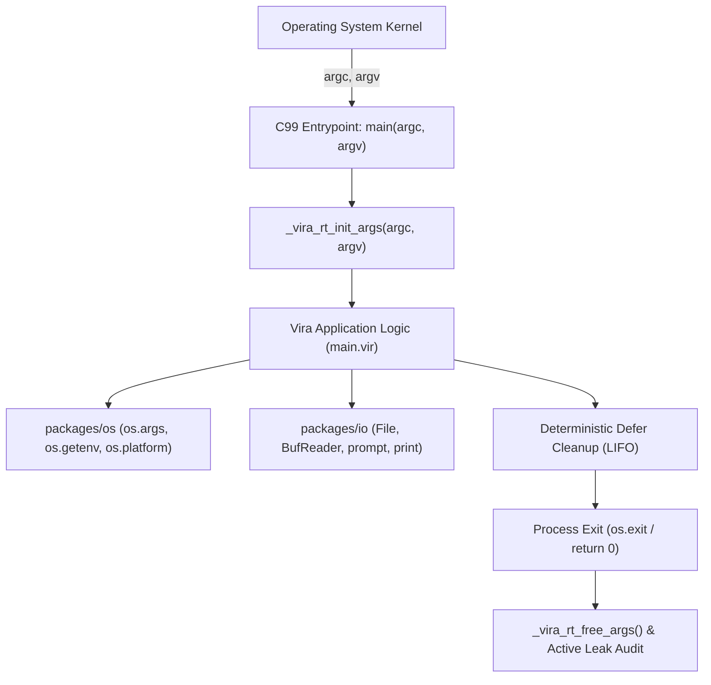

# Tutorial 31: Basic CLI Application Development

> **Language Version:** Vira `v0.5.9-dev`+  
> **Reference Example:** [`docs/examples/34_basic_cli_app.vir`](file:///mnt/flutter_drive/vira/docs/examples/34_basic_cli_app.vir)  
> **Standard Packages:** [`packages/os`](file:///mnt/flutter_drive/vira/packages/os), [`packages/io`](file:///mnt/flutter_drive/vira/packages/io), [`packages/strings`](file:///mnt/flutter_drive/vira/packages/strings)

---

## 1. Overview & Architecture

Modern systems programming demands first-class primitives for building robust, high-performance command-line utilities. In Vira, command-line applications are compiled directly down to native C99 code with an explicit `int main(int argc, char **argv)` entrypoint.

Vira's runtime bridge captures command-line arguments and exposes them through safe, zero-leak abstractions:



### Key Highlights
1. **Zero-Copy Argument Capture**: Raw `argv` pointers are initialized at startup and made available via `os.args()` as an autofreed `[]string` slice.
2. **Environment & Host Inspection**: Access environment variables, working directory, process IDs, and platform metadata cross-platform (Linux, macOS, Windows).
3. **Deterministic Resource Cleanup with `defer`**: Clean up temporary files, file handles, and directories reliably on all exit paths without manual bookkeeping.
4. **Standard I/O Streams**: Dedicated `stdout` (`print`, `println`) and `stderr` (`eprint`, `eprintln`) intrinsics with interactive console input (`io.read_line`, `io.prompt`).
5. **Zero Memory Leaks**: Full verification by the built-in Vira memory telemetry runtime (`active_leaks=0`).

---

## 2. Inspecting Command-Line Arguments (`os.args`)

The `os` standard package provides `os.args()`, which returns a slice containing the executable invocation name and all supplied arguments:

```vira
import os

fn main() {
    args := os.args()
    println('Total arguments: ${args.len}')
    
    // argv[0] contains the executable path
    println('Program name: ${args[0]}')
    
    // Inspect remaining flags and positional arguments
    for mut i := 1; i < args.len; i += 1 {
        println('  arg[${i}] = \'${args[i]}\'')
    }
}
```

Because `args` is a standard Vira `[]string` slice, it is automatically freed when the enclosing scope exits, with no memory leaks.

---

## 3. Environment Variables & Process Metadata

The `os` package exposes cross-platform process and environment inspection:

| Function | Signature | Description |
| :--- | :--- | :--- |
| `os.getenv` | `fn(name string) string` | Retrieves environment variable value, or empty string if unset. |
| `os.setenv` | `fn(name string, val string) !bool` | Sets or overwrites an environment variable in the process scope. |
| `os.unsetenv` | `fn(name string) !bool` | Unsets an environment variable. |
| `os.environ` | `fn() []string` | Returns a snapshot of all environment variables as `KEY=VALUE` strings. |
| `os.getpid` | `fn() int` | Returns the current process ID (`getpid`). |
| `os.getppid` | `fn() int` | Returns the parent process ID (`getppid`). |
| `os.getuid` | `fn() int` | Returns the real user ID of the calling process (POSIX). |
| `os.getgid` | `fn() int` | Returns the real group ID of the calling process (POSIX). |
| `os.hostname`| `fn() !string` | Returns the system network host name. |

### Example
```vira
import os

fn main() {
    // Set custom environment variable
    os.setenv('APP_MODE', 'release') or {
        eprintln('Failed to set environment variable')
        return
    }

    mode := os.getenv('APP_MODE')
    println('Active mode: ${mode}')
    println('Process PID: ${os.getpid()}')
}
```

---

## 4. Platform & Filesystem Paths

Writing portable CLI tools requires path normalization and platform awareness. The `os` package provides dedicated helpers:

```vira
import os

fn main() {
    println('Platform: ${os.platform()}') // "linux", "windows", "darwin"
    
    if os.is_windows() {
        println('Running on Windows NT subsystem')
    } else {
        println('Running on POSIX compliant system')
    }

    // Path manipulation
    path := os.join_path('logs', 'daily.log')
    println('Joined path: ${path}')           // logs/daily.log
    println('Base name:   ${os.base_name(path)}') // daily.log
    println('Dir name:    ${os.dir_name(path)}')  // logs
    println('Extension:   ${os.ext(path)}')       // .log
}
```

---

## 5. File Operations & Deterministic Cleanup with `defer`

Vira combines `packages/os` filesystem manipulation with `packages/io` buffered streams. The `defer` keyword guarantees that cleanup code executes in **LIFO** (Last-In, First-Out) order when the surrounding scope exits:

```vira
import os
import io

fn process_temporary_data() {
    tmp_dir := 'scratch_build'
    if !os.is_dir(tmp_dir) {
        os.mkdir_all(tmp_dir, 0o755) or {
            eprintln('Failed to create directory')
            return
        }
    }
    // Guaranteed to remove directory at function exit
    defer os.remove(tmp_dir)

    file_path := os.join_path(tmp_dir, 'config.json')
    // Guaranteed to remove file before directory removal
    defer os.remove(file_path)

    // Write file
    mut out_f := io.File.open(file_path, 'wb') or { return }
    out_f.write_string('{"status": "ok"}') or { 0 }
    out_f.close() or { false }

    // Read back with buffered reader
    mut in_f := io.File.open(file_path, 'rb') or { return }
    mut reader := io.BufReader.new(in_f)
    for {
        line := reader.read_line() or { break }
        if line.len == 0 { break }
        println('Read: ${line}')
    }
    reader.close() or { false }

    // When process_temporary_data returns:
    // 1. `os.remove(file_path)` runs
    // 2. `os.remove(tmp_dir)` runs
}
```

---

## 6. Standard I/O Streams & Exit Codes

Vira provides built-in functions for writing to standard output and standard error:

```vira
import os
import io

fn main() {
    // Standard Output
    print('Processing...')
    println(' Done.')

    // Standard Error
    eprintln('Warning: non-critical advisory message')

    // Exit code dispatch
    // os.exit(0)  // Success
    // os.exit(1)  // General error
    // os.exit(2)  // Misuse of shell builtins or argument error
}
```

---

## 7. Running Example 34

The complete runnable implementation is located at [`docs/examples/34_basic_cli_app.vir`](file:///mnt/flutter_drive/vira/docs/examples/34_basic_cli_app.vir).

Execute directly via:
```bash
./vira run docs/examples/34_basic_cli_app.vir --demo=cli --mode=fast input.txt
```

Compile to an optimized production binary:
```bash
./vira build -prod -o basic_cli docs/examples/34_basic_cli_app.vir
./basic_cli --demo=cli --mode=fast input.txt
```

Verify with zero memory leaks:
```text
===========================================================
  ViraCLI v1.0.0 - Native Systems CLI Demo
===========================================================
[1] Command-Line Arguments (os.args):
  Total arguments received: 4
    argv[0] = '/tmp/vira_run_1870472317/app'
    argv[1] = '--demo=cli'
    argv[2] = '--mode=fast'
    argv[3] = 'input.txt'

[2] Environment Variables (os.getenv & os.setenv):
  Set and retrieved VIRA_DEMO_ENV = "production_ready
  Current process PID: 858671
  Host platform: linux (is_windows: false)
  Joined path helper: "build/output.log

[3] File Operations & Cleanup with `defer`:
  Created temporary test directory: scratch_cli_demo
  Target file path: scratch_cli_demo/manifest.txt
  File written successfully. Exists on disk: true
  Reading lines via io.BufReader:
    > app_name=ViraCLI
    > version=1.0.0
    > status=verified
  Deterministic `defer` handlers registered for cleanup.

✓ All basic CLI operations completed successfully.
[vira_rt] simd=x86_64 SSE2 (128-bit / 4x f32 per cycle, Multi-Threaded)
[vira_rt] pool_workers=0 | actor_tasks_run=0 | work_steals=0
[vira_rt] active_leaks=0 | total_freed=33
```
