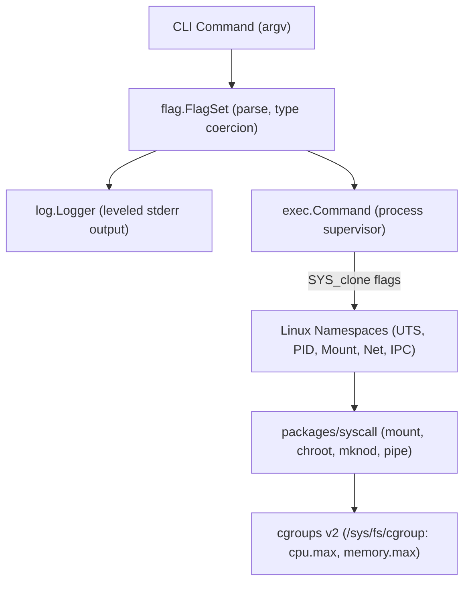

# Tutorial 32: Advanced CLI Flags, Subprocess Execution & Linux Containers

> **Language Version:** Vira `v0.5.9-dev`+  
> **Reference Examples:**  
> - [`docs/examples/35_advanced_cli_flags_syscall_exec.vir`](file:///mnt/flutter_drive/vira/docs/examples/35_advanced_cli_flags_syscall_exec.vir)  
> - [`docs/examples/36_linux_container_runtime_reference.vir`](file:///mnt/flutter_drive/vira/docs/examples/36_linux_container_runtime_reference.vir)  
> **Standard Packages:** [`packages/flag`](file:///mnt/flutter_drive/vira/packages/flag), [`packages/log`](file:///mnt/flutter_drive/vira/packages/log), [`packages/exec`](file:///mnt/flutter_drive/vira/packages/exec), [`packages/syscall`](file:///mnt/flutter_drive/vira/packages/syscall), [`packages/os`](file:///mnt/flutter_drive/vira/packages/os)

---

## 1. Overview & Architecture

Building enterprise CLI utilities, system daemons, and low-level container engines requires four pillars:
1. **Flag Parsing**: Declarative flags with type validation, defaults, short (`-v`) and long (`--verbose`) options, and auto-generated help manuals.
2. **Structured Logging**: Timestamped, leveled logging (`DEBUG`, `INFO`, `WARN`, `ERROR`, `FATAL`) formatted to standard error with process prefixes.
3. **Subprocess Management**: Spawning child processes with pipe redirection, custom working directories, inherited stdio, and wait/exit tracking.
4. **Direct Kernel Syscalls**: Low-level UNIX primitives (pipes, file descriptors, octal permissions `0o755`, Linux container namespaces, cgroups v2, and filesystem mounts).



---

## 2. Declarative Flag Parsing (`packages/flag`)

The `flag` standard package provides `flag.FlagSet`, inspired by POSIX and GNU command-line conventions.

### 2.1 Setting Up a FlagSet
```vira
import flag
import os

fn main() {
    mut fs := flag.FlagSet.new('mytool')
    fs.bool_flag('verbose', 'v', false, 'Enable verbose debug output')
    fs.int_flag('port', 'p', 8080, 'Server listening port')
    fs.string_flag('config', 'c', 'config.json', 'Configuration path')
    fs.f64_flag('timeout', 't', 10.0, 'Network timeout in seconds')

    // Parse arguments (skipping argv[0])
    raw := os.args()
    mut args := []string{}
    if raw.len > 1 {
        args = raw.slice(1, raw.len)
    }

    fs.parse(args) or {
        eprintln('Argument error: ${err}')
        return
    }

    verbose := fs.get_bool('verbose')
    port := fs.get_int('port')
    println('Verbose: ${verbose}, Port: ${port}')
}
```

### 2.2 Supported Flag Syntaxes
The Vira parser handles all common command-line styles:
- **Long flags**: `--verbose`, `--port=9000`, `--port 9000`
- **Short flags**: `-v`, `-p=9000`, `-p 9000`
- **Boolean flags**: Setting `-v` or `--verbose` automatically sets the flag to `true`
- **Positional separator**: `--` terminates flag parsing; all subsequent items are stored in `fs.args`
- **Auto-help table**: `fs.help_string()` renders a column-aligned flag table with optional ANSI terminal color styling (`flag.ansi_bold`, `flag.ansi_green`).

---

## 3. Leveled Logging (`packages/log`)

The `log` package directs structured log entries to `stderr`, leaving `stdout` clean for pipeline output:

```vira
import log

fn main() {
    mut l := log.Logger.new(log.LEVEL_INFO)
    l.set_prefix('app')
    l.set_timestamp(true)

    l.debug('This is hidden because level is INFO')
    l.info('Service initialized')
    l.warn('High latency detected')
    l.error('Database connection dropped')

    // Or use package-level helpers:
    log.info('Direct package-level log')
}
```

Log levels:
- `log.LEVEL_DEBUG`: Verbose diagnostic data
- `log.LEVEL_INFO`: Standard operational events
- `log.LEVEL_WARN`: Non-fatal warning conditions
- `log.LEVEL_ERROR`: Recoverable runtime failures
- `log.LEVEL_FATAL`: Critical system failure (prints message to `stderr` and calls `os.exit(1)`)

---

## 4. Subprocess Execution (`packages/exec`)

The `exec` package manages child processes cross-platform:

```vira
import exec
import os

fn main() {
    mut prog := 'echo'
    mut args := ['Hello from child process']
    if os.is_windows() {
        prog = 'cmd'
        args = ['/c', 'echo Hello from child process']
    }

    // Capture combined stdout and stderr
    out := exec.combined_output(prog, args) or {
        eprintln('Failed to execute: ${err}')
        return
    }
    println('Output: ${out}')

    // Granular process control
    mut cmd := exec.Command.new(prog, args)
    cmd.set_inherit_stdio(true)
    pid := cmd.start() or { return }
    exit_code := cmd.wait() or { return }
    println('Process exited with code: ${exit_code}')
}
```

---

## 5. Low-Level Kernel Syscalls (`packages/syscall`)

The `syscall` package exposes raw operating system and kernel primitives:

### 5.1 Pipes and Direct File Descriptors
```vira
import syscall

fn main() {
    mut fds := []int{}
    syscall.pipe(mut fds) or { return }

    r_fd := fds[0]
    w_fd := fds[1]
    defer syscall.close(r_fd)
    defer syscall.close(w_fd)

    // Write to pipe
    msg := 'kernel_payload'
    b := msg.bytes()
    _ := syscall.write(w_fd, b, b.len) or { 0 }

    // Read from pipe
    mut buf := []u8{}
    _ := syscall.read(r_fd, mut buf, 64) or { 0 }
    println('Read: ${buf.to_string()}')
}
```

### 5.2 Octal Permissions & Container Constants
Vira supports native octal integer literals (`0o755`, `0o644`):
- `syscall.CLONE_NEWUTS`: Private hostname/domain namespace
- `syscall.CLONE_NEWPID`: Private process ID tree (PID 1 inside container)
- `syscall.CLONE_NEWNS`: Private mount namespace
- `syscall.CLONE_NEWNET`: Private network stack (loopback, interfaces, routes)
- `syscall.CLONE_NEWIPC`: Private System V IPC & POSIX message queues

---

## 6. Deep Dive: Linux Container Runtime Reference

[`docs/examples/36_linux_container_runtime_reference.vir`](file:///mnt/flutter_drive/vira/docs/examples/36_linux_container_runtime_reference.vir) implements a complete, native Linux container runtime in pure Vira:

### 6.1 The Child Re-Exec Pattern
To spawn a container with new namespaces, the parent process invokes `/proc/self/exe child` with clone flags:

```vira
mut cmd := exec.Command.new('/proc/self/exe', ['child'])
cmd.set_inherit_stdio(true)
cmd.set_clone_flags(
    syscall.CLONE_NEWUTS | syscall.CLONE_NEWPID |
    syscall.CLONE_NEWNS  | syscall.CLONE_NEWNET | syscall.CLONE_NEWIPC
)
pid := cmd.start() or { return }
```

### 6.2 Resource Isolation with cgroups v2
The parent attaches the child's host PID to a dedicated cgroup slice:
- Memory capping: `/sys/fs/cgroup/virabox/memory.max`
- CPU quotas: `/sys/fs/cgroup/virabox/cpu.max`
- Process limiting: `/sys/fs/cgroup/virabox/pids.max`
- Attachment: `/sys/fs/cgroup/virabox/cgroup.procs`

### 6.3 In-Container Sandboxing
Inside `child_entrypoint`:
- Private hostname is set via `syscall.sethostname(CONTAINER_NAME)`
- Private `/proc` filesystem is mounted via `syscall.mount('proc', '/proc', 'proc', 0i64, '')`
- Private devices (`/dev/null`, `/dev/urandom`, `/dev/pts`) are provisioned using `syscall.mknod` and `syscall.makedev`.

---

## 7. Running the Examples

### Running Example 35 (Flags, Logging, Pipe IPC)
```bash
./vira run docs/examples/35_advanced_cli_flags_syscall_exec.vir -v -w 8 -t cloud task1 task2
```

Output:
```text
===========================================================
  Vira Advanced Systems Stack: Flags, Logging, Syscall & Exec
===========================================================
[1] Command-Line Flag Parsing & Structured Logging:
2026-10-30 00:14:53 [runner] [DEBUG] Debug tracing activated (workers=8, timeout=30.00s)
2026-10-30 00:14:53 [runner] [INFO] Initializing execution pipeline for target: cloud
  Parsed Flag Values:
    --verbose : true
    --workers : 8
    --target  : cloud
    --timeout : 30.00
  Remaining Positional Arguments (2):
    pos[0] = 'task1'
    pos[1] = 'task2'

[2] Child Subprocess Execution (exec.Command):
  Spawned child process: "echo"
  Combined stdout/stderr output: Vira Child Process Active

[3] Low-Level Kernel IPC (syscall.pipe):
  Wrote 26 bytes into pipe write-end (fd=11)
  Read 26 bytes from pipe read-end (fd=10): "VIRA_PIPE_MESSAGE_VERIFIED"
  Direct file descriptor cleanup handled by `defer`.

✓ All advanced subsystems verified with 0 leaks.
[vira_rt] simd=x86_64 SSE2 (128-bit / 4x f32 per cycle, Multi-Threaded)
[vira_rt] pool_workers=0 | actor_tasks_run=0 | work_steals=0
[vira_rt] active_leaks=0 | total_freed=73
```

### Running Example 36 (Container Runtime Reference)
```bash
./vira run docs/examples/36_linux_container_runtime_reference.vir
```
Output:
```text
======================================================================
  Vira Native Linux Container Runtime (Architecture Reference)        
======================================================================
• Isolated Namespaces: CLONE_NEWUTS | CLONE_NEWPID | CLONE_NEWNS
                       CLONE_NEWNET | CLONE_NEWIPC
• Resource Governance: Linux cgroups v2 (CPU, Memory, PIDs)
• Network Topology:    Virtual Ethernet (veth) Pair + NetNS Bridge
• Filesystem Sandbox:  Private devpts, tmpfs /dev, and isolated /proc
----------------------------------------------------------------------
Host Telemetry:
  OS Platform:   linux
  Effective UID: 1000
  Target Box:    virabox

[NOTICE] Container namespace spawning requires Linux root (CAP_SYS_ADMIN).
Simulating architecture configuration validation:
  ✓ Namespace bitmask verified: 0x20000000 (CLONE_NEWPID)
  ✓ Character device nodes: /dev/null (1:3), /dev/urandom (1:9)
  ✓ cgroups v2 tree: /sys/fs/cgroup/virabox
  ✓ Virtual ethernet pair: veth_host0 <---> veth_guest0

To execute full kernel containerization on Linux:
  sudo ./vira run docs/examples/36_linux_container_runtime_reference.vir

✓ Container runtime reference execution finished.
[vira_rt] simd=x86_64 SSE2 (128-bit / 4x f32 per cycle, Multi-Threaded)
[vira_rt] pool_workers=0 | actor_tasks_run=0 | work_steals=0
[vira_rt] active_leaks=0 | total_freed=7
```
