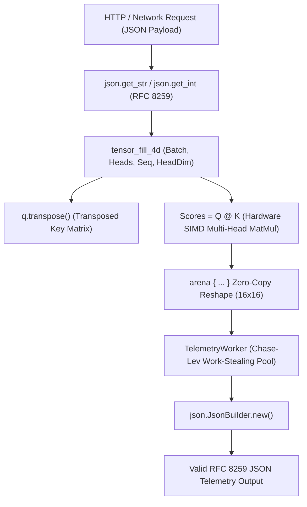

# Tutorial 33: 1D-4D Strided Tensors, Batched Attention & Pure-Vira JSON

> **Language Version:** Vira `v0.5.9-dev`+  
> **Matching Code Example:** [`docs/examples/33_nd_tensors_and_stdlib_json.vir`](file:///mnt/flutter_drive/vira/docs/examples/33_nd_tensors_and_stdlib_json.vir)  
> **Standard Packages:** [`packages/json`](file:///mnt/flutter_drive/vira/packages/json)

---

## 1. Overview & Architecture

Modern AI systems, transformer architectures, and microservices demand two core capabilities:
1. **Multi-Dimensional Strided Tensors**: Native 1D to 4D tensor primitives supporting batched multi-head attention matrix multiplication (`@`), zero-copy transposition, and trailing-dimension bias broadcasting.
2. **Zero-Dependency RFC 8259 JSON**: Fast, pure-Vira JSON parsing (`json.get_str`, `json.get_int`, `json.is_valid`) and programmatic serializing (`json.JsonBuilder`) without external C libraries or GC overhead.



---

## 2. 4D Strided Tensors & Batched Multi-Head Attention

In transformer architectures, queries ($Q$) and keys ($K$) are represented as 4D tensors with shape:
$$\text{Shape} = (\text{Batch}, \text{Heads}, \text{SeqLen}, \text{HeadDim})$$

### Creating and Transposing 4D Tensors
```vira
// Allocate a 4D tensor: (Batch=2, Heads=4, Seq=8, HeadDim=16)
q := tensor_fill_4d(2, 4, 8, 16, 0.25)
k := q.transpose() // Transposes the last two dimensions -> (2, 4, 16, 8)

// Compute attention scores via batched matrix multiplication (@)
scores := q @ k
```

The `@` operator automatically vectorizes the batched contraction across all heads using SIMD (AVX2 + FMA on x86_64, NEON on ARM64) with 64-byte alignment.

---

## 3. Zero-Copy Arena Reshape & Trailing-Dimension Broadcasting

When passing tensor activations between linear layers, temporary memory allocations can introduce latency. Vira's bump arenas (`arena { ... }`) allow instant $O(1)$ slab allocations that are wiped cleanly at block exit:

```vira
mut proj_total := 0.0f32
arena {
    // 3D sequence tensor: (Batch=2, Seq=8, Dim=16)
    seq := tensor_fill_3d(2, 8, 16, 0.5)

    // Reshape to 2D matrix view (16x16) without copying memory
    flat_view := seq.reshape_2d(16, 16)

    // Projection weights (16x8) and trailing bias (1x8)
    w_proj := tensor_fill(16, 8, 0.25)
    bias := tensor_fill(1, 8, 1.0)

    // Linear projection with automatic trailing-dimension bias broadcasting
    projected := (seq @ w_proj) + bias
    proj_total = tensor_sum(projected)
} // Arena memory is instantly reclaimed here with 0 leaks
```

---

## 4. Pure-Vira RFC 8259 JSON Parsing (`packages/json`)

The standard [`packages/json`](file:///mnt/flutter_drive/vira/packages/json) library provides zero-allocation JSON extraction directly from UTF-8 strings:

```vira
import json

fn parse_request(payload string) {
    // Validate RFC 8259 compliance
    if !json.is_valid(payload) {
        eprintln('Invalid JSON received')
        return
    }

    // Extract fields with automatic Result error handling
    model := json.get_str(payload, 'model') or { 'unknown' }
    heads := json.get_int(payload, 'heads') or { 0 }
    tag := json.get_str(payload, 'tag') or { '' }

    println('Model: ${model}, Heads: ${heads}, Tag: ${tag}')
}
```

Key features of `packages/json`:
- **Nested Key Support**: Extracts top-level and nested properties without allocating full AST trees.
- **Escape Handling**: Automatically unescapes Unicode sequences (`\uXXXX`) and quotation marks (`\"`).
- **Strict Typing**: Specialized accessors for `get_str`, `get_int`, `get_i64`, `get_bool`, and `get_raw`.

---

## 5. Serializing with `json.JsonBuilder` inside Concurrent Actors

To build telemetry reports and API responses, use `json.JsonBuilder` to construct compact JSON strings efficiently:

```vira
import json

pub actor TelemetryWorker {
pub:
    worker_id int
mut:
    reports_built int = 0
}

pub fn (mut w TelemetryWorker) build_report(model string, heads int, attn_numel int, proj_sum f32) string {
    w.reports_built += 1
    mut jb := json.JsonBuilder.new()
    jb.set_str('model', model)
    jb.set_int('heads', heads)
    jb.set_int('attn_numel', attn_numel)
    jb.set_raw('proj_sum', '${proj_sum}')
    jb.set_bool('zero_copy_arena', true)
    return jb.build()
}
```

Because `TelemetryWorker` runs as an isolated actor on Vira's multicore work-stealing pool, reports are constructed concurrently without thread lock contention:

```vira
mut worker := TelemetryWorker{ worker_id: 1, reports_built: 0 }
fut := worker <- build_report('vira-attn-4d', 4, 512, 384.0)
report_json := fut.await() or { '{"error":"worker_fault"}' }
println('Generated: ${report_json}')
```

---

## 6. Running the Code

Execute the matching tutorial example:

```bash
vira run docs/examples/33_nd_tensors_and_stdlib_json.vir
```

Expected output:
```text
=== 1. 4D MULTI-HEAD ATTENTION & BATCHED MATMUL (@) ===
Q rank=4, K shape=(2x4x16x8)
Scores numel=512, sum=512.00
=== 2. ZERO-COPY ARENA RESHAPE & TRAILING-DIM BIAS BROADCAST ===
Arena 2D view=(16x16), projected rank=3, sum=384.00
=== 3. PURE-VIRA RFC 8259 JSON PARSER & ACTOR JSONBUILDER ===
Parsed model=vira-attn-4d, heads=4, unescaped_tag=simd"cpu
Valid RFC 8259 JSON=true -> {"model":"vira-attn-4d","heads":4,"attn_numel":512,"proj_sum":384.00,"zero_copy_arena":true}
```

---

## Next Steps

- Explore [**Tutorial 31: Basic CLI Application Development**](./31_basic_cli_application_development.md) for command-line argument processing, file manipulation, and `defer`.
- Explore [**Tutorial 32: Advanced CLI Flags, Subprocess Execution & Linux Containers**](./32_advanced_cli_flags_syscall_and_exec.md) for flag parsing, leveled logging, and system calls.
- Read the [**Standard Library Guide**](../STANDARD_LIBRARY.md) for an index of all 14 standard packages.
