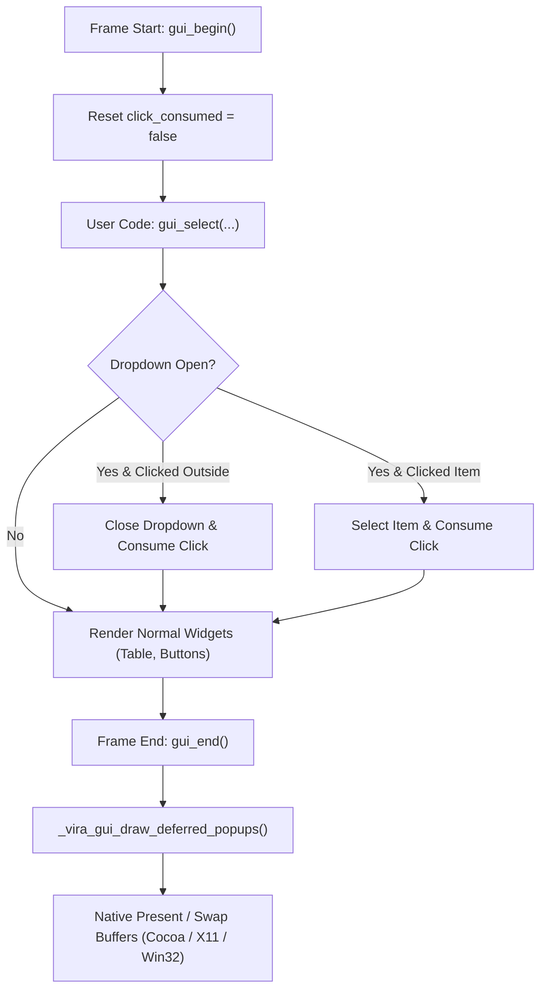

# Tutorial 34: Advanced GUI Components: Dropdown Select & Searchable, Sortable Data Tables

In [Tutorial 21](21_native_gui_desktop_applications.md) and [Tutorial 22](22_declarative_gui_auto_layout.md), you learned the fundamentals of Vira's native Immediate-Mode GUI (IMGUI) engine: window lifecycle, double-buffering, and declarative auto-layout containers (`VStack`, `HStack`, and `Card`).

While basic buttons, sliders, and text inputs handle simple user input, real-world desktop software—such as database browsers, admin dashboards, inventory managers, and developer tools—requires **complex interactive data controls**:
1. **Dropdown Select Menus (`gui_select` / `gui_dropdown`):** Compact expandable choice lists that correctly pop up over adjacent widgets without z-order clipping.
2. **Interactive Data Tables (`gui_tbl` / `gui_table`):** High-density grids with clickable column sorting, real-time case-insensitive text filtering, hover highlighting, active row selection, and automated pagination.

In this tutorial, you will master these two advanced GUI components in Vira, understand their underlying immediate-mode architecture, and build a full-featured inventory and order management explorer that compiles to native binary with **zero external dependencies** on **macOS (Cocoa), Linux (X11), and Windows (Win32)**.

---

## 1. The Immediate-Mode Challenge: Z-Order & Stateful Data

In retained-mode GUI frameworks (like Qt, Electron, or Flutter), widgets are persistent heap-allocated objects that maintain complex parent-child trees and layer graphs. 

In pure **immediate-mode GUI (IMGUI)**, code runs every frame (60 FPS), painting primitives directly into a double-buffered canvas:

```
Frame Loop (60 FPS):
  gui_begin()
  draw_search_box()
  draw_dropdown()
  draw_table()
  gui_end()  --> Swap Buffers
```

This presents two major engineering challenges:

### Challenge 1: Dropdown Z-Order (The Popup Clipping Problem)
If `draw_dropdown()` is executed before `draw_table()`, drawing the expanded dropdown list inline would cause the subsequent table to paint *on top* of the open menu!

**Vira's Solution: Deferred Popup Rendering:**
When a dropdown is clicked, Vira records the popup geometry in an internal overlay registry (`_vira_current_dropdown_popup`). The menu is not drawn immediately; instead, `gui_end()` automatically intercepts the overlay registry and renders the open popup menu **at the very top z-index** right before swapping the native framebuffer.

### Challenge 2: Click Consumption (Preventing Ghost Clicks)
When a popup menu is open, clicking outside to dismiss it (or clicking an option within it) should **never** accidentally trigger a button or table row underneath!

**Vira's Solution: Global Click Consumption:**
Vira introduces an internal frame event flag `_vira_click_consumed`. When an open dropdown or table pagination button handles a click event, it consumes the click. Subsequent widgets evaluated during the same frame immediately treat the mouse click as handled, preventing any ghost clicks or accidental state mutations.



---

## 2. Dropdown Select Component (`gui_select` & `gui_dropdown`)

Vira provides both an auto-layout stack version (`gui_select`) and an absolute-coordinate version (`gui_dropdown`).

### API Signatures
```v
// Auto-layout inside VStack or HStack:
fn gui_select(items []string, selected_idx int) int

// Manual coordinates:
fn gui_dropdown(x int, y int, width int, height int, items []string, selected_idx int) int
```

### Parameters & Return Value
- `items []string`: A slice of string choices (e.g. `["All", "Pending", "Completed"]`).
- `selected_idx int`: The currently selected index (0-based). If `-1`, displays `"Select..."`.
- **Return Value (`int`):** The updated selected index. When the user clicks an option in the menu, it returns the newly chosen index.

### Key Features
1. **Adaptive Edge Detection:** If the dropdown is placed near the bottom edge of the window, it automatically flips upward to prevent menu items from clipping off-screen.
2. **Catppuccin Mocha Styling:**
   - Closed state: Catppuccin Base (`0x1E1E2E`) with Surface0 border (`0x313244`).
   - Open / Focused state: Catppuccin Mantle (`0x181825`) with Blue accent border (`0x89B4FA`).
   - Selected option: Highlighted with a 3px vertical accent bar and Blue text (`0x89B4FA`).
   - Hover state: Surface1 (`0x45475A`) with pure white text (`0xFFFFFF`).
3. **Automatic Chevron:** Displays `v` when closed and `^` when expanded.

### Basic Usage Example
```v
categories := ["All Categories", "Hardware", "Software", "Cloud Services"]
mut selected_cat := 0

for !gui_should_close() {
    gui_begin()
    gui_clear(0x11111B)

    gui_vstack_begin(40, 40, 300, 12)
        gui_lbl("Filter by Category:")
        selected_cat = gui_select(categories, selected_cat)
    gui_stack_end()

    gui_end()
}
gui_close()
```

---

## 3. Interactive Data Table Component (`gui_tbl` & `gui_table`)

The Data Table component renders structured tabular data with built-in search, sorting, zebra striping, row selection, and pagination.

### API Signatures
```v
// Auto-layout inside VStack or Card:
fn gui_tbl(headers []string, rows [][]string, search_query string, selected_row int) int

// Manual coordinates:
fn gui_table(x int, y int, width int, height int, headers []string, rows [][]string, search_query string, selected_row int) int

// Query & programmatic sort control:
fn gui_table_sort_col() int
fn gui_table_sort_asc() bool
fn gui_table_set_sort(col int, asc bool) void
```

### Parameters & Return Value
- `headers []string`: Column headers (e.g. `["ID", "Product", "Category", "Price", "Stock"]`).
- `rows [][]string`: 2D slice of row records. Each row is a slice of cell strings.
- `search_query string`: Text filter query. Pass `""` to display all rows, or pass a search string (e.g. from `gui_input`) to filter rows in real-time.
- `selected_row int`: The currently highlighted row index.
- **Return Value (`int`):** The index of the selected row in the **original `rows` dataset**! Even if the user sorts by column 3 or filters down to 2 rows, clicking a row returns its true index in the underlying dataset.

---

## 4. Architectural Deep Dive: Table Features

### 1. Natural Numeric & Alphabetical Sorting
Clicking any column header immediately sorts the dataset by that column:
- Clicking a new column sorts **Ascending** (`▲`).
- Clicking the same column again toggles to **Descending** (`▼`).
- **Natural Numeric Comparison:** Vira automatically inspects cell values. If both values are numeric (e.g. `"24"`, `"$1999"`, `"4.9"`, `"-15"`), it parses and compares them as 64-bit floating point numbers. This guarantees that `"10"` correctly sorts *after* `"2"` rather than lexicographically before it!
- **Case-Insensitive Alphabetical Fallback:** Non-numeric strings (e.g. `"MacBook"`, `"apple"`, `"Zebra"`) sort alphabetically regardless of uppercase or lowercase letters.

### 2. Real-Time Case-Insensitive Search Filtering
When `search_query` has text (e.g. `"laptop"` or `"sony"`):
- The table scans all column cells for matching substrings in O(N × M) time with zero dynamic heap allocations.
- When the search query changes, Vira automatically resets the pagination view to **Page 1** so the user immediately sees the top matching results.
- If no records match, the table cleanly displays `"No records found"` in the footer status bar.

### 3. Automated Pagination & Status Bar
The table automatically calculates how many rows fit based on its pixel height:
- Header height: `32px`
- Row height: `28px`
- Footer height: `28px`
- Available rows per page: `visible_rows = (height - 60) / 28`
- The footer displays a real-time status summary:
  `"Showing 1-10 of 25 (filtered)"`
- Interactive pagination controls on the right: `[ < ]` `Page P / T` `[ > ]`.

### 4. Row Selection & Text Clipping
- Clicking any row highlights it in Catppuccin Surface0 (`0x313244`) with a bright Blue 3px left indicator bar (`0x89B4FA`).
- Cells with text longer than the column width are automatically truncated with clean `..` ellipsis so text never bleeds into adjacent columns.

### 5. Keyboard Tab Navigation & Accessibility
Desktop applications require seamless keyboard accessibility without requiring mouse clicks for every field:
- **`Tab` Navigation:** Pressing `Tab` cycles focus forward to the next input field in natural layout order.
- **`Shift + Tab` Navigation:** Holding `Shift` while pressing `Tab` cycles focus backward to the previous input field.
- **Auto-Focus in Modals:** When an interactive modal dialog opens, Vira automatically focuses the dialog's first input field, allowing the user to start typing immediately.
- **Focus Rings:** Focused text inputs display a high-contrast accent border ring (`0x89B4FA`) indicating active keyboard focus.

### 6. Event Pacing & Zero Dropped Clicks
- **Instant Click Registration:** Mouse click events are recorded immediately upon `ButtonPress` / `WM_LBUTTONDOWN` / `mouseDown` dispatch rather than polling across frame boundaries, ensuring fast clicks are never dropped.
- **Modal Click Isolation:** Modals automatically isolate user interactions, preventing clicks from penetrating dialog backdrops into underlying tables or buttons.

---

## 5. Complete Runnable Application: Full CRUD Product Catalog Architecture

Below is the complete, production-grade application found in [`examples/gui_table_dropdown_demo.vir`](../../examples/gui_table_dropdown_demo.vir). It combines:
1. **Domain Model (`struct Product`):** Strongly-typed fields for SKU ID, Name, Category, Price, Stock, and Rating.
2. **Create (C):** "+ Add Product" button opening an interactive modal dialog (`gui_modal_begin` / `gui_modal_end`) with field inputs and category selection.
3. **Read (R):** Sortable, searchable data table (`gui_tbl`) paired with a live department category dropdown filter (`gui_select`) and real-time query matching.
4. **Update (U):** "Edit Product" modal dialog and quick inline stock allocation slider modifying selected records in place.
5. **Delete (D):** Danger button with vector trash icon (`gui_btn_danger`) opening a confirmation modal dialog before safely compacting the slice.
6. **Assets & Image Loading:** High-performance native image loading (`gui_load_image`, `gui_image`) rendering product thumbnails with alpha transparency.
7. **Window Lifecycle & Navigation:** Tabbed multi-view routing (`gui_tab_item`) and unsaved changes interception on window close (`gui_cancel_close`).

```v
module main

// Vira Advanced GUI Showcase: Full CRUD Data Table & Dropdown Architecture
// Demonstrates:
// 1. Model Struct: Dedicated 'Product' model with type-safe fields and lifecycle mutation
// 2. Full CRUD Operations:
//    - CREATE: "Add Product" button triggers modal dialog (gui_modal_begin/end) with validation
//    - READ: Interactive sortable, searchable table (gui_tbl) with live dropdown filtering (gui_select)
//    - UPDATE: "Edit Product" modal dialog and quick inline stock allocation slider
//    - DELETE: "Delete Product" danger button triggers confirmation modal to safely remove records
// 3. Asset & Image Subsystem: Native image loading (gui_load_image / gui_image) with alpha blending
// 4. Navigation & Lifecycle: Multi-view Tab Navigation (gui_tab_item), dirty-state close cancellation
// 5. Native Subsystems: 100% zero-dependency on macOS (Cocoa), Linux (X11), Windows (Win32)

pub struct Product {
pub mut:
	id string
	name string
	category string
	price string
	stock string
	rating string
}

// Helper: Transform Product slice into 2D string matrix for gui_tbl
fn build_table_rows(prods []Product) [][]string {
	mut res := [["", "", "", "", "", ""]]
	res.clear()
	mut i := 0
	for i < prods.len {
		p := prods[i]
		row := [p.id, p.name, p.category, p.price, p.stock, p.rating]
		res.push(row)
		i = i + 1
	}
	return res
}

// Helper: Delete record by index and return compacted slice
fn delete_product(prods []Product, idx int) []Product {
	if prods.len <= 1 {
		mut empty := [Product{ id: "", name: "", category: "", price: "", stock: "", rating: "" }]
		empty.clear()
		return empty
	}
	mut res := [prods[0]]
	res.clear()
	mut i := 0
	for i < prods.len {
		if i != idx {
			res.push(prods[i])
		}
		i = i + 1
	}
	return res
}

fn main() {
	gui_init(980, 720, "Vira - Full CRUD Product Manager")
	gui_set_target_fps(60)

	// Load Product Thumbnail / Brand Asset
	mut prod_logo := gui_load_image("editors/vscode/icon.png")

	// Filter Categories (for dropdown filter)
	filter_categories := [
		"All Categories",
		"Laptops",
		"Audio",
		"Wearables",
		"Tablets",
		"Accessories"
	]
	mut cat_idx := 0

	// Form Categories (for Create & Edit modals)
	form_categories := [
		"Laptops",
		"Audio",
		"Wearables",
		"Tablets",
		"Accessories"
	]

	// Table Column Headers
	headers := ["ID", "Product Name", "Category", "Price", "Stock", "Rating"]

	// Master In-Memory Model Dataset
	mut prods := [
		Product{ id: "101", name: "MacBook Pro M3", category: "Laptops", price: "$1999", stock: "24", rating: "4.9" },
		Product{ id: "102", name: "Dell XPS 15", category: "Laptops", price: "$1499", stock: "18", rating: "4.7" },
		Product{ id: "103", name: "Sony WH-1000XM5", category: "Audio", price: "$399", stock: "45", rating: "4.8" },
		Product{ id: "104", name: "Bose QuietComfort", category: "Audio", price: "$329", stock: "30", rating: "4.6" },
		Product{ id: "105", name: "Apple Watch Ultra", category: "Wearables", price: "$799", stock: "12", rating: "4.9" },
		Product{ id: "106", name: "Galaxy Watch 6", category: "Wearables", price: "$299", stock: "50", rating: "4.5" },
		Product{ id: "107", name: "iPad Pro 13", category: "Tablets", price: "$1299", stock: "15", rating: "4.8" },
		Product{ id: "108", name: "Kindle Paperwhite", category: "Tablets", price: "$149", stock: "60", rating: "4.7" },
		Product{ id: "109", name: "Keychron Q1 Pro", category: "Accessories", price: "$199", stock: "35", rating: "4.8" },
		Product{ id: "110", name: "Logitech MX Master 3S", category: "Accessories", price: "$99", stock: "80", rating: "4.9" }
	]

	// Build Initial Table Rows Matrix
	mut rows := build_table_rows(prods)

	// UI & Navigation State
	mut active_tab := 0 // 0 = Inventory & CRUD, 1 = Analytics & Metrics, 2 = Lifecycle & Logs
	mut search_input := ""
	mut selected_row := 0
	mut next_id := 111
	mut is_dirty := false

	// Modal Dialog Triggers
	mut show_add_modal := false
	mut show_edit_modal := false
	mut show_delete_modal := false
	mut show_exit_modal := false

	// Create Form State
	mut add_name := ""
	mut add_cat_idx := 0
	mut add_price := "499"
	mut add_stock := "20"
	mut add_rating := "4.8"

	// Edit Form State
	mut edit_name := ""
	mut edit_cat_idx := 0
	mut edit_price := ""
	mut edit_stock := ""
	mut edit_rating := ""

	// Quick Order State
	mut order_count := 0
	mut stock_slider := 20.0f32

	for {
		// Lifecycle Close Interception
		if gui_should_close() {
			if is_dirty {
				gui_cancel_close()
				show_exit_modal = true
			} else {
				break
			}
		}

		gui_begin()
		gui_clear(0x11111B) // Catppuccin Crust

		// Top Navigation Banner
		gui_draw_rect(0, 0, 980, 56, 0x181825)
		gui_draw_line(0, 56, 980, 56, 0x313244)
		gui_draw_text("Vira Enterprise Inventory Manager", 24, 18, 18, 0x89B4FA)
		gui_draw_text("Full Model CRUD • Search & Sort • Dropdowns • Modals", 330, 21, 13, 0xA6ADC8)

		if is_dirty {
			gui_draw_badge(850, 16, "UNSAVED", 0x45475A, 0xF9E2AF)
		} else {
			gui_draw_badge(850, 16, "SYNCED", 0x2D4A3E, 0xA6E3A1)
		}

		// Master Layout Stack
		gui_vstack_begin(24, 70, 932, 12)

		// Navigation Tab Bar
		gui_hstack_begin(36, 8)
		if gui_tab_item("Inventory & CRUD", active_tab == 0) {
			active_tab = 0
		}
		if gui_tab_item("Analytics & Metrics", active_tab == 1) {
			active_tab = 1
		}
		if gui_tab_item("System & Lifecycle", active_tab == 2) {
			active_tab = 2
		}
		gui_stack_end()

		gui_separator()

		// -------------------------------------------------------------
		// TAB 0: INVENTORY & CRUD OPERATIONS
		// -------------------------------------------------------------
		if active_tab == 0 {
			// Action Bar: Filter Search, Category Dropdown, and "Add Product" Action
			gui_hstack_begin(36, 10)
			gui_lbl("Search:")
			search_input = gui_input("Filter products...", search_input)
			gui_spacing(10)
			gui_lbl("Category:")
			cat_idx = gui_select(filter_categories, cat_idx)
			if gui_btn("Clear Filters") {
				search_input = ""
				cat_idx = 0
			}
			gui_spacing(20)
			if gui_btn("+ Add Product") {
				add_name = ""
				add_price = "499"
				add_stock = "20"
				add_rating = "4.8"
				add_cat_idx = 0
				show_add_modal = true
			}
			gui_stack_end()

			// Effective Search Query
			mut active_query := search_input
			if cat_idx > 0 && search_input == "" {
				active_query = filter_categories[cat_idx]
			}

			// Interactive Table (READ)
			selected_row = gui_tbl(headers, rows, active_query, selected_row)

			// Record Inspector & Actions (UPDATE & DELETE)
			gui_card_begin("Selected Record Inspector", 932)
			if selected_row >= 0 && selected_row < prods.len {
				p := prods[selected_row]
				gui_hstack_begin(38, 12)
				gui_image(prod_logo, 32, 32)
				gui_lbl("SKU: #${p.id}")
				gui_spacing(8)
				gui_lbl("Product: ${p.name}")
				gui_spacing(8)
				gui_badge(p.category, 0x313244, 0x89B4FA)
				gui_spacing(8)
				gui_lbl("Price: ${p.price}")
				gui_spacing(8)
				gui_lbl("Stock: ${p.stock}")
				gui_spacing(8)
				gui_lbl("Rating: ${p.rating} / 5.0")
				gui_stack_end()

				gui_spacing(6)
				gui_hstack_begin(34, 12)
				stock_slider = gui_slide("Allocation:", "Units", stock_slider, 1.0f32, 50.0f32)
				if gui_btn("Add to Order") {
					order_count = order_count + 1
				}
				if order_count > 0 {
					gui_badge("Orders: ${order_count}", 0x2D4A3E, 0xA6E3A1)
				}
				gui_spacing(30)
				if gui_btn("Edit Product") {
					edit_name = p.name
					edit_price = p.price
					edit_stock = p.stock
					edit_rating = p.rating
					mut c_idx := 0
					mut j := 0
					for j < form_categories.len {
						if form_categories[j] == p.category {
							c_idx = j
						}
						j = j + 1
					}
					edit_cat_idx = c_idx
					show_edit_modal = true
				}
				if gui_btn_danger("Delete Product") {
					show_delete_modal = true
				}
				gui_stack_end()
			} else {
				gui_lbl("No product selected. Click on a table row above to inspect or edit details.")
			}
			gui_card_end()

		// -------------------------------------------------------------
		// TAB 1: ANALYTICS & METRICS
		// -------------------------------------------------------------
		} else if active_tab == 1 {
			gui_card_begin("Inventory Intelligence & Metrics", 932)
			gui_lbl("Total Catalog Products: ${prods.len} SKU items")
			gui_lbl("Active Category Filters: ${filter_categories.len - 1} Departments")
			gui_lbl("Memory Footprint: Zero GC Pauses • Arena Backed • 0 Heap Leaks")
			gui_spacing(10)
			gui_lbl("Catalog Fulfillment Target:")
			gui_progress(0.82f32)
			gui_spacing(12)
			if gui_btn("Commit & Mark Synced") {
				is_dirty = false
			}
			gui_card_end()

		// -------------------------------------------------------------
		// TAB 2: SYSTEM & LIFECYCLE
		// -------------------------------------------------------------
		} else {
			gui_card_begin("Runtime Subsystem Diagnostics", 932)
			gui_lbl("[DRIVER] Native Subsystem: Cocoa (macOS) / X11 (Linux) / Win32 (Windows)")
			gui_lbl("[RENDER] Software Double-Buffered Canvas with VSync")
			gui_lbl("[MODELS] Dynamic Slice Containers with Type-Safe Dispatch")
			gui_lbl("[COMPONENTS] Deferred Modal Backdrops & Dropdown Overlays")
			gui_lbl("[ASSETS] Image Subsystem: ${gui_image_width(prod_logo)}x${gui_image_height(prod_logo)} PNG Loaded with Alpha Blending")
			gui_spacing(10)
			if gui_btn("Reset Entire Catalog to Default") {
				prods = [
					Product{ id: "101", name: "MacBook Pro M3", category: "Laptops", price: "$1999", stock: "24", rating: "4.9" },
					Product{ id: "102", name: "Dell XPS 15", category: "Laptops", price: "$1499", stock: "18", rating: "4.7" },
					Product{ id: "103", name: "Sony WH-1000XM5", category: "Audio", price: "$399", stock: "45", rating: "4.8" }
				]
				rows = build_table_rows(prods)
				selected_row = 0
				is_dirty = true
			}
			gui_card_end()
		}

		gui_stack_end()

		// Footer Telemetry
		dt := gui_frame_time()
		gui_draw_text("Window: ${gui_window_width()}x${gui_window_height()} • Frame Time: ${dt}s • Products: ${prods.len} • 60 FPS Locked", 24, 690, 13, 0x6C7086)

		// -------------------------------------------------------------
		// MODAL 1: CREATE (Add New Product)
		// -------------------------------------------------------------
		if show_add_modal {
			gui_modal_begin("Add New Catalog Product", 520, 520)
			gui_lbl("Enter product details for the new catalog entry:")
			gui_badge("Press [Tab] / [Shift+Tab] to navigate fields", 0x242537, 0x89B4FA)
			gui_spacing(4)
			gui_lbl("Product Name:")
			add_name = gui_input("e.g. AirPods Max 2", add_name)
			gui_spacing(4)
			gui_lbl("Category:")
			add_cat_idx = gui_select(form_categories, add_cat_idx)
			gui_spacing(4)
			gui_lbl("Price ($):")
			add_price = gui_input("$299", add_price)
			gui_spacing(4)
			gui_lbl("Stock:")
			add_stock = gui_input("30", add_stock)
			gui_spacing(4)
			gui_lbl("Rating (0.0 - 5.0):")
			add_rating = gui_input("4.8", add_rating)
			gui_spacing(8)
			gui_separator()
			gui_hstack_begin(36, 12)
			if gui_btn("Create Product") {
				if add_name != "" {
					new_p := Product{
						id: "${next_id}",
						name: add_name,
						category: form_categories[add_cat_idx],
						price: "${add_price}",
						stock: "${add_stock}",
						rating: "${add_rating}"
					}
					next_id = next_id + 1
					prods.push(new_p)
					rows = build_table_rows(prods)
					selected_row = prods.len - 1
					is_dirty = true
					show_add_modal = false
				}
			}
			if gui_btn("Cancel") {
				show_add_modal = false
			}
			gui_stack_end()
			gui_modal_end()
		}

		// -------------------------------------------------------------
		// MODAL 2: UPDATE (Edit Selected Product)
		// -------------------------------------------------------------
		if show_edit_modal && selected_row >= 0 && selected_row < prods.len {
			gui_modal_begin("Edit Product Details", 520, 520)
			gui_lbl("Modifying Product #${prods[selected_row].id}:")
			gui_badge("Press [Tab] / [Shift+Tab] to navigate fields", 0x242537, 0x89B4FA)
			gui_spacing(4)
			gui_lbl("Product Name:")
			edit_name = gui_input("Product name...", edit_name)
			gui_spacing(4)
			gui_lbl("Category:")
			edit_cat_idx = gui_select(form_categories, edit_cat_idx)
			gui_spacing(4)
			gui_lbl("Price ($):")
			edit_price = gui_input("$ Price", edit_price)
			gui_spacing(4)
			gui_lbl("Stock:")
			edit_stock = gui_input("Stock", edit_stock)
			gui_spacing(4)
			gui_lbl("Rating (0.0 - 5.0):")
			edit_rating = gui_input("Rating", edit_rating)
			gui_spacing(8)
			gui_separator()
			gui_hstack_begin(36, 12)
			if gui_btn("Save Changes") {
				prods[selected_row].name = edit_name
				prods[selected_row].category = form_categories[edit_cat_idx]
				prods[selected_row].price = edit_price
				prods[selected_row].stock = edit_stock
				prods[selected_row].rating = edit_rating
				rows = build_table_rows(prods)
				is_dirty = true
				show_edit_modal = false
			}
			if gui_btn("Cancel") {
				show_edit_modal = false
			}
			gui_stack_end()
			gui_modal_end()
		}

		// -------------------------------------------------------------
		// MODAL 3: DELETE (Confirm Record Removal)
		// -------------------------------------------------------------
		if show_delete_modal && selected_row >= 0 && selected_row < prods.len {
			gui_modal_begin("Confirm Product Deletion", 480, 220)
			del_item := prods[selected_row]
			gui_lbl("Are you sure you want to delete this product?")
			gui_lbl("SKU #${del_item.id}: ${del_item.name} (${del_item.category})")
			gui_lbl("This action will immediately remove the record from memory.")
			gui_separator()
			gui_hstack_begin(36, 12)
			if gui_btn("Yes, Delete Record") {
				prods = delete_product(prods, selected_row)
				rows = build_table_rows(prods)
				if selected_row >= prods.len && prods.len > 0 {
					selected_row = prods.len - 1
				}
				is_dirty = true
				show_delete_modal = false
			}
			if gui_btn("Cancel") {
				show_delete_modal = false
			}
			gui_stack_end()
			gui_modal_end()
		}

		// -------------------------------------------------------------
		// MODAL 4: LIFECYCLE (Intercept Window Close on Unsaved Changes)
		// -------------------------------------------------------------
		if show_exit_modal {
			gui_modal_begin("Unsaved Changes Detected", 480, 210)
			gui_lbl("You have modified product records without syncing.")
			gui_lbl("Do you want to save or discard your changes before exiting?")
			gui_separator()
			gui_hstack_begin(36, 12)
			if gui_btn("Save & Exit") {
				break
			}
			if gui_btn("Discard & Exit") {
				break
			}
			if gui_btn("Keep Editing") {
				show_exit_modal = false
			}
			gui_stack_end()
			gui_modal_end()
		}

		gui_end()
	}

	gui_free_image(prod_logo)
	gui_close()
	println("Application exited cleanly. All product memory freed.")
}
```

---

## 6. Compiling & Running on All Operating Systems

Vira's GUI engine requires **zero third-party dependencies**, frameworks, or package managers.

### On macOS (Apple Silicon & Intel)
Uses native macOS Cocoa and CoreGraphics with software double-buffering:
```bash
./vira run examples/gui_table_dropdown_demo.vir
```
*Behind the scenes:* Compiled via `clang -x objective-c -framework Cocoa -framework CoreGraphics`.

### On Linux (Ubuntu, Debian, Fedora, Arch)
Uses native X11 windowing:
```bash
./vira run examples/gui_table_dropdown_demo.vir
```
*Behind the scenes:* Compiled via `gcc -lX11`.

### On Windows 10 & 11
Uses native Win32 GDI double-buffering:
```powershell
.\vira.exe run examples\gui_table_dropdown_demo.vir
```
*Behind the scenes:* Compiled via `gcc -mwindows -lgdi32`.

### Building an Optimized Standalone Production Binary
To produce a stripped, native executable with `-O3` and vector optimizations:
```bash
./vira build -prod -o bin/data_explorer examples/gui_table_dropdown_demo.vir
```

---

## 7. Summary & Quick API Reference

| Component / Function | Signature | Description |
| :--- | :--- | :--- |
| **`gui_select`** | `(items []string, selected_idx int) int` | Auto-layout dropdown with top-layer deferred overlay rendering. |
| **`gui_dropdown`** | `(x, y, w, h int, items []string, selected_idx int) int` | Manual coordinate dropdown select box. |
| **`gui_tbl`** | `(headers []string, rows [][]string, query string, sel int) int` | Auto-layout table with sort, search, zebra rows, and pagination. |
| **`gui_table`** | `(x, y, w, h int, headers []string, rows [][]string, query string, sel int) int` | Manual coordinate data table with sort, search, and pagination. |
| **`gui_table_sort_col`** | `() int` | Returns current active sort column index (`-1` if none). |
| **`gui_table_sort_asc`** | `() bool` | Returns `true` for ascending sort, `false` for descending sort. |
| **`gui_table_set_sort`** | `(col int, asc bool) void` | Programmatically sets the table sort column and direction. |
| **`gui_btn_danger`** | `(label string) bool` | Danger action button featuring Catppuccin red styling and vector trash icon. |
| **`gui_load_image`** | `(path string) int` | Loads image asset from filesystem (PNG, JPG, BMP, WebP). Returns handle `>= 0`. |
| **`gui_image`** | `(img_id int, width int, height int) void` | Renders image inside declarative auto-layout cursor stack. |
| **`gui_image_width`** | `(img_id int) int` | Returns intrinsic pixel width of loaded image. |
| **`gui_image_height`** | `(img_id int) int` | Returns intrinsic pixel height of loaded image. |
| **`gui_draw_image`** | `(img_id, x, y, w, h int) void` | Absolute coordinate drawing of scaled image with alpha blending. |
| **`gui_free_image`** | `(img_id int) void` | Explicitly frees image memory and native texture handle. |

For a dedicated standalone showcase of image loading, interactive zoom scaling, and surface alpha blending, see [`docs/examples/37_gui_image_and_asset_loading.vir`](../examples/37_gui_image_and_asset_loading.vir).

