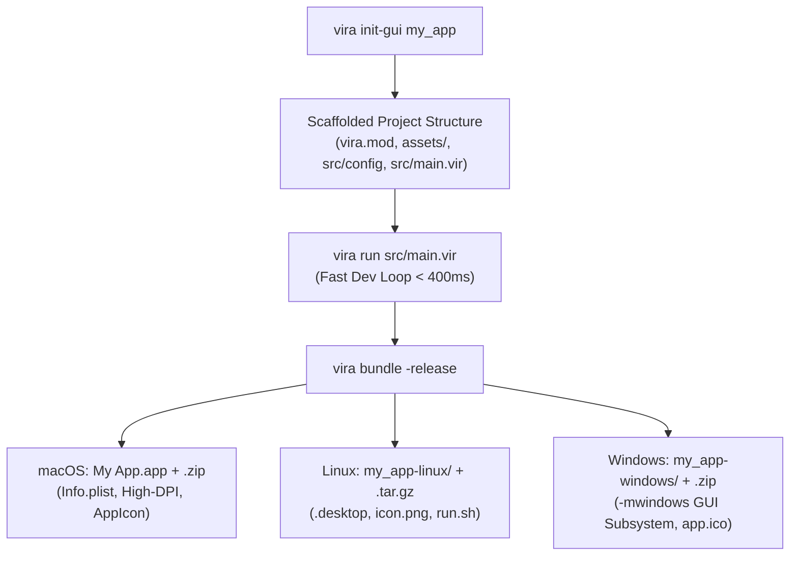

# Tutorial 35: Native GUI App Scaffolding & Cross-Platform Bundling (macOS, Linux & Windows)

In [Tutorial 21](21_native_gui_desktop_applications.md), [Tutorial 22](22_declarative_gui_auto_layout.md), [Tutorial 23](23_gui_window_navigation_and_lifecycle.md), and [Tutorial 34](34_advanced_gui_tables_and_dropdowns.md), you learned how to build rich, hardware-accelerated desktop interfaces using Vira's native Immediate-Mode GUI (IMGUI) engine.

However, compiling a raw `.vir` script into a single binary is only the first step toward shipping a commercial or open-source desktop product. Real-world applications require:
1. **Dedicated Project Structure:** Standardized layout separating UI theme tokens, state models, business logic, and visual assets.
2. **Project Manifest Metadata (`vira.mod`):** Human-readable application names, reverse-DNS bundle identifiers, icons, and asset directories.
3. **Native macOS `.app` Bundles:** Structured bundles containing `Contents/Info.plist`, High-DPI Retina display flags, native icons, and bundled asset trees inside `Contents/Resources/`.
4. **Native Linux Deployments:** Portable standalone directories with FreeDesktop-compliant `.desktop` application launchers, icons, and dynamic runtime library loaders.
5. **Native Windows Deployments:** PE executables compiled for the Win32 GUI subsystem (`-mwindows` flag to completely eliminate black CMD console windows), `.ico` icons, and bundled runtime assets.

In this tutorial, you will master the two dedicated toolchain commands introduced in Vira: **`vira init-gui`** (interactive GUI app scaffolding) and **`vira bundle`** (the zero-dependency cross-platform desktop packager).

---

## 1. Why Dedicated GUI Tooling Matters

Building desktop software in modern ecosystems is often plagued by massive runtime bloat:

| Framework / Language | Typical Bundle Size | Memory Footprint | Runtime Architecture | Native OS Integration |
| :--- | :--- | :--- | :--- | :--- |
| **Electron (JS/TS)** | 120 MB - 250 MB | 180 MB - 400 MB | Bundled Chromium + Node.js | Manual `electron-builder` config |
| **Tauri (Rust + Web)** | 10 MB - 30 MB | 50 MB - 120 MB | System Webview + Rust binary | External Cargo bundler |
| **Flutter Desktop** | 30 MB - 60 MB | 80 MB - 150 MB | Flutter C++ Engine + Dart VM | `flutter build macos/windows/linux` |
| **Vira Native IMGUI** | **1.2 MB - 3.5 MB** | **8 MB - 25 MB** | **Pure C99 AOT Machine Code** | **Built-in `vira bundle` (0 external tools)** |

Vira provides a completely self-contained toolchain. You do not need Node.js, Python scripts, CMake setups, or third-party packaging utilities. The Vira compiler binary itself knows how to compile, structure, generate plists, assemble `.desktop` entries, and compress production release archives.



---

## 2. Scaffolding a GUI Application (`vira init-gui`)

To initialize a new native desktop project, run `vira init-gui` (or `vira init --gui`):

```bash
vira init-gui studio_designer
cd studio_designer
```

### Generated Project Architecture

```
studio_designer/
├── vira.mod              # Package manifest with dedicated GUI metadata
├── assets/
│   └── icon.png          # High-resolution vector gradient app icon (128x128)
├── src/
│   ├── config/
│   │   └── theme.vir     # Modular Catppuccin design tokens and theme struct
│   └── main.vir          # Main IMGUI lifecycle loop and auto-layout UI
├── tests/
│   └── app_test.vir      # Unit test suite verified by `vira test`
└── README.md             # Project documentation and CLI usage instructions
```

### The Enhanced `vira.mod` Manifest

Vira's package manifest format natively supports desktop application properties:

```ini
name = "studio_designer"
version = "0.1.0"
author = "Developer"
license = "MIT"
description = "Native Vira GUI desktop application"

# Desktop Application & Bundler Configuration
app_name = "Studio Designer"
app_id = "com.vira.studio_designer"
icon = "assets/icon.png"
assets = ["assets"]
```

#### Manifest Field Breakdown:
- **`app_name` (string):** The human-readable application title displayed in the macOS menu bar, OS dock, Linux desktop launcher, and Windows window header. Defaults to title-cased directory name if omitted.
- **`app_id` (string):** The reverse-DNS application identifier (e.g. `com.company.product`). Crucial for macOS bundle isolation, settings storage, and Linux XDG notification routing.
- **`icon` (string):** The path to the primary application icon relative to the project root. Supports high-resolution `.png` or `.ico`.
- **`assets` (array of strings):** Directories or files to automatically copy into the application bundle's resources directory during `vira bundle`.

---

## 3. Dissecting the Scaffolded Code

The scaffolding creates modular, clean, and zero-leak code separating UI design tokens from the application state loop.

### Theme Tokens (`src/config/theme.vir`)

Design tokens are encapsulated within a strongly-typed struct:

```v
module config

pub struct AppTheme {
pub:
    bg_color      int
    surface_color int
    accent_color  int
    text_color    int
    subtext_color int
    border_color  int
    window_w      int
    window_h      int
}

// Canonical factory constructor
pub fn AppTheme.new() AppTheme {
    return AppTheme{
        bg_color:      0x1E1E2E, // Catppuccin Mocha Base
        surface_color: 0x313244, // Surface0
        accent_color:  0x89B4FA, // Blue
        text_color:    0xCDD6F4, // Text
        subtext_color: 0xA6ADC8, // Subtext0
        border_color:  0x45475A, // Surface1
        window_w:      800,
        window_h:      560,
    }
}
```

### The GUI Lifecycle Loop (`src/main.vir`)

The entrypoint initializes the window with native double-buffering, applies the theme, and runs the 60 FPS event loop:

```v
module main

import config

fn main() {
    mut theme := config.AppTheme.new()

    // 1. Initialize native window (Cocoa on macOS, X11 on Linux, Win32 on Windows)
    gui_init('Studio Designer', theme.window_w, theme.window_h)
    gui_set_bg_color(theme.bg_color)

    mut counter := 0
    mut progress := 35

    // 2. 60 FPS Event and Rendering Loop
    for !gui_should_close() {
        gui_begin()

        // Auto-layout column with 20px padding and 12px item spacing
        gui_vstack_begin(24, 24, 752, 12)

        gui_card_begin('Control Panel', 752)
        gui_lbl('Welcome to your native Vira desktop application.')
        gui_lbl('Built with zero external runtime dependencies.')
        gui_spacing(8)

        gui_badge('System Status: Ready', 0x22C55E)
        gui_spacing(8)

        gui_hstack_begin(36, 12)
        if gui_btn('Increment') {
            counter += 1
            if progress < 100 {
                progress += 5
            }
        }
        if gui_btn_danger('Reset') {
            counter = 0
            progress = 0
        }
        gui_stack_end()

        gui_spacing(8)
        gui_lbl('Action Counter: ${counter}')
        gui_progress(progress, 100, 704, 16)

        gui_card_end()
        gui_stack_end()

        gui_end()
    }

    // 3. Free native window and OS resources
    gui_cleanup()
}
```

---

## 4. Local Development & Rapid Iteration

During development, you don't need to bundle your application for every change. You can compile and run directly:

```bash
# Rapid development run (< 400ms compilation)
vira run src/main.vir

# Run unit tests to verify package integrity
vira test ./tests

# Check type safety and verify autofree memory escape analysis
vira check src/main.vir
```

---

## 5. Cross-Platform Bundling (`vira bundle`)

When you are ready to package your application for end users, run:

```bash
vira bundle
```

By default, `vira bundle`:
1. Reads `vira.mod` to resolve `app_name`, `app_id`, `icon`, and `assets`.
2. Targets the **host operating system** automatically.
3. Compiles the binary with production optimization (`-prod`, `-O3`, `-flto`).
4. Generates all platform-specific metadata, launchers, and icon assets into the `dist/` folder.
5. Emits a compressed distribution archive (`.zip` or `.tar.gz`) ready for download.

### Bundling for a Specific Target OS

You can explicitly specify the target platform using `--target` (or `-target`):

```bash
# Package for macOS (.app bundle + .zip)
vira bundle --target darwin

# Package for Linux (portable directory + .desktop + .tar.gz)
vira bundle --target linux

# Package for Windows (subsystem GUI .exe + .ico + .zip)
vira bundle --target windows
```

### Specifying Custom Output Paths

```bash
vira bundle --target linux -o release_builds/
```

---

## 6. Deep Dive: macOS Bundling (`.app`)

On macOS, native graphical software is not distributed as a standalone binary; it must be structured as an **Application Bundle** (`.app` directory structure).

```
dist/
├── Studio Designer.app/
│   └── Contents/
│       ├── Info.plist            # macOS bundle configuration
│       ├── MacOS/
│       │   └── studio_designer   # 64-bit Mach-O executable
│       └── Resources/
│           ├── AppIcon.png       # Primary application icon
│           └── assets/           # Bundled project assets
└── Studio Designer-macos.zip     # Distribution archive
```

### 1. The Anatomy of `Contents/Info.plist`

Vira automatically generates a valid Apple XML property list (`Info.plist`):

```xml
<?xml version="1.0" encoding="UTF-8"?>
<!DOCTYPE plist PUBLIC "-//Apple//DTD PLIST 1.0//EN" "http://www.apple.com/DTDs/PropertyList-1.0.dtd">
<plist version="1.0">
<dict>
    <key>CFBundleExecutable</key>
    <string>studio_designer</string>
    <key>CFBundleIdentifier</key>
    <string>com.vira.studio_designer</string>
    <key>CFBundleName</key>
    <string>Studio Designer</string>
    <key>CFBundleDisplayName</key>
    <string>Studio Designer</string>
    <key>CFBundleVersion</key>
    <string>0.1.0</string>
    <key>CFBundleShortVersionString</key>
    <string>0.1.0</string>
    <key>CFBundlePackageType</key>
    <string>APPL</string>
    <key>CFBundleIconFile</key>
    <string>AppIcon</string>
    <key>LSMinimumSystemVersion</key>
    <string>10.15</string>
    <key>NSHighResolutionCapable</key>
    <true/>
</dict>
</plist>
```

#### Key macOS Settings:
- **`CFBundlePackageType = APPL`:** Identifies the folder to macOS Finder as a launchable GUI application.
- **`NSHighResolutionCapable = true`:** **Critical for Apple Retina displays.** Without this flag, macOS runs the application in pixel-doubled low-DPI emulation mode, causing text and IMGUI widgets to look blurry and distorted. With this flag set to `true`, Vira renders crisp text and sub-pixel lines at full Retina native resolution.
- **`CFBundleExecutable`:** Identifies the Mach-O binary inside `Contents/MacOS/`.
- **`CFBundleIdentifier`:** Uses the `app_id` declared in `vira.mod`.

### 2. High-Resolution Icon Handling
- Vira copies your icon to `Contents/Resources/AppIcon.png`.
- If compiling on macOS where Apple's `iconutil` or `sips` utilities are installed, it can automatically generate an Apple `.icns` multi-resolution icon pack.

### 3. Locating Assets at Runtime on macOS
Inside a `.app` bundle, the working directory when launched by Finder is often `/` or the user's home directory. Vira applications resolve assets relative to the executable path:

```
Executable Path: Studio Designer.app/Contents/MacOS/studio_designer
Resources Path:  Studio Designer.app/Contents/Resources/assets/
```

To access your assets portably in Vira:
```v
// Look in current working directory first, fallback to macOS bundle Resources
fn resolve_asset(path string) string {
    if file_exists(path) {
        return path
    }
    mut macos_path := '../Resources/${path}'
    if file_exists(macos_path) {
        return macos_path
    }
    return path
}
```

---

## 7. Deep Dive: Linux Bundling (`.desktop` & Portable Directory)

On Linux (Ubuntu, Debian, Fedora, Arch, Alpine, etc.), applications follow the **XDG (FreeDesktop.org)** desktop integration standards.

```
dist/
├── studio_designer-linux/
│   ├── studio_designer          # 64-bit ELF executable (compiled with -O3)
│   ├── icon.png                 # FreeDesktop application icon
│   ├── studio_designer.desktop  # XDG desktop specification entry
│   ├── run.sh                   # Portable environment launcher script
│   └── assets/                  # Bundled assets directory
└── studio_designer-linux.tar.gz # Compressed tarball for distribution
```

### 1. FreeDesktop `.desktop` Specification

The `.desktop` file enables seamless integration with desktop environments (GNOME, KDE Plasma, XFCE, Sway, etc.):

```ini
[Desktop Entry]
Type=Application
Version=1.0
Name=Studio Designer
Comment=Native Vira GUI desktop application
Exec=./run.sh
Icon=icon.png
Terminal=false
Categories=Utility;Development;
StartupNotify=true
```

#### Key Linux Settings:
- **`Type=Application`:** Informs application menus and docks that this file launches an app.
- **`Terminal=false`:** Prevents the window manager from opening an unnecessary terminal emulator window.
- **`Exec=./run.sh`:** Invokes the smart launcher script so relative assets and dynamic libraries resolve correctly regardless of how the user clicked the icon.

### 2. The Smart `run.sh` Launcher Script

When users double-click an executable from a graphical file manager (like Nautilus or Dolphin), the process working directory is often set to the user's home folder. 

`run.sh` guarantees that the working directory is always set to the application root:

```bash
#!/bin/sh
# Auto-generated by Vira Native Bundler
set -e
HERE="$(cd "$(dirname "$0")" && pwd)"
cd "$HERE"
export LD_LIBRARY_PATH="$HERE:$LD_LIBRARY_PATH"
exec "./studio_designer" "$@"
```

### 3. System-Wide or User Installation on Linux

To install your bundled application permanently into a Linux user account:

```bash
# 1. Move application folder to user programs directory
mkdir -p ~/.local/share/studio_designer
cp -r dist/studio_designer-linux/* ~/.local/share/studio_designer/

# 2. Update .desktop file with absolute paths
sed -i "s|Exec=./run.sh|Exec=$HOME/.local/share/studio_designer/run.sh|" ~/.local/share/studio_designer/studio_designer.desktop
sed -i "s|Icon=icon.png|Icon=$HOME/.local/share/studio_designer/icon.png|" ~/.local/share/studio_designer/studio_designer.desktop

# 3. Link to applications menu
ln -sf ~/.local/share/studio_designer/studio_designer.desktop ~/.local/share/applications/

# 4. Update desktop database
update-desktop-database ~/.local/share/applications/ 2>/dev/null || true
```

The application now appears instantly in GNOME Activities, KDE Kickoff, and application search!

---

## 8. Deep Dive: Windows Bundling (Win32 GUI Subsystem)

On Microsoft Windows, packaging desktop software presents a unique challenge: **the black console window**.

```
dist/
├── studio_designer-windows/
│   ├── studio_designer.exe      # 64-bit PE binary with GUI subsystem
│   ├── app.ico                  # Multi-resolution Windows icon
│   └── assets/                  # Bundled assets directory
└── studio_designer-windows.zip  # Compressed distribution zip
```

### 1. Eliminating the Console Window (`-mwindows`)

When typical compilers (like GCC or Clang) build a C binary, they default to the **Console Subsystem** (`IMAGE_SUBSYSTEM_WINDOWS_CUI`). When a user double-clicks the resulting `.exe`, Windows spawns a black Command Prompt window behind the GUI window:

```
[Default Build]
User double-clicks app.exe  -->  [cmd.exe Console Window] (Ugly black box)
                                       └── [Your GUI Window]
```

**Vira's Automatic Solution:**
When compiling for Windows with `guiApp` enabled or via `vira bundle --target windows`, the Vira compiler automatically passes the **`-mwindows`** linker flag:

```
[Vira Bundle Build]
User double-clicks app.exe  -->  [Your GUI Window] (Clean native presentation)
```

The `-mwindows` flag instructs the linker to set the executable subsystem to `IMAGE_SUBSYSTEM_WINDOWS_GUI`. Windows initializes the process directly without allocating a console buffer.

### 2. Multi-Resolution Windows `.ico`

Windows Explorer and the taskbar require icons in multiple resolutions (`16x16`, `32x32`, `48x48`, `256x256`).

`vira bundle` packages `app.ico` directly beside the binary and prepares it for embedding into the PE executable resources via `windres` or installer packages (such as Inno Setup or WiX).

### 3. Creating a Windows Installer (Inno Setup Script Example)

You can convert your `studio_designer-windows/` directory into a professional Windows setup installer (`Setup.exe`) using this standard Inno Setup script:

```ini
[Setup]
AppName=Studio Designer
AppVersion=0.1.0
DefaultDirName={autopf}\Studio Designer
DefaultGroupName=Studio Designer
OutputDir=installer
OutputBaseFilename=StudioDesigner_Setup
SetupIconFile=app.ico
Compression=lzma2
SolidCompression=yes

[Files]
Source: "dist\studio_designer-windows\*"; DestDir: "{app}"; Flags: recursesubdirs createallsubdirs

[Icons]
Name: "{group}\Studio Designer"; Filename: "{app}\studio_designer.exe"; IconFilename: "{app}\app.ico"
Name: "{autodesktop}\Studio Designer"; Filename: "{app}\studio_designer.exe"; IconFilename: "{app}\app.ico"
```

---

## 9. Automated CI/CD Cross-Platform Workflow

Because `vira bundle` operates identically across operating systems, you can easily build production releases for all three platforms using GitHub Actions:

```yaml
name: Release GUI Applications

on:
  push:
    tags:
      - 'v*'

jobs:
  build-and-bundle:
    strategy:
      matrix:
        include:
          - os: macos-latest
            target: darwin
            artifact_name: macos
          - os: ubuntu-latest
            target: linux
            artifact_name: linux
          - os: windows-latest
            target: windows
            artifact_name: windows

    runs-on: ${{ matrix.os }}

    steps:
      - name: Checkout Code
        uses: actions/checkout@v4

      - name: Install Vira Toolchain
        run: |
          git clone https://github.com/viralang/vira.git /tmp/vira
          cd /tmp/vira && ./scripts/install.sh
          echo "$HOME/.vir/bin" >> $GITHUB_PATH

      - name: Verify Unit Tests
        run: vira test ./tests

      - name: Bundle GUI Application
        run: vira bundle --target ${{ matrix.target }} -release

      - name: Upload Release Archive
        uses: softprops/action-gh-release@v1
        with:
          files: dist/*.*
        env:
          GITHUB_TOKEN: ${{ secrets.GITHUB_TOKEN }}
```

---

## 10. Summary & Command Cheat Sheet

| Command | Action | Key Outputs |
| :--- | :--- | :--- |
| `vira init-gui <name>` | Scaffold complete GUI desktop project | `vira.mod`, `assets/icon.png`, `src/config/theme.vir`, `src/main.vir` |
| `vira run src/main.vir` | Live development testing (< 400ms) | Immediate-Mode native GUI window |
| `vira bundle` | Bundle for current host OS | Native bundle in `dist/` with `-prod` optimizations |
| `vira bundle --target darwin` | Bundle for macOS | `.app` bundle, `Contents/Info.plist`, High-DPI flag, `.zip` |
| `vira bundle --target linux` | Bundle for Linux | Portable directory, FreeDesktop `.desktop`, `run.sh`, `.tar.gz` |
| `vira bundle --target windows` | Bundle for Windows | Win32 GUI subsystem (`-mwindows`), `.ico`, `.zip` |
| `vira bundle -o <dir>` | Specify custom output directory | Builds bundle directly inside specified target folder |

By pairing Vira's fast immediate-mode GUI engine with built-in zero-dependency application bundling, you can write high-performance, single-digit-megabyte desktop software that looks and feels native on every major operating system!
