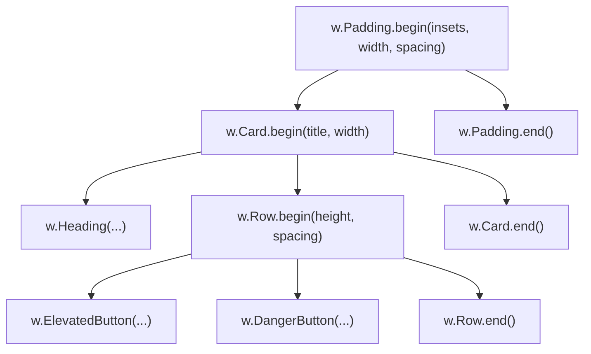

# Tutorial 36: Flutter-Style Declarative Widgets & Responsive Desktop UI (`package widget`)

In [Tutorial 21](21_native_gui_desktop_applications.md), [Tutorial 22](22_declarative_gui_auto_layout.md), [Tutorial 23](23_gui_window_navigation_and_lifecycle.md), and [Tutorial 34](34_advanced_gui_tables_and_dropdowns.md), you explored Vira's native Immediate-Mode GUI (IMGUI) engine and its low-level builtins (`gui_vstack_begin`, `gui_btn`, `gui_input`, `gui_tbl`, etc.).

While low-level builtins offer raw C-level performance, designing modern, commercial-grade software requires **clean ergonomics, cohesive design tokens, responsive layout helpers, and expressive component names**.

Vira ships with **`widget`** (`import widget as w`), a first-party standard library package that introduces **Flutter-inspired ergonomics, responsive layout primitives, Catppuccin design tokens, and a complete UI component library** on top of the native hardware-accelerated GUI engine—with **zero garbage collection overhead, deterministic autofree, and zero memory leaks**.

---

## 1. The `widget` Philosophy: Immediate-Mode with Flutter Ergonomics

In retained-mode frameworks like **Flutter**, widgets are persistent, heap-allocated class instances organized in a deeply nested object tree (`Widget build(BuildContext context)`). When state changes, the framework diffs the element tree and coordinates redraw passes.

In Vira, the `widget` package gives you **the clean, expressive syntax of Flutter widgets**, but preserves **the lightning-fast speed and low memory footprint of an Immediate-Mode GUI (IMGUI)**:

```
┌────────────────────────────────────────────────────────────────────────┐
│                   Vira Application Developer Code                      │
│        w.Scaffold, w.Column, w.Row, w.Button, w.DataTable, etc.        │
└───────────────────────────────────┬────────────────────────────────────┘
                                    │
┌───────────────────────────────────▼────────────────────────────────────┐
│                  Standard Library: `packages/widget`                   │
│   ├── layout.vir     (Column, Row, Card, Padding, Center, Spacer)      │
│   ├── responsive.vir (MediaQuery, Screen, Fluid Breakpoints)           │
│   ├── controls.vir   (ElevatedButton, TextField, Slider, Dropdown)     │
│   ├── data.vir       (DataTable, ProgressBar, Badge, Image)            │
│   ├── navigation.vir (App, Scaffold, Tab, Modal, Dialog)               │
│   └── theme.vir      (Theme, Colors, EdgeInsets, TextStyle)            │
└───────────────────────────────────┬────────────────────────────────────┘
                                    │
┌───────────────────────────────────▼────────────────────────────────────┐
│                    Native Hardware Engine & Backends                   │
│         Cocoa (macOS)  │  X11 / Wayland (Linux)  │  Win32 (Windows)    │
└────────────────────────────────────────────────────────────────────────┘
```

### Why Developers Love the `widget` Package:
1. **Readable, Flutter-Inspired Naming:** Say goodbye to cryptic C-style names like `gui_vstack_begin` and `gui_lbl`. Use `w.Column`, `w.Row`, `w.Card`, `w.Text`, `w.ElevatedButton`, and `w.Padding`.
2. **First-Class Responsive Engine (`MediaQuery`):** Native desktop windows are freely resizable by users. `MediaQuery` lets you compute percentage widths (`w.pct_w(50.0)`), inspect responsive breakpoints (`w.is_mobile()`, `w.is_desktop()`), and wrap layouts dynamically.
3. **Cohesive Design System:** Built-in Catppuccin Mocha, Latte, and Midnight themes with pre-configured `EdgeInsets` margins, typography hierarchies (`TextStyle`), and color palettes.
4. **Featherlight Footprint:** 1.2 MB to 3.5 MB compiled native standalone binary with zero external runtime dependencies (no Chromium, Node.js, or Webview).

---

## 2. Quick Start: The Modern Vira GUI Architecture

Here is how a clean Vira GUI desktop application is written using the `widget` package:

```v
module main

import widget as w

fn main() {
    // 1. Initialize the application shell (800x600, 60 FPS)
    mut app := w.App.new('Studio Pro', 800, 600)
    app.init()
    defer app.cleanup()

    theme := w.Theme.mocha()
    mut counter := 0
    mut progress := 35

    // 2. 60 FPS double-buffered event loop
    for !app.should_close() {
        app.begin_frame(theme.bg_color)
        w.Scaffold.begin(theme)

        // 3. Responsive 24px Margin Container
        w.Padding.begin(w.EdgeInsets.all(24), w.window_width(), 14)

        // 4. Framed Elevation Card
        w.Card.begin('Flutter-Style Control Panel', w.content_width(24))

        w.Heading('System Telemetry')
        w.Text('Hardware-accelerated native GUI with zero garbage collection.')
        w.Spacer(6)

        w.StatusBadge('Cluster: Online', true)
        w.Spacer(6)
        w.Divider()
        w.Spacer(6)

        // 5. Horizontal Action Row
        w.Row.begin(38, 12)
        if w.ElevatedButton('Increment (+1)') {
            counter += 1
            if progress < 100 {
                progress += 5
            }
        }
        if w.DangerButton('Reset') {
            counter = 0
            progress = 0
        }
        w.Row.end()

        w.Spacer(10)
        w.Text('Operations Completed: ${counter}')
        w.ProgressBar(progress, 100)

        w.Card.end()
        w.Padding.end()

        w.Scaffold.end()
        app.end_frame()
    }
}
```

---

## 3. The Application Shell & Window Lifecycle (`App` & `Scaffold`)

Instead of juggling manual window initializations and frame state, [`App`](../../packages/widget/src/navigation.vir) handles the entire native OS lifecycle:

```v
pub struct App {
pub mut:
    title          string
    width          int
    height         int
    target_fps     int
    is_initialized bool
}
```

### Lifecycle Methods
- **`w.App.new(title string, width int, height int) App`**: Constructs an application descriptor with a default target of 60 FPS.
- **`app.init()`**: Creates the native OS window (Cocoa on macOS, X11/Wayland on Linux, Win32 on Windows) and sets up double-buffering.
- **`app.should_close() bool`**: Checks if the user clicked the window close button or sent a termination signal.
- **`app.begin_frame(bg_color int)`**: Starts a new frame and clears the screen to the theme background color.
- **`app.end_frame()`**: Flushes immediate-mode render commands and swaps buffers without flicker.
- **`app.cancel_close()`**: Intercepts a window close event (e.g., to display an unsaved changes modal).
- **`app.cleanup()`**: Releases native window handles and GPU textures cleanly.

### `w.Scaffold` (Baseline Page Setup)
Like Flutter's `Scaffold`, `w.Scaffold.begin(theme)` establishes the root visual canvas, setting background tokens and aligning top-level margins.

---

## 4. Design System, Themes & Tokens

The [`theme.vir`](../../packages/widget/src/theme.vir) module gives you a curated color palette and layout models out of the box.

### 4.1 Theme Modes
```v
mocha    := w.Theme.mocha()    // Dark Catppuccin Mocha (Default)
latte    := w.Theme.latte()    // Light Catppuccin Latte
midnight := w.Theme.midnight() // High-contrast True Black (0x0F0F14)
```

Each `Theme` struct contains typed color properties:
- `bg_color`: Window canvas background
- `surface_color`: Elevation cards and panels
- `accent_color`: Primary buttons and active highlights
- `text_color`: Primary high-contrast text
- `subtext_color`: Secondary muted labels and captions
- `border_color`: Card and container borders
- `danger_color`: Destructive actions and error badges
- `success_color`: Positive actions and online indicators

### 4.2 Standard Color Palette
```v
w.COLOR_BASE      // 0x1E1E2E
w.COLOR_SURFACE0   // 0x313244
w.COLOR_SURFACE1   // 0x45475A
w.COLOR_TEXT       // 0xCDD6F4
w.COLOR_SUBTEXT    // 0xA6ADC8
w.COLOR_BLUE       // 0x89B4FA
w.COLOR_GREEN      // 0xA6E3A1
w.COLOR_RED        // 0xF38BA8
w.COLOR_PEACH      // 0xFAB387
w.COLOR_YELLOW     // 0xF9E2AF
w.COLOR_WHITE      // 0xFFFFFF
w.COLOR_BLACK      // 0x000000
```

### 4.3 Insets (`w.EdgeInsets`)
Modeled directly after Flutter's `EdgeInsets`, this struct represents directional padding:
```v
// 16px on all 4 sides
insets := w.EdgeInsets.all(16)

// 24px horizontal (left & right), 12px vertical (top & bottom)
sym := w.EdgeInsets.symmetric(24, 12)

// Granular side control
custom := w.EdgeInsets.only(10, 20, 10, 20)

// Zero padding
zero := w.EdgeInsets.zero()
```

---

## 5. Responsive UI Kit & Breakpoints (`MediaQuery`)

Unlike mobile apps with fixed screen dimensions, desktop applications can be resized to any width or height at any moment.

The [`responsive.vir`](../../packages/widget/src/responsive.vir) module provides dynamic viewport inspection:

```v
// Real-time window dimensions
w := w.window_width()
h := w.window_height()

// Fluid percentage calculation (e.g. 50% width, 25% height)
half_width  := w.pct_w(50.0)
quarter_h   := w.pct_h(25.0)

// Content width inside margins (subtracts 24px padding from both sides)
inner_width := w.content_width(24)

// Breakpoint detection
if w.is_mobile() {
    // Viewport width < 640px (compact / side panel mode)
} else if w.is_tablet() {
    // 640px <= Viewport width <= 1024px
} else if w.is_desktop() {
    // Viewport width > 1024px (expanded multi-column mode)
}
```

### Typed `Screen` Metrics (`w.MediaQuery.of()`)
```v
screen := w.MediaQuery.of()
// screen.width: int
// screen.height: int
// screen.is_mobile: bool
// screen.is_tablet: bool
// screen.is_desktop: bool
// screen.is_landscape: bool
```

### Pattern: Responsive Adaptive Stacks
```v
if w.is_mobile() {
    // Stack items vertically on narrow viewports
    w.Column.begin(w.content_width(16), 10)
    w.ElevatedButton('Submit')
    w.SecondaryButton('Cancel')
    w.Column.end()
} else {
    // Display items side-by-side on wide viewports
    w.Row.begin(38, 12)
    w.ElevatedButton('Submit')
    w.SecondaryButton('Cancel')
    w.Row.end()
}
```

---

## 6. Layout Containers: Building Structural Interfaces

All layout containers use scoped block pairs (`begin` / `end`):



### 1. `w.Column` (Vertical Stack)
Arranges child elements top-to-bottom with automatic vertical cursor tracking:
```v
// At current stack cursor with 12px item spacing
w.Column.begin(w.content_width(24), 12)
// children...
w.Column.end()

// Or at an explicit (x, y) offset
w.Column.begin_at(20, 40, 760, 12)
// children...
w.Column.end()
```

### 2. `w.Row` (Horizontal Stack)
Arranges child elements left-to-right with uniform height:
```v
w.Row.begin(38, 12)
w.ElevatedButton('Primary Action')
w.SecondaryButton('Secondary Action')
w.Row.end()
```

### 3. `w.Card` (Framed Elevation Container)
Renders a rounded rectangular panel with a title header, border, and elevation styling:
```v
w.Card.begin('Hardware Telemetry', w.content_width(24))
w.Text('GPU Temperature: 42°C')
w.Text('Memory Usage: 14%')
w.Card.end()
```

### 4. `w.Padding` (Inset Margin Container)
Subtracts directional `EdgeInsets` from available width and indents the child layout:
```v
w.Padding.begin(w.EdgeInsets.all(24), w.window_width(), 12)
// content rendered with 24px left, right, and top margins
w.Padding.end()
```

### 5. `w.Center` (Horizontal Auto-Centering)
Calculates horizontal margins to center a fixed-width column within the window:
```v
// Centers a 400px column regardless of how wide the window is resized
w.Center.begin(400, 12)
w.Heading('Login to Platform')
w.TextField('Username', username)
w.ElevatedButton('Sign In')
w.Center.end()
```

### 6. `w.Spacer` & `w.Divider`
- `w.Spacer(16)`: Adds an explicit 16-pixel layout gap between widgets.
- `w.Divider()`: Renders a subtle 1px horizontal separator line.

---

## 7. Interactive Form Controls & Inputs

Immediate-mode controls return interactive events or updated state directly on every frame.

### 7.1 Action Buttons
```v
if w.ElevatedButton('Deploy Cluster') {
    // Executes on click; button renders with accent color and hover effect
}

if w.DangerButton('Terminate Process') {
    // Destructive action; renders with red highlight
}

if w.SecondaryButton('Export Logs') {
    // Subtle bordered button with transparent base
}
```

### 7.2 Text Input (`w.TextField`)
Handles keyboard input, cursor selection, and text entry:
```v
mut search_query := ''

// Evaluated every frame; returns updated string when typed
search_query = w.TextField('Search records...', search_query)
```

### 7.3 Toggles (`w.Checkbox` & `w.Radio`)
```v
mut is_enabled := true
mut selected_mode := 0 // 0 = Fast, 1 = Balanced, 2 = Accurate

// Toggle checkbox
if w.Checkbox('Enable SIMD Vectorization', is_enabled) {
    is_enabled = !is_enabled
}

// Single-choice radio buttons
if w.Radio('Fast Mode (FP16)', selected_mode == 0) {
    selected_mode = 0
}
if w.Radio('Balanced Mode (FP32)', selected_mode == 1) {
    selected_mode = 1
}
if w.Radio('Accurate Mode (FP64)', selected_mode == 2) {
    selected_mode = 2
}
```

### 7.4 Value Range Sliders (`w.Slider`)
Renders a smooth horizontal slider with min/max bounds and real-time floating-point value feedback:
```v
mut volume := 75.0f32

// Slider with label, value, min (0.0), and max (100.0)
volume = w.Slider('Audio Volume', volume, 0.0f32, 100.0f32)
```

### 7.5 Expandable Dropdowns (`w.Dropdown` / `w.Select`)
Features **deferred top z-index rendering**, guaranteeing that the open popup menu floats over any adjacent widgets without clipping:
```v
options := ['Production', 'Staging', 'Development']
mut selected_env := 0

selected_env = w.Dropdown(options, selected_env)
```

---

## 8. Data Display, Badges & Tables

### 8.1 Typography & Badges
```v
w.Heading('System Telemetry')     // 22px bold header
w.Subheading('Node Health')        // 17px secondary header
w.Text('All services operating.')  // 14px body text
w.Caption('Last updated: 1s ago')  // 12px muted caption

// Custom badge with background and text color
w.Badge('BETA 2.0', w.COLOR_SURFACE1, w.COLOR_TEXT)

// Semantic status badge (Green when true, Red when false)
w.StatusBadge('Database Connected', true)
w.StatusBadge('Replica Sync Failed', false)
```

### 8.2 Fluid Progress Indicators (`w.ProgressBar`)
```v
mut current_step := 45
mut total_steps  := 100

// Displays an auto-scaled progress bar filled to (45 / 100) = 45%
w.ProgressBar(current_step, total_steps)

// Or specify percentage directly (0.0 to 100.0)
w.ProgressPercent(85.5f32)
```

### 8.3 Interactive Data Tables (`w.DataTable`)
A high-density grid featuring **clickable column sorting, real-time case-insensitive search filtering, and row selection**:

```v
headers := ['ID', 'Service Name', 'Uptime', 'Memory', 'Status']
rows := [
    ['1', 'Core Gateway', '99.98%', '142 MB', 'Active'],
    ['2', 'Inference Worker', '99.85%', '1.2 GB', 'Active'],
    ['3', 'Auth Service', '100.0%', '48 MB', 'Active'],
    ['4', 'Event Pipeline', '98.50%', '310 MB', 'Degraded'],
]

mut search := ''
mut selected_row := 0

search = w.TextField('Filter services...', search)
selected_row = w.DataTable(headers, rows, search, selected_row)
```

---

## 9. Full Walkthrough: Production Telemetry Explorer

Let's assemble a complete, production-grade telemetry dashboard demonstrating responsive layouts, cards, sliders, interactive tables, and dropdowns:

```v
module main

import widget as w

fn main() {
    mut app := w.App.new('Production Telemetry Studio', 920, 680)
    app.init()
    defer app.cleanup()

    theme := w.Theme.mocha()
    mut counter := 0
    mut progress := 40
    mut gain := 55.0f32
    mut selected_env := 0
    mut search_query := ''
    mut selected_row := 0

    env_options := ['US-East (Virginia)', 'EU-Central (Frankfurt)', 'AP-East (Tokyo)']
    
    headers := ['Service', 'Instances', 'Latency', 'Status']
    rows := [
        ['API Gateway', '12', '4.2 ms', 'Operational'],
        ['LLM Inference Engine', '64', '18.5 ms', 'Operational'],
        ['Redis Cache Cluster', '8', '0.6 ms', 'Operational'],
        ['Postgres Primary', '2', '2.1 ms', 'Operational'],
        ['Worker Queue Pool', '24', '11.0 ms', 'Warning'],
    ]

    for !app.should_close() {
        app.begin_frame(theme.bg_color)
        w.Scaffold.begin(theme)

        // 1. Responsive Margin Container (24px all sides)
        w.Padding.begin(w.EdgeInsets.all(24), w.window_width(), 14)

        // 2. Main Elevation Panel
        w.Card.begin('Vira Studio — Operations Control', w.content_width(24))

        w.Heading('System Metrics & Fleet Telemetry')
        w.Text('Hardware-accelerated IMGUI interface with zero memory leaks.')
        w.Spacer(6)

        // Status Indicators Row
        w.Row.begin(28, 10)
        w.StatusBadge('Fleet Status: Healthy', true)
        w.Badge('Autofree: Active', w.COLOR_BLUE, w.COLOR_BASE)
        w.Badge('SIMD: AVX2+FMA', w.COLOR_SURFACE1, w.COLOR_TEXT)
        w.Row.end()

        w.Spacer(6)
        w.Divider()
        w.Spacer(6)

        // 3. Horizontal Interactive Actions
        w.Subheading('Action Triggers')
        w.Row.begin(38, 12)
        if w.ElevatedButton('Deploy Batch (+1)') {
            counter += 1
            if progress < 100 {
                progress += 10
            }
        }
        if w.SecondaryButton('Run Diagnostics') {
            // trigger diagnostic task
        }
        if w.DangerButton('Reset Telemetry') {
            counter = 0
            progress = 0
        }
        w.Row.end()

        w.Spacer(8)
        w.Text('Batches Processed: ${counter}')
        w.ProgressBar(progress, 100)

        w.Spacer(12)
        w.Subheading('Inference Engine Gain')
        gain = w.Slider('Sensitivity', gain, 0.0f32, 100.0f32)

        w.Spacer(12)
        w.Subheading('Deployment Region')
        selected_env = w.Dropdown(env_options, selected_env)

        w.Spacer(12)
        w.Subheading('Fleet Services Grid')
        search_query = w.TextField('Search services by name or status...', search_query)
        selected_row = w.DataTable(headers, rows, search_query, selected_row)

        w.Card.end()
        w.Padding.end()

        w.Scaffold.end()
        app.end_frame()
    }
}
```

---

## 10. Building, Testing & Bundling

### Rapid Local Development Run
```bash
vira run examples/flutter_style_dashboard.vir
```

### Running Unit Tests
```bash
vira test packages/widget/tests
```
Output:
```
=== RUN   packages/widget/tests/widget_test.vir
--- PASS: packages/widget/tests/widget_test.vir (2.11s)
    active_leaks=0 [Zero Memory Leaks Verified]

Test Summary: 1 passed, 0 failed in 2.11s
```

### Compiling an Optimized Standalone Binary
```bash
vira build -prod -o studio_dashboard examples/flutter_style_dashboard.vir
./studio_dashboard
```

### Shipping with Cross-Platform Bundling
Using the tools covered in [Tutorial 35](35_gui_app_scaffolding_and_cross_platform_bundling.md), package your app directly:

```bash
# Package as macOS Application Bundle (.app + .zip)
vira bundle --target darwin

# Package as Linux Standalone Portable Package (.desktop + .tar.gz)
vira bundle --target linux

# Package as Windows GUI Subsystem Binary (-mwindows without CMD window + .ico + .zip)
vira bundle --target windows
```

---

## 11. Quick Reference API Cheat Sheet

| Flutter Widget | Vira `widget` Equivalent | Description |
| :--- | :--- | :--- |
| `MaterialApp` | `w.App.new(title, w, h)` | Application lifecycle runner with 60 FPS loop |
| `Scaffold` | `w.Scaffold.begin(theme)` / `end()` | Root canvas background and theme setup |
| `Column` | `w.Column.begin(w, sp)` / `end()` | Vertical auto-layout stack |
| `Row` | `w.Row.begin(h, sp)` / `end()` | Horizontal auto-layout row |
| `Card` | `w.Card.begin(title, w)` / `end()` | Framed elevation panel with title |
| `Padding` | `w.Padding.begin(insets, w, sp)` / `end()` | Directional margin wrapper |
| `Center` | `w.Center.begin(w, sp)` / `end()` | Horizontally centered column |
| `SizedBox` | `w.Spacer(px)` | Explicit pixel spacing gap |
| `Divider` | `w.Divider()` | Subtle 1px horizontal separator line |
| `MediaQuery` | `w.MediaQuery.of()` / `w.pct_w(pct)` | Viewport dimension & breakpoint queries |
| `ElevatedButton`| `w.ElevatedButton(label) bool` | Accent-colored primary action button |
| `FilledButton` (Red)| `w.DangerButton(label) bool` | Destructive action button |
| `OutlinedButton`| `w.SecondaryButton(label) bool`| Subtle bordered action button |
| `TextField` | `w.TextField(placeholder, text) string`| Interactive single-line text input |
| `Checkbox` | `w.Checkbox(label, checked) bool` | Toggle checkbox |
| `Radio` | `w.Radio(label, selected) bool` | Single-choice radio item |
| `Slider` | `w.Slider(label, val, min, max) f32` | Continuous horizontal range slider |
| `DropdownButton`| `w.Dropdown(items, selected_idx) int` | Expandable popup select with top z-index |
| `Text` | `w.Text(content)` | Standard body label |
| `Chip` / `Badge`| `w.Badge(label, bg, fg)` | Custom pill badge |
| `Badge` (Status)| `w.StatusBadge(label, is_ok)` | Green/Red semantic status badge |
| `LinearProgressIndicator`| `w.ProgressBar(current, max)` | Percentage-filled horizontal bar |
| `PaginatedDataTable`| `w.DataTable(hdrs, rows, q, sel) int` | Sortable, searchable data grid |
| `Image.asset` | `w.Image(id, w, h)` | Hardware-accelerated GPU image |
